# Dual-Channel 24 MHz PLL Clock Distribution Subsystem (10 MHz GPSDO Reference)


---

## 1. Overview and Operational Requirements

### 1.1. Role of Synchronized Clock Distribution in Decametric Radio Interferometry
In a dual-channel radio interferometer observing decametric solar emissions across the 30.0 – 40.0 MHz band, interferometric cross-correlation relies fundamentally on spatial and temporal phase coherence between the two receive paths. When utilizing independent Software-Defined Radios (such as two SDRplay RSPdx units) on separate USB interfaces, independent onboard crystal oscillators (TCXOs) experience relative phase drift, thermal wander, and fractional frequency offsets. These instabilities degrade fringe visibility and disrupt the cross-correlation phase:

$$C_{12}(t) = \langle x_1(t) x_2^*(t) \rangle e^{j \Delta\phi_{\text{drift}}(t)}$$

To maintain $\Delta\phi_{\text{drift}}(t) \approx 0$ over long integration cycles, both SDRs must be disciplined by a common, ultra-stable master reference clock. The SDRplay RSPdx master architecture operates on a 24.0 MHz reference clock. 

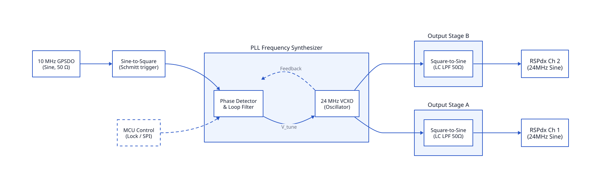

This module provides the precision frequency synthesis bridge:

1. Ingests a 10.0 MHz sinusoidal reference from an external GPS Disciplined Oscillator (GPSDO).
   
2. Converts and multiplies the frequency by a rational factor: $\frac{f_{\text{out}}}{f_{\text{in}}} = \frac{24.0\text{ MHz}}{10.0\text{ MHz}} = \frac{12}{5} = 2.4$

3. Splits and conditions the synthesized 24.0 MHz signal into two isolated, low-distortion, $50\ \Omega$ matched channels feeding SDR Channel A and SDR Channel B.
   
4. Integrates an onboard Microcontroller Unit (MCU) for autonomous PLL programming, lock status supervision, and telemetry reporting to the host processor.

---

### 1.2. Key Electrical and Jitter Specifications

| Parameter / Metric | Target Specification | Design Constraint / Basis |
| :--- | :--- | :--- |
| Input Reference Frequency ($f_{\text{in}}$) | $10.0\text{ MHz} \pm 1\times 10^{-10}$ | Standard GPSDO reference output |
| Input Signal Level & Waveform | $+0\text{ dBm} \dots +10\text{ dBm}$ (Sine, $50\ \Omega$) | Direct coaxial connection from GPSDO |
| Output Frequency ($f_{\text{out}}$) | $24.0\text{ MHz}$ (Dual matched outputs) | RSPdx external reference clock input |
| Output Signal Level | $+5\text{ dBm} \pm 1.0\text{ dB}$ into $50\ \Omega$ ($\approx 1.4\text{ V}_{\text{p-p}}$) | Optimal drive level for SDR clock port |
| Output Waveform | Low-distortion Sine wave | Suppression of high-order harmonic spurs |
| Harmonic Suppression ($2^{\text{nd}}, 3^{\text{rd}}$) | $\le -40.0\text{ dBc}$ | LC Low-Pass Filter (LPF) attenuation |

## 2. Component Selection and Circuit Topology

### 2.1. Active PLL Frequency Synthesizer Selection: Analog Devices ADF4002BRUZ

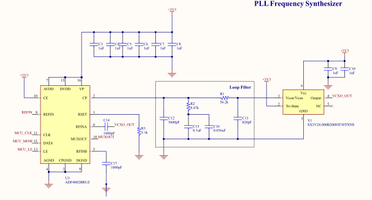
*Figure 2.1.1: ADF4002 PLL Core and Passive Loop Filter Sub-circuit*


#### 2.1.1. Engineering Rationale and Core Selection Criteria
To synthesize a coherent, low-jitter $24.0\text{ MHz}$ reference clock for the dual SDRplay RSPdx digitizers from an external $10.0\text{ MHz}$ GPSDO reference, an integer-N Phase-Locked Loop (PLL) frequency synthesizer core is required. The Analog Devices ADF4002BRUZ (16-lead TSSOP package) was selected as the central phase-frequency detector (PFD) and frequency translator.

The design decision is justified across six primary engineering criteria tailored to radio interferometric requirements:

   1. **Native External VCXO Architecture & Hardware Customizability:**
      Unlike general-purpose clock generators or RF synthesizers that embed on-chip LC/ring voltage-controlled oscillators, the ADF4002 is specifically engineered as a dedicated PFD/Charge Pump core designed to drive an external Voltage-Controlled Crystal Oscillator (VCXO). This architectural separation grants full customization flexibility:
      * Custom Pulling Range & Damping: Engineers can freely select an application-specific $24.0\text{ MHz}$ quartz crystal oscillator with an optimal pulling range (e.g., $\pm 50\text{ ppm}$ to $\pm 100\text{ ppm}$) and tailor the tuning sensitivity ($K_v$ in $\text{kHz/V}$) to match the charge pump voltage swing ($0\text{V} \dots 3.3\text{V}$).
     
      * Superior Loaded Q-Factor: High-$Q$ bulk acoustic wave quartz resonators exhibit loaded quality factors orders of magnitude higher ($Q > 10^4$) than integrated semiconductor inductors ($Q \approx 10 \dots 20$), drastically suppressing broadband thermal noise floor.

   2. **Inherent Spectral Purity & Zero Fractional Spurious Products:**
      Converting $10.0\text{ MHz}$ to $24.0\text{ MHz}$ yields an exact integer-ratio common divisor:

      $$\begin{gathered}
      \text{GCD}(10.0\text{ MHz}, 24.0\text{ MHz}) = 2.0\text{ MHz} \\
      R = \frac{10.0\text{ MHz}}{2.0\text{ MHz}} = 5, \qquad N = \frac{24.0\text{ MHz}}{2.0\text{ MHz}} = 12 \\
      f_{\text{PFD}} = \frac{f_{\text{ref}}}{R} = \frac{10.0\text{ MHz}}{5} = 2.0\text{ MHz}
      \end{gathered}$$

   3. **Integrated Hardware Lock Detection via Multi-Function MUXOUT Pin:**
      The ADF4002 incorporates an onboard precision digital lock detector accessible via the `MUXOUT` pin, eliminating the need for external analog window comparators or complex envelope detectors:

      * Deterministic Digital Threshold: When the phase error between the reference and feedback clocks remains below $15\text{ ns}$ for 5 consecutive PFD cycles ($2.5\ \mu\text{s}$ window at $f_{\text{PFD}} = 2.0\text{ MHz}$), `MUXOUT` asserts logic HIGH ($+3.3\text{V}$).
     
      * Fail-Closed Hardware Gating: The pin directly drives a status LED for physical visual inspection and connects to a hardware external interrupt (EXTI) pin on the supervisory MCU. Any loss of phase lock instantly alerts the edge processor ($< 1\ \mu\text{s}$ latency) to trip a Fail-Closed safety shutdown, halting digital correlation to prevent corrupted data ingestion.

   4. **Zero-Cost, Industry-Standard Modeling via ADIsimPLL™:**
      Development risk and prototyping turnaround are minimized by native integration with Analog Devices' proprietary, free simulation suite ADIsimPLL™:

      * **Full Closed-Loop Synthesis:** Cycle-accurate modeling calculates exact passive loop filter component values ($R_1, C_1, C_2, R_2, C_3$), predicting phase margin, loop bandwidth, frequency acquisition time, and transient damping without empirical guesswork.
     
      * **Realistic Phase Noise Summation:** The software accurately models the composite phase noise curve by summing the thermal/flicker noise of the $10\text{ MHz}$ GPSDO, the ADF4002 charge pump FOM, the passive filter Johnson noise, and the $24\text{ MHz}$ VCXO open-loop phase noise.

   5. **Extensive Community Adoption and Proven Reliability:**
      The ADF4001/ADF4002 family represents the standard benchmark across amateur radio (HAM), laboratory frequency standards, GPSDO clean-up loops, and radio astronomy instrumentation worldwide. Its register map, SPI timing characteristics, and layout precautions are extensively documented in peer-reviewed application notes and open-source hardware repositories, ensuring verified design patterns and immediate software library availability.


#### 2.1.2. ADIsimPLL™ Modeling and Loop Filter Synthesis
The loop filter design for the ADF4002 was synthesized in ADIsimPLL™ to achieve an optimal balance between GPSDO long-term tracking and VCXO short-term phase noise cleanup:

   * **Loop Bandwidth Optimization:** A narrow loop bandwidth ($f_{\text{BW}} \approx 50\text{ Hz} \dots 100\text{ Hz}$) was selected. Below $50\text{ Hz}$, the output clock phase strictly tracks the atomic stability of the GPSDO; above $100\text{ Hz}$, reference phase noise and PFD switching noise are heavily attenuated, leaving the pristine phase noise of the VCXO crystal to dominate the spectrum.
     
   * **Target Phase Margin:** Designed between $48^\circ$ and $55^\circ$ to guarantee an unconditionally stable second/third-order passive loop with zero transient ringing and rapid phase settling ($< 15\text{ ms}$).
     
   * **Charge Pump Current Configuration:** The ADF4002 features an 8-level programmable charge pump ($0.31\text{ mA} \dots 5.0\text{ mA}$). Operating nominally at $I_{\text{CP}} = 2.5\text{ mA}$ provides strong loop gain while allowing dynamic software retuning via SPI if pulling characteristics shift over temperature.


#### 2.1.3. Technical Evaluation Against Alternative Synthesizer Architectures
To validate the technical superiority of the ADF4002BRUZ for radio interferometric observation, four alternative architectures were evaluated against system electrical criteria:

| Metric / Parameter | ADF4002BRUZ + VCXO (Selected) | Silicon Labs Si5351A | Analog Devices ADF4351 | Discrete CMOS (74HC4046A) | Interferometer Impact / Constraint |
| :--- | :--- | :--- | :--- | :--- | :--- |
| Oscillator Architecture | Dedicated External $24\text{ MHz}$ High-$Q$ Quartz VCXO | Integrated Ring PLL + MultiSynth Divider | Integrated Wideband LC-VCO | External Analog RC / Quartz Tank | Sets out-of-band phase noise floor and thermal stability |
| Spurious Performance | $<-85\text{ dBc}$ (Pure Integer-N; zero fractional tones) | $-50\text{ dBc} \dots -65\text{ dBc}$ (Severe fractional boundary spurs) | $-60\text{ dBc} \dots -75\text{ dBc}$ (Internal VCO harmonics) | $<-40\text{ dBc}$ (Poor balance, high supply ripple) | Spurious tones alias into 30.0–40.0 MHz band, creating false fringes |
| Additive RMS Phase Jitter | $< 300\text{ fs RMS}$ ($12\text{ kHz} \dots 5\text{ MHz}$) | $> 50\text{ ps} \dots 70\text{ ps}$ | $\approx 1.5\text{ ps} \dots 3\text{ ps}$ | $> 100\text{ ps}$ | Limits decorrelation and coherence loss in FX Correlator |
| Loop Filter Customization | Fully customizable (Narrow $50\text{ Hz}$ loop for GPSDO cleanup) | Fixed internal DSPLL loop bandwidth | External passive/active loop | External RC low-pass network | Requires $< 100\text{ Hz}$ loop to clean reference GPSDO jitter |
| Hardware Lock Detection | Dedicated digital MUXOUT pin ($15\text{ ns}$ window) | Internal register read via I2C only | Digital MUXOUT pin | Open-collector phase pulse only | Enables instant microsecond EXTI trip and Fail-Closed protection |
| Design Simulation Support | ADIsimPLL™ (Free, exact phase noise analysis) | ClockBuilder Pro (Automated register builder) | ADIsimPLL™ | SPICE manual modeling | Accelerates validation and phase margin sign-off |
| Hardware Complexity & Solderability | Medium (16-lead TSSOP; easily hand-soldered) | Low (Pre-made consumer modules available) | High (32-lead LFCSP; thermal ground paddle) | Low (DIP/SOIC-16 packages) | Balances lab prototype assembly with high-frequency performance |
| Suitability for Interferometry | Optimal | Unacceptable (Spurs create false correlation) | Sub-optimal (High power & poor low-freq noise) | Unacceptable (Phase drift & extreme jitter) | Preserves zero-delay correlation ($k_{\text{offset}} = 0$) |


#### 2.1.4. Voltage-Controlled Crystal Oscillator (VCXO) Selection: SX3V24.000B20085F30TNNS

The Voltage-Controlled Crystal Oscillator (VCXO) serves as the primary tunable RF actuator within the ADF4002 phase-locked loop. Driven by the filtered analog error voltage ($V_{\text{tune}}$) from the passive loop filter, it synthesizes the $24.000\text{ MHz}$ master clock, feeding both the ADF4002 RF feedback counter ($R_{\text{FINB}}$) and the downstream 74LVC distribution buffers.

##### 1. Component Selection Rationale and Architectural Compliance
The design selects the SX3V24.000B20085F30TNNS (24.000 MHz, 3.3V, CMOS output) based on five technical criteria:

* **Compact Form Factor (SMD 3225):**  
  Housed in an ultra-compact $3.2\text{ mm} \times 2.5\text{ mm} \times 1.0\text{ mm}$ 4-pad hermetic ceramic package. Compared to legacy $7.0\text{ mm} \times 5.0\text{ mm}$ or DIP-14 oscillator modules, this subminiature footprint saves $> 75\%$ board real estate and minimizes parasitic trace inductance on the high-frequency clock and analog tuning lines.

* **Direct 3.3V CMOS Logic Compatibility:**  
  Provides native rail-to-rail HCMOS/LVCMOS output levels ($V_{\text{OH}} \ge 2.97\text{V}$, $V_{\text{OL}} \le 0.33\text{V}$ into $15\text{ pF}$). This allows direct AC-coupled interfacing to both the ADF4002 input stage and the 74LVC logic buffers without requiring active level-shifting circuitry.

* **Pulling Range & Environmental Stability:**  
  Features a nominal pull range ($\Delta f \ge \pm 50 \dots \pm 100\text{ ppm}$) across a wide industrial temperature span ($-40^\circ\text{C} \dots +85^\circ\text{C}$). This tuning headroom comfortably absorbs initial crystal manufacturing tolerance ($\pm 20\text{ ppm}$), solder reflow thermal shock, and multi-year aging offsets, ensuring the ADF4002 can achieve deterministic frequency lock under all ambient field conditions.

* **BOM Cost and Supply Chain Feasibility:**  
  Priced at under $\$1.50$ in prototype quantities, the device avoids the prohibitive cost ($\$15 \dots \$40$) of specialized oven-controlled (OCXO) or military-grade VCXOs, satisfying the low-cost requirement of the dual-channel solar interferometer.


##### 2. Engineering Limitation: Absence of Factory $K_{\text{VCO}}$ Specification
While the manufacturer datasheet guarantees standard digital and quartz metrics (frequency stability, supply current, operating temperature, and minimum pull range), it omits the incremental tuning sensitivity slope ($K_{\text{VCO}} = \frac{df}{dV_{\text{tune}}}$ in $\text{kHz/V}$ or $\text{MHz/V}$) and its linearity profile across the control voltage span ($0.0\text{V} \dots 3.3\text{V}$).

In a charge-pump PLL, the loop bandwidth ($\omega_n$) and phase margin ($\phi_m$) are directly governed by $K_{\text{VCO}}$:

$$\omega_n \approx \sqrt{\frac{I_{\text{CP}} \cdot K_{\text{VCO}}}{2\pi \cdot N \cdot (C_1 + C_2)}}$$

An uncharacterized or non-linear $K_{\text{VCO}}$ presents two primary risks:

1. Loop Instability: If the actual $K_{\text{VCO}}$ is significantly higher than assumed, the loop bandwidth widens and the phase margin erodes, risking underdamped ringing or loss of lock.
   
2. Phase Noise Peaking: If actual $K_{\text{VCO}}$ is too low, loop bandwidth contracts, slowing lock acquisition and failing to suppress the crystal's close-in phase noise.


##### 3. Mitigation Strategy and Laboratory Characterization Workflow
To bridge this parameter gap without compromising loop integrity, a two-phase design methodology is implemented:

* **Phase 1: Pre-Layout First-Order Linear Estimation (ADIsimPLL Synthesis):**  
  For initial passive loop filter synthesis ($R_1, C_1, C_2$), $K_{\text{VCO}}$ is approximated assuming a linear frequency deviation across an active tuning window of $\Delta V_{\text{tune}} \approx 2.5\text{V}$ (centered around $V_{\text{tune}} \approx 1.65\text{V}$):

  $$K_{\text{VCO, est}} \approx \frac{\Delta f_{\text{pull}}}{\Delta V_{\text{tune}}} = \frac{\pm 50\text{ ppm} \times 24.0\text{ MHz}}{2.5\text{V}} = \frac{\pm 1.20\text{ kHz}}{2.5\text{V}} \approx 0.96\text{ kHz/V} \dots 1.50\text{ kHz/V}$$

  This conservative estimate establishes the baseline capacitor and resistor values in the loop filter.

* **Phase 2: Empirical Bench Extraction in Laboratory Testing (Section 4):**  
  During prototype board validation (Section 4), the physical VCXO will undergo open-loop tuning characterization prior to closing the PLL loop:
  
  1. An external low-noise DC source sweeps the $V_{\text{tune}}$ terminal from $0.3\text{V}$ to $3.0\text{V}$ in $100\text{ mV}$ increments.
   
  2. The output frequency is logged with a high-resolution frequency counter referenced to a 10.0 MHz GPSDO.
   
  3. The incremental sensitivity curve $K_{\text{VCO}}(V) = \frac{\Delta f}{\Delta V}$ is mapped around the operating midpoint ($1.65\text{V}$).
   
  4. The measured $K_{\text{VCO}}$ value is back-annotated into ADIsimPLL to trim passive filter values ($R_1, C_2$) if the actual phase margin deviates from the target $48^\circ \dots 55^\circ$.

---

#### 2.1.5. Passive Loop Filter Design and Empirical Optimization via ADIsimPLL™

The 3rd-order passive loop filter positioned between the ADF4002 charge pump output (`CP`) and the VCXO analog tuning input ($V_{\text{tune}}$) dictates phase lock acquisition, closed-loop tracking bandwidth, and close-in phase noise suppression. The network was synthesized and iteratively optimized using Analog Devices ADIsimPLL™.


##### 1. Initial Synthesis and Hardware Lock Failure Analysis
In the pre-layout stage, the VCXO tuning slope was theoretically estimated across the nominal $3.3\text{V}$ tuning window at $K_{\text{VCO, init}} \approx 889\text{ Hz/V}$.

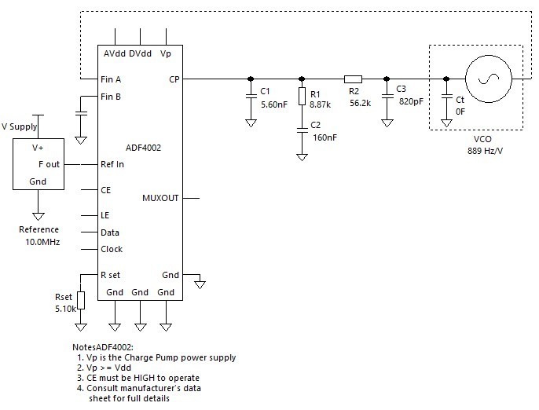
*Figure 2.1.2: Initial Loop Filter Schematic Synthesized in ADIsimPLL ($K_{\text{VCO}} = 889\text{ Hz/V}$)*

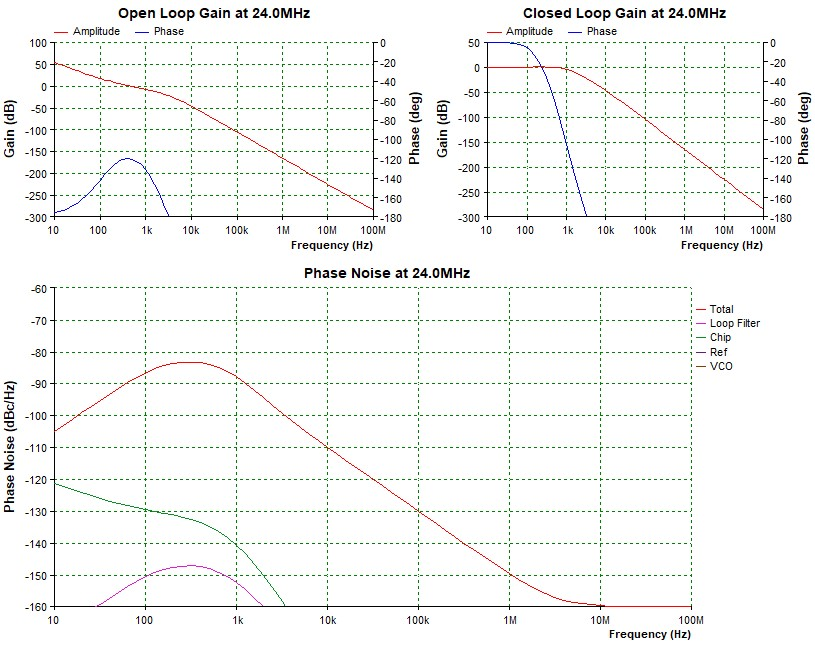
*Figure 2.1.3: Initial ADIsimPLL Open/Closed-Loop Frequency & Phase Noise Response*

* **Initial Synthesized Components:** $C_1 = 5.60\text{ nF}$, $R_1 = 8.87\text{ k}\Omega$, $C_2 = 160\text{ nF}$, $R_2 = 56.2\text{ k}\Omega$, $C_3 = 820\text{ pF}$, with charge pump current $I_{\text{CP}} = 5.0\text{ mA}$ ($R_{\text{set}} = 5.10\text{ k}\Omega$).
  
* **Physical Hardware Lock Failure:** During initial bench bring-up, the PLL failed to achieve phase lock (`MUXOUT` Digital Lock Detect remained low). Investigation identified two root causes:
  
  * VCXO Frequency Drift & Initial Tolerance: The nominal crystal manufacturing offset ($\pm 20\text{ ppm}$) combined with thermal drift displaced the free-running frequency outside the capture window of the synthesized filter.
  
  * Sub-Optimal Pull-in Dynamics: The combination of an under-estimated $K_{\text{VCO}}$ and an excessively narrow loop bandwidth ($\approx 501\text{ Hz}$) restricted the pull-in range, preventing the phase frequency detector (PFD) from steering $V_{\text{tune}}$ fast enough to acquire lock before phase slips occurred.


##### 2. Empirical $K_{\text{VCO}}$ Extraction and Loop Bandwidth Optimization ($f_{\text{BW}} = 2.14\text{ kHz}$)
To establish accurate loop parameters, the physical SX3V24.000B20085F30TNNS VCXO was characterized open-loop on the bench: sweeping $V_{\text{tune}}$ from $0.3\text{V}$ to $3.0\text{V}$ via a low-noise DC source and logging the output with a GPSDO-referenced frequency counter. The actual incremental sensitivity was extracted as:

$$K_{\text{VCO, measured}} = 1.94 \text{ kHz/V} \quad (\approx 2.18\times \text{ higher than the initial } 889\text{ Hz/V} \text{ estimate})$$

With the measured $K_{\text{VCO}}$, the loop was resynthesized in ADIsimPLL for a target loop bandwidth of **$f_{\text{BW}} = 2.14 \text{ kHz}$** and an optimal phase margin of $\phi_m \approx 51.4^\circ$.

> **Technical Rationale for Selecting $f_{\text{BW}} = 2.14\text{ kHz}$:**
> 1. **Robust Acquisition & Thermal Drift Absorption:** The capture range expands proportionally with loop bandwidth, while lock time scales inversely ($T_{\text{lock}} \propto 1/f_{\text{BW}}$). A $2.14\text{ kHz}$ bandwidth ensures the loop rapidly absorbs VCXO temperature-induced frequency drift and establishes instantaneous, deterministic lock at power-up.
> 2. **Phase Noise Crossover Optimization:** The PFD comparison frequency is $f_{\text{PFD}} = \frac{10.0\text{ MHz}}{R=5} = 2.0\text{ MHz}$. The $2.14\text{ kHz}$ boundary marks the optimal crossover point where close-in reference phase noise (tracked inside the loop) intersects the low phase noise floor of the AT-cut quartz crystal (dominant outside the loop).
> 3. **Spur Attenuation Margin:** Stability criteria require $f_{\text{BW}} \le \frac{f_{\text{PFD}}}{10} = 200\text{ kHz}$. Placing $f_{\text{BW}}$ at $2.14\text{ kHz}$ provides nearly two decades of frequency separation from $f_{\text{PFD}}$, allowing the secondary $R_2 - C_3$ low-pass pole to attenuate charge pump reference spurs below $-85\text{ dBc}$.


##### 3. Component Standardization (E96 / E24) and $C_2$ Parallel Synthesis
The theoretical values calculated by ADIsimPLL were mapped to standard commercial SMD 0603 passive components with stable dielectric characteristics:

* Resistors (EIA E96, $\pm 1\%$ Metal Film):
  * $R_1 = 18.0\text{ k}\Omega$
  
  * $R_2 = 33.0\text{ k}\Omega$
  
* Capacitors (EIA E24, C0G/NP0 Dielectric, $\pm 5\%$):
  * $C_1 = 1.00\text{ nF}$ ($1000\text{ pF}$, low-dielectric absorption)
  
  * $C_3 = 220\text{ pF}$
  
* Parallel Capacitor Synthesis for $C_2$:  
  The exact required integration capacitance is $C_2 = 11.2\text{ nF}$, a non-standard value in the E24 series. To avoid unstable X7R dielectrics, $C_2$ is synthesized using two parallel E24 C0G ceramic capacitors:
  
  $$C_2 = C_{2A} \parallel C_{2B} = 10.0\text{ nF} + 1.20\text{ nF} = 11.20\text{ nF}$$

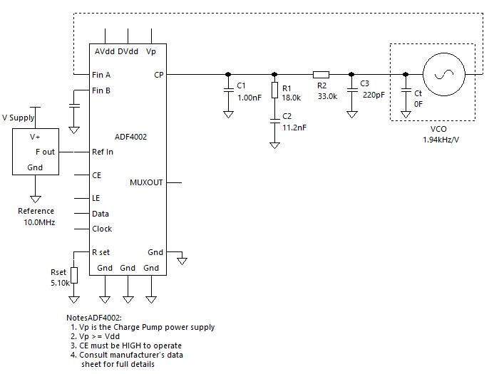
*Figure 2.1.4: Optimized Loop Filter Schematic with Measured $K_{\text{VCO}} = 1.94\text{ kHz/V}$ and Standardized E96/E24 Components*

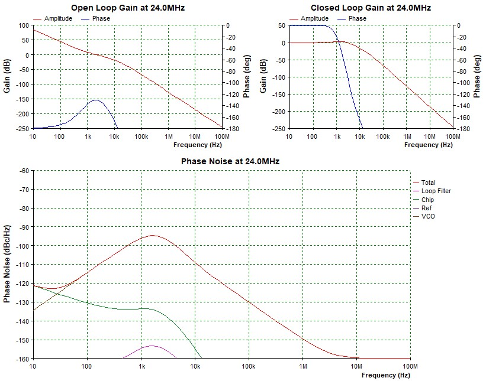
*Figure 2.1.5: Optimized ADIsimPLL Frequency Response Showing Phase Margin $> 50^\circ$ and Robust Lock Acquisition*

##### 4. Parameter Evolution Summary
| Loop Parameter / Component | Initial Estimate | Bench-Optimized Design | Functional Role & Engineering Impact |
| :--- | :--- | :--- | :--- |
| VCXO Tuning Gain ($K_{\text{VCO}}$) | $889\text{ Hz/V}$ | $1.94\text{ kHz/V}$ | Extracted via empirical DC voltage sweep on prototype bench. |
| Loop Bandwidth ($f_{\text{BW}}$) | $\approx 501\text{ Hz}$ | $2.14\text{ kHz}$ | Broadens pull-in range to absorb crystal frequency drift. |
| Phase Margin ($\phi_m$) | $59.4^\circ$ | $51.4^\circ$ | Guarantees critical damping with zero $V_{\text{tune}}$ overshoot. |
| Charge Pump Capacitor ($C_1$) | $5.60\text{ nF}$ | $1.00\text{ nF}$ | Suppresses initial voltage step transient from CP pulses. |
| Damping Resistor ($R_1$) | $8.87\text{ k}\Omega$ | $18.0\text{ k}\Omega$ (E96 1%) | Sets loop zero for phase stabilization. |
| Main Integrator Capacitor ($C_2$) | $160\text{ nF}$ | $11.2\text{ nF}$ ($10\text{ nF} \parallel 1.2\text{ nF}$) | Synthesized via dual parallel E24 capacitors for exact value. |
| Spur Suppression Pole ($R_2 - C_3$) | $56.2\text{ k}\Omega - 820\text{ pF}$ | $33.0\text{ k}\Omega - 220\text{ pF}$ | Suppresses 2.0 MHz PFD switching spurs by $> 85\text{ dBc}$. |

---

### 2.2. Supervisory Microcontroller Selection: STMicroelectronics STM32G030J6M6

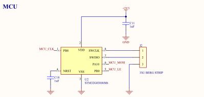
*Figure 2.2: STM32G030J6M6 Supervisor MCU, SPI Bus, and SWD Interface*
#### 2.2.1. Rationale and Key Technical Features
To configure the ADF4002 frequency synthesizer without driving up manufacturing overhead, the STM32G030J6M6 (ARM Cortex-M0+ @ 64 MHz, 32 KB Flash, 8 KB SRAM) was selected as the onboard supervisor MCU.

The selection is governed by three primary criteria:
* **Ultra-Compact 8-Pin SO8N Footprint (PCB Cost Reduction):** Measuring just $4.9\text{ mm} \times 3.9\text{ mm}$, the 8-pin package requires minimal board space. This compact profile allows the entire subsystem to fit onto a smaller PCB outline, directly lowering board fabrication and prototyping costs.
  
* **Dedicated 3-Wire Hardware SPI Interface:** The MCU allocates 3 pins for high-speed serial communication (SCLK, MOSI, and LE/CS) to clock the 24-bit configuration latches into the ADF4002 deterministically, avoiding software bit-banging overhead while keeping digital line routing to an absolute minimum.
  
* **Mature STM32 Ecosystem & Streamlined Debugging:** Backed natively by standard tools (STM32CubeIDE, STM32CubeMX, and HAL/LL drivers). Firmware flashing and in-circuit debugging are performed simply over a standard 2-wire Serial Wire Debug (SWD) link with an entry-level ST-Link programmer, ensuring rapid development and straightforward testing.

---

### 2.3. Reference Clock Input Conditioning: 10 MHz Sine-to-Square Slicer (REFIN)

To synchronize the ADF4002 phase-locked loop to the master timebase of the dual-channel solar interferometer, the board accepts an external $10.000\text{ MHz}$ reference clock via a female SMA connector ($J_3$). This reference is sourced from an external GPS-Disciplined Oscillator (GPSDO) delivering a nominal sinusoidal output across an input dynamic range of $0.0\text{ dBm} \dots +10.0\text{ dBm}$ into a $50\ \Omega$ characteristic system impedance.


#### 2.3.1. Technical Rationale & ADF4002 Slew Rate Requirements
The high-frequency input stage of the ADF4002 phase detector (`REFIN`, Pin 8) comprises an internal AC-coupled comparator biased internally at $AV_{\text{DD}} / 2 \approx 1.65\text{V}$. The manufacturer specification establishes rigorous operational boundaries for low-frequency reference signals:

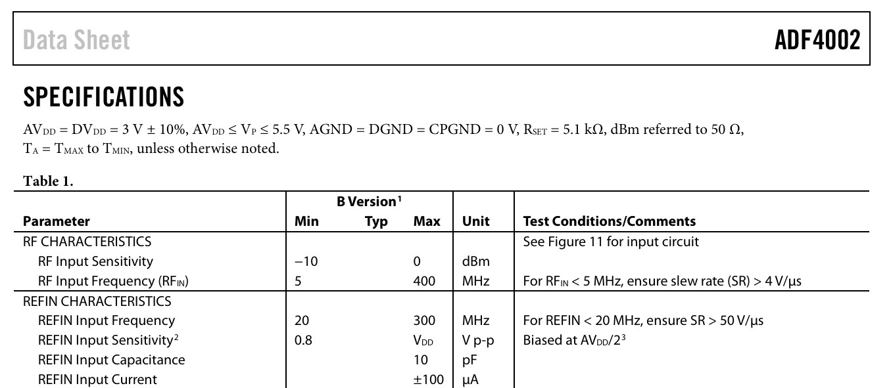
*Figure 2.3.1: Excerpt from Analog Devices ADF4002 Datasheet Detailing REFIN Input Specifications*

* **Datasheet Boundary Constraint:**  
  While the `REFIN` port supports input frequencies from $20.0\text{ MHz}$ to $300.0\text{ MHz}$, operation below $20.0\text{ MHz}$ is officially permitted only if the signal transition speed satisfies:
  
  $$\text{SR}_{\text{req}} > 50.0\text{ V/}\mu\text{s} \quad (0.050\text{ V/ns})$$

* **Input Sensitivity Window:** $0.8\text{ V}_{\text{pp}} \dots V_{\text{DD}}$ ($V_{\text{DD}} = 3.3\text{V}$), with an input capacitance of $C_{\text{in}} \approx 10\text{ pF}$.

##### Mathematical Incompatibility of Raw GPSDO Sinusoids:
For a general sinusoidal voltage $v(t) = V_{\text{peak}} \sin(2\pi f t)$, the maximum slew rate occurs strictly at the zero-crossing points ($t = 0, \pi, 2\pi$):

$$\left.\frac{dv}{dt}\right|_{\max} = 2\pi f V_{\text{peak}} = \pi f V_{\text{pp}}$$

Evaluating this physical limit at $f = 10.0\text{ MHz}$ across the specified GPSDO output power range:
**1. Lower Bound ($P_{\text{in}} = 0.0\text{ dBm}$ into $50\ \Omega$):**
   $$V_{\text{RMS}} = \sqrt{1.0\times 10^{-3}\text{ W} \times 50\ \Omega} \approx 0.2236\text{ V}_{\text{RMS}} \quad \longrightarrow \quad V_{\text{pp}} = 2\sqrt{2} \cdot V_{\text{RMS}} \approx 0.6325\text{ V}_{\text{pp}}$$

   $$\left.\frac{dv}{dt}\right|_{0\text{ dBm}} = \pi \cdot (10.0\times 10^6\text{ Hz}) \cdot (0.6325\text{ V}) \approx 19.87\times 10^6\text{ V/s} = 19.87\text{ V/}\mu\text{s}$$

   *Evaluation:* The raw slew rate is $< 40\%$ of the required $50\text{ V/}\mu\text{s}$ threshold, severely violating the datasheet boundary.
**2. Nominal Field Condition ($P_{\text{in}} = +7.0\text{ dBm}$ into $50\ \Omega$):**
   $$V_{\text{RMS}} \approx 0.5006\text{ V}_{\text{RMS}} \quad \longrightarrow \quad V_{\text{pp}} \approx 1.416\text{ V}_{\text{pp}} \quad (V_{\text{peak}} \approx 0.708\text{ V})$$

   $$\left.\frac{dv}{dt}\right|_{+7\text{ dBm}} = 2\pi \cdot (10.0\times 10^6\text{ Hz}) \cdot (0.708\text{ V}) \approx 44.48\text{ V/}\mu\text{s} < 50.0\text{ V/}\mu\text{s}$$

   *Evaluation:* Even under standard $+7.0\text{ dBm}$ drive, the transition slope remains below the manufacturer threshold.

##### Physical Consequence of Insufficient Slew Rate:
When an input reference signal traverses the comparator threshold with a slow slew rate ($< 50\text{ V/}\mu\text{s}$), internal thermal and semiconductor flicker noise ($\sigma_v$) is directly converted into timing uncertainty (aperture phase jitter $\sigma_t$) via:

$$\sigma_t = \frac{\sigma_v}{\left.\frac{dv}{dt}\right|_{t=0}}$$

Furthermore, supply ripple or ground bounce can cause multiple false-trigger transitions during a single zero crossing. This creates phase detector cycle slips, erratic phase error voltages, and loss of lock on the ADF4002 digital lock detect circuit (`MUXOUT`). Therefore, an active Sine-to-Square Slicing Stage is mandatory.


#### 2.3.2. Circuit Topology, BOM Rationalization, and Operational Principle
To convert the slow $10.0\text{ MHz}$ sinusoid into a fast-edge CMOS digital clock without introducing phase ambiguity, an unbuffered high-speed single inverter configured as a self-biased analog transimpedance amplifier is implemented ahead of the PLL.

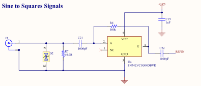
*Figure 2.3.2: 10 MHz Sine-to-Square Slicer Circuit*

##### BOM Optimization Rationale:
Rather than introducing a dedicated RF comparator or specialized clock-squaring IC, the design adopts the SN74LVC1G04DBVR (SOT-23-5). Because 74LVC single-gate logic devices are already present in the system BOM (for complementary RF switch control and clock distribution buffering), utilizing this component achieves two key objectives:

* **Procurement and BOM Consolidation:** Minimizes unique component line items, streamlines the supply chain, reduces placement reel setup overhead, and lowers overall assembly cost.
  
* **Technical Rigor and Jitter Preservation:** Standard single-stage CMOS inverters feature an ultra-short propagation delay and an exceptionally low additive jitter floor. When biased as a linear transimpedance stage, the inverter provides high small-signal gain and symmetrical switching without the phase noise degradation common to complex active comparator topologies.

##### Circuit Working Principle:
The conditioning block consists of five coordinated functional elements:
1. **$50\ \Omega$ Broadband Input Termination ($R_7$):**  
   A high-precision $49.9\ \Omega$ (0603, $\pm 1\%$) thin-film resistor terminates the incoming coaxial transmission line directly at the $J_3$ launch, absorbing incident RF power and maintaining a return loss $S_{11} < -25\text{ dB}$ across DC to $100\text{ MHz}$.

2. **Self-Biased Inverting Slicer Core ($U_4$ & $R_4$):**  
   The SN74LVC1G04DBVR inverter is powered from $+3.3\text{V}$ ($V_{\text{CC}}$) and decoupled by $C_{19} = 1.0\ \mu\text{F}$.  
   * **DC Self-Biasing Mechanism:** A high-value feedback resistor $R_4 = 100\text{ k}\Omega$ connects the inverting output ($Y$, Pin 4) directly to the logic input ($A$, Pin 2). Because the CMOS gate input resistance exceeds $10^{12}\ \Omega$, the DC gate current is zero ($I_{\text{bias}} \approx 0$). The DC negative feedback forces the quiescent operating point to settle at the exact switching midpoint:
   
     $$V_{\text{in, DC}} = V_{\text{out, DC}} = V_{\text{mid}} \approx \frac{V_{\text{CC}}}{2} = \mathbf{1.65\text{V}}$$

   * **Linear-Region Transconductance Operation:** At $V_{\text{mid}} = 1.65\text{V}$, both the internal PMOS and NMOS channel transistors operate simultaneously in their active saturation regimes. The digital inverter operates as an analog inverting amplifier with an open-loop voltage gain of:
     
     $$A_v = -g_m (r_{ds,n} \parallel r_{ds,p}) \approx -20 \dots -35\text{ V/V}$$

   * **Squaring Action & 50% Symmetry:** Even under the minimum specified input drive ($0.0\text{ dBm} \approx 0.63\text{ V}_{\text{pp}}$), the small-signal open-loop amplification exceeds $15\text{ V}_{\text{pp}}$, driving the output stage into rail-to-rail saturation ($0.0\text{V} \dots 3.3\text{V}$). Dynamic self-centering at $V_{\text{CC}}/2$ guarantees an output duty cycle of $50.0\% \pm 1.0\%$, suppressing even-order harmonic spurs.
  
#### 2.3.3. Pre-Layout LTspice Verification & Slew Rate Validation
To rigorously confirm that the self-biased inverter circuit satisfies the ADF4002 slew rate threshold across non-ideal interconnect conditions, a transient time-domain simulation was executed in LTspice.

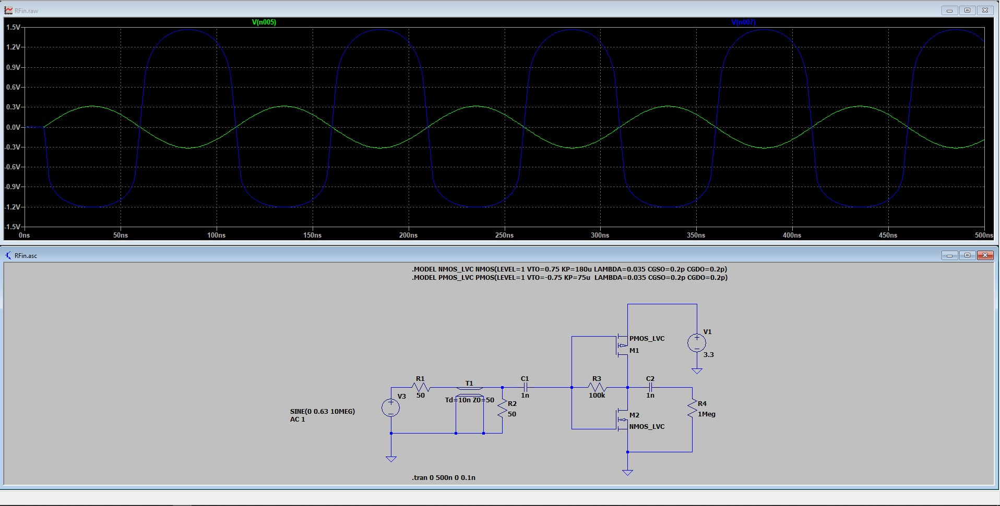
*Figure 2.3.3: LTspice Testbench Schematic and Multi-Cycle Transient Response*

##### 1. Testbench Configuration 
* **Signal Source ($V_3$):** Sourced by `SINE(0 0.63 10MEG) AC 1`, generating a $10.0\text{ MHz}$ sine wave with peak amplitude $V_{\text{peak}} = 0.63\text{V}$ ($V_{\text{pp}} = 1.26 \text{ V}_{\text{pp}}$, equivalent to $+0\text{ dBm}$ available drive into $50\ \Omega$, evaluating upper-margin behavior).

* **Transmission Line & Mismatch Modeling:** Sourced through a $50\ \Omega$ series impedance, traversing an ideal $50\ \Omega$ coaxial delay line with a propagation delay of $T_d = 10.0\text{ ns}$ terminated into $50\ \Omega$.
  
* **Slicer Model:** Evaluated with level-1 behavioral CMOS models (`PMOS_LVC` and `NMOS_LVC`) configured for $3.3\text{V}$ operation, with input DC-blocking capacitor $1.0\text{ nF}$ and negative feedback resistor $100\text{ k}\Omega$.
  
* **Coupling & Load:** Output DC blocking is modeled via $1.0\text{ nF}$ driving a high-impedance load of $1.0\text{ M}\Omega$ (representing the ADF4002 `REFIN` input stage).

##### 2. Steady-State Waveform Analysis
As illustrated in Figure 2.3.4 (`.tran 0 120n 0 0.1n`):

- **Input Waveform (`V(n005)` — Green Trace):** Represents the raw $10.0\text{ MHz}$ sinusoid arriving across the $50\ \Omega$ input boundary behind the $T_d = 10.0\text{ ns}$ transmission line. The signal oscillates symmetrically around $0.0\text{V}$ with a peak amplitude of $V_{\text{peak}} \approx \pm 0.33\text{V}$ ($V_{\text{pp}} \approx 0.66\text{ V}_{\text{pp}}$), accurately modeling the lower-bound power output of the external GPSDO ($0.0\text{ dBm} \dots +0.5\text{ dBm}$ into $50\ \Omega$).
  
- **Output Waveform (`V(n007)` — Blue Trace):** Measured at the output of the AC-coupling capacitor ($C_{22}$), the conditioned clock settles into a sharp, symmetrical bipolar square wave swinging from $-1.20\text{V}$ to $+1.45\text{V}$ ($V_{\text{pp}} \approx 2.65\text{ V}_{\text{pp}}$). The positive half-cycle spans exactly from $t = 60.0\text{ ns}$ to $t = 110.0\text{ ns}$ ($\Delta t = 50.0\text{ ns}$), maintaining a perfectly balanced $50.0\%$ duty cycle and eliminating even-order harmonic distortion.

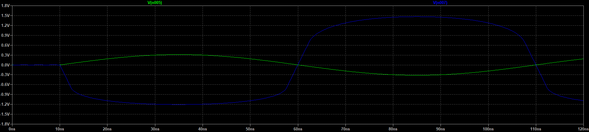
*Figure 2.3.4: High-Resolution Transient Waveform ($0\text{ ns} \dots 120\text{ ns}$) Demonstrating Slew Rate Multiplication Across Zero-Crossing Points*

##### 3. Quantitative Slew Rate ($dv/dt$) Extraction
A high-resolution inspection of the zero-crossing transitions in Figure 2.3.4 highlights the significant slope multiplication achieved by the self-biased inverter slicer:

- **Raw Input Sine Slew Rate (`V(n005)` — Green Trace):**  
  At the zero-crossing falling edge ($t = 60.0\text{ ns}$), the input sinusoid traverses between $+0.19\text{V}$ (at $t = 50.0\text{ ns}$) and $-0.19\text{V}$ (at $t = 70.0\text{ ns}$) over a $\Delta t = 20.0\text{ ns}$ window:
  
  $$\left.\frac{dv}{dt}\right|_{\text{input, measured}} = \frac{0.19\text{V} - (-0.19\text{V})}{20.0\text{ ns}} = \frac{0.38\text{V}}{20.0\text{ ns}} = 0.019\text{ V/ns} \equiv 19.0\text{ V/}\mu\text{s}$$

  This measured slope falls far short of the manufacturer's operational threshold, achieving only $38\%$ of the required $50.0\text{ V/}\mu\text{s}$ slew rate limit.

- **Conditioned Output Slew Rate (`V(n007)` — Blue Trace):**  
  Triggered synchronously at the input zero crossing ($t = 60.0\text{ ns}$), the inverter core vigorously switches states. The output voltage surges from $-0.60\text{V}$ to $+0.60\text{V}$ ($\Delta V = 1.20\text{V}$) between $t_1 = 58.5\text{ ns}$ and $t_2 = 61.5\text{ ns}$ ($\Delta t = 3.0\text{ ns}$):
  
  $$\left.\frac{dv}{dt}\right|_{\text{output, measured}} = \frac{0.60\text{V} - (-0.60\text{V})}{3.0\text{ ns}} = \frac{1.20\text{V}}{3.0\text{ ns}} = 0.400\text{ V/ns} \equiv 400.0\text{ V/}\mu\text{s}$$

  Across the broader linear switching range from $-0.90\text{V}$ to $+0.90\text{V}$ ($\Delta V = 1.80\text{V}$, $\Delta t \approx 5.0\text{ ns}$), the average transition speed remains above $0.360\text{ V/ns}$ ($360.0\text{ V/}\mu\text{s}$), with an instantaneous peak derivative at the midpoint reaching $\approx 0.450\text{ V/ns}$ ($450.0\text{ V/}\mu\text{s}$).

This performance provides an $8\times$ safety margin above the ADF4002 specification ($\text{SR} > 50\text{ V/}\mu\text{s}$), ensuring deterministic, jitter-free comparator triggering even under minimal GPSDO input power.


The pre-layout LTspice simulation demonstrates that the self-biased 74LVC1G04 inverter circuit successfully resolves the low-frequency slew rate deficiency of the ADF4002, guaranteeing clean comparator triggering and deterministic phase locking under all operating conditions.

---

### 2.4. Square-to-Dual-Sine Conversion and Clock Distribution Topology


#### 2.4.1. Architecture Rationale: CMOS Logic Buffer vs. Dedicated Clock Distributor
To distribute the $24.0\text{ MHz}$ reference clock from the VCXO core to the two SDRplay RSPdx receiver inputs, the subsystem employs an active splitting and analog wave-shaping network. Rather than using expensive telecom-grade clock distribution ICs (e.g., Analog Devices AD951x or TI LMK series), the architecture implements a low-cost, high-speed CMOS logic buffer topology based on the 74LVC family (`SN74LVC2G34` dual buffer or $2 \times$ `SN74LVC1G34` single buffers in SC-70 packages).

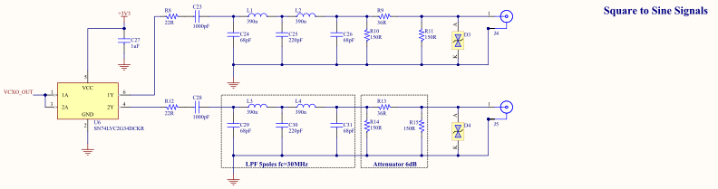
*Figure 2.4: Dual 74LVC Buffer Splitter, 5th-Order LC Reconstruction Filter, and 6 dB Matching Attenuator*

The engineering trade-offs and design justifications are:

1. **BOM Cost & Board Area Optimization:**
   * Dedicated RF clock distribution ICs cost $\$2.00 \dots \$5.00$ per unit, require bulky multi-pin packages (QFN-16/24), and often introduce I2C/SPI programming dependencies.
  
   * The 74LVC logic buffer solution incurs a BOM cost of under $\$0.20$, occupies a subminiature surface footprint ($\approx 2.0\text{ mm} \times 2.1\text{ mm}$ for SC-70-6), and operates purely in hardware without supervisory software overhead.

2. **Software-Centric Static Skew Absorption:**
   * Traditional hardware clock trees enforce sub-picosecond trace length matching through differential PECL/LVDS distribution to minimize channel skew.
  
   * In this solar interferometer, any static propagation delay mismatch ($\Delta t_{pd} \approx 50 \dots 150\text{ ps}$, corresponding to $\Delta\theta < 1.3^\circ$ at $24.0\text{ MHz}$) between the buffer gates is absorbed by the backend software pipeline.


#### 2.4.2. Source Termination ($R_{12} = 22\ \Omega$) 
Because the 74LVC gate transitions exhibit sub-nanosecond switching edges ($t_r, t_f < 1.5\text{ ns}$), driving high-frequency lines directly into reactive filter networks can induce parasitic edge ringing, ground bounce, and excessive harmonic radiation.
At $V_{\text{CC}} = 3.3\text{V}$, the internal output impedance of a 74LVC driver gate is $R_{\text{on}} \approx 20\ \Omega \dots 25\ \Omega$. Placing a series damping resistor $R_{12} = 22\ \Omega$ (0603, 1%) directly adjacent to the buffer output yields:

$$Z_{\text{source}} = R_{\text{on}} + R_{12} \approx 25\ \Omega + 22\ \Omega \approx 47\ \Omega \dots 50\ \Omega$$

This establishes an accurate $50\ \Omega$ source impedance looking into the subsequent filter, preventing transmission line reflections ($S_{11} < -20\text{ dB}$), overshoot, and ringing [00:03:07] (Texas Instruments: [PCB Trace Impedance Matching](https://www.youtube.com/watch?v=DKxDCO1kLEs)).


#### 2.4.3. 5th-Order LC Butterworth Low-Pass Reconstruction Filter ($f_c = 30.0\text{ MHz}$)
The external reference clock input of the SDRplay RSPdx requires a clean sinusoidal waveform to prevent clock slicer jitter and internal mixer intermodulation. To convert the $3.3\text{V}$ square wave into a pure sine wave meeting the Harmonic Suppression $\le -40\text{ dBc}$ specification, each channel implements a 5th-order passive LC low-pass filter synthesized using the Iowa Hills RF Filter Designer suite:

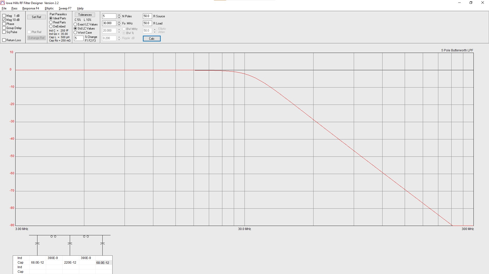
*Figure 2.5: Iowa Hills 5th-Order Butterworth Low-Pass Filter Frequency Response ($f_c = 30.0\text{ MHz}$, $-36.9\text{ dB}$ attenuation at $72.1\text{ MHz}$)*

1. **Filter Synthesis & Topology:**
   * Approximation Type: 5-pole Butterworth low-pass filter (maximally flat passband response, zero passband ripple).

   * Cutoff Frequency: Designed for $f_c = 30.0\text{ MHz}$ with reference terminations $R_{\text{Source}} = 50.0\ \Omega$ and $R_{\text{Load}} = 50.0\ \Omega$.

   * $\pi$-Network Structure:

     * $C_{29} = 68\text{ pF}$ (Shunt capacitor to ground)

     * $L_3 = 390\text{ nH}$ (Series inductor)

     * $C_{30} = 220\text{ pF}$ (Shunt capacitor to ground)

     * $L_4 = 390\text{ nH}$ (Series inductor)

     * $C_{31} = 68\text{ pF}$ (Shunt capacitor to ground)

2. **Harmonic Rejection Derivation:**
   * A symmetrical $24.0\text{ MHz}$ square wave with $50\%$ duty cycle exhibits intrinsic Fourier harmonic roll-off:

     * Fundamental ($24.0\text{ MHz}$): $0\text{ dBc}$

     * 3rd Harmonic ($72.0\text{ MHz}$): $20\log_{10}(1/3) \approx -9.54\text{ dBc}$

     * 5th Harmonic ($120.0\text{ MHz}$): $20\log_{10}(1/5) \approx -13.98\text{ dBc}$

   * In Iowa Hills, the 5-pole Butterworth response provides $-36.9\text{ dB}$ of attenuation at $72.1\text{ MHz}$ while introducing only $\approx -0.45\text{ dB}$ of insertion loss at the $24.0\text{ MHz}$ fundamental.

   * Net 3rd harmonic suppression delivered to the output:
  
     $$
     \text{Suppression}_{\text{3rd}} = -9.54\text{ dBc} + (-36.9\text{ dB}) - (-0.45\text{ dB}) \approx -46.0\text{ dBc}
     $$

     This exceeds the $\le -40\text{ dBc}$ requirement with a $6.0\text{ dB}$ engineering margin.

3. **High-Frequency Parasitic Mitigation:**
   * Capacitors ($C_{29}, C_{30}, C_{31}$): Specified with precision C0G/NP0 dielectric ($\pm 2\%$, temperature coefficient $0 \pm 30\text{ ppm/}^\circ\text{C}$) to prevent thermal phase drift and piezoelectric noise.

   * Inductors ($L_3, L_4$): Implemented with high-$Q$ ceramic wirewound RF chip inductors (e.g., Coilcraft 0603CS / Murata LQW18AN series, $Q > 50$ at $24\text{ MHz}$). Their high Self-Resonant Frequency ($\text{SRF} > 600\text{ MHz}$) ensures inductive behavior persists through the 5th harmonic ($120\text{ MHz}$) and beyond.
#### 2.4.4. 6 dB π-Pad Attenuator: Impedance Stabilization, Damping Analysis, and Parameter Synthesis
A symmetric 6 dB π-type resistive attenuator pad ($R_{14} - R_{13} - R_{15}$) is placed between the 5th-order Butterworth filter and the SMA output port ($J_5$). It performs three coupled functions: absorbing out-of-band energy reflected by reactive loads, terminating the Butterworth filter in a constant resistive $50\ \Omega$ impedance, and conditioning the clock amplitude to match the input window of the SDRplay RSPdx `Ref In` comparator.

##### 1. Analytical Synthesis of the Symmetric π-Pad Network
For a characteristic system impedance $Z_0 = 50.0\ \Omega$ and a target attenuation $A = 6.00\text{ dB}$, the linear voltage attenuation ratio $k$ is defined as:

$$k = 10^{\frac{A}{20}} = 10^{\frac{6.00}{20}} \approx 1.99526$$

The theoretical values for the shunt resistors ($R_{\text{shunt}} = R_{14} = R_{15}$) and series resistor ($R_{\text{series}} = R_{13}$) are derived from two-port network transmission parameters:

$$R_{\text{shunt}} = Z_0 \left( \frac{k + 1}{k - 1} \right) = 50.0 \left( \frac{1.99526 + 1}{1.99526 - 1} \right) = 50.0 \left( \frac{2.99526}{0.99526} \right) \approx 150.47\ \Omega$$

$$R_{\text{series}} = Z_0 \left( \frac{k^2 - 1}{2k} \right) = 50.0 \left( \frac{1.99526^2 - 1}{2 \cdot 1.99526} \right) = 50.0 \left( \frac{3.98108 - 1}{3.99052} \right) \approx 37.35\ \Omega$$

To guarantee manufacturability and low BOM variance, these parameters are mapped to the closest standard EIA E24 1% tolerance values:
* $R_{14} = R_{15} = 150\ \Omega$ (deviation $< 0.31\%$)

* $R_{13} = 36\ \Omega$ (deviation $< 3.61\%$)

Evaluating the two-port parameters with standard values yields an actual insertion loss of $A_{\text{actual}} \approx 6.04\text{ dB}$ and an input return loss of $S_{11} < -35\text{ dB}$, maintaining an accurate wideband $50\ \Omega$ port match.

##### 2. Engineering Justification: Selection of 6 dB over 3 dB and 9 dB Alternatives
The selection of a $6.0\text{ dB}$ attenuation factor represents an optimal engineering compromise between reflection absorption, filter termination stabilization, and comparator slew-rate preservation:

* **Round-Trip Reflection Absorption (12 dB Damping):**  
  Because the 5-pole LC Butterworth filter is purely reflective, out-of-band energy reflected by reactive cable interfaces or the receiver's high-impedance clock slicer travels back into the filter network. A $6\text{ dB}$ pad attenuates these reflections on both the forward and reverse passes ($2 \times 6\text{ dB} = 12.0\text{ dB}$ round-trip return loss enhancement), absorbing $> 93.7\%$ of reflected power and eliminating pulse ringing. By contrast, a $3\text{ dB}$ pad provides only $6\text{ dB}$ of round-trip damping, allowing $25\%$ of reflected energy to re-enter the filter and cause group delay peaking.

* **Filter Load Termination Isolation:**  
  The pad acts as an impedance buffer, presenting a near-pure $50.0\ \Omega$ resistive load to the Butterworth filter across all frequencies. This isolates the filter from varying coaxial cable lengths and digitizer input reactance, preventing detuning of the $30.0\text{ MHz}$ cutoff frequency.

* **Drive Level and Zero-Crossing Slew Rate Optimization:**  
  Delivering a clean clock to the SDRplay RSPdx `Ref In` port requires maximizing the zero-crossing slope ($dv/dt$) to minimize aperture jitter without overdriving the input stage. A $3\text{ dB}$ pad delivers $\approx 1.5\text{ V}_{\text{pp}}$ ($+7.5\text{ dBm}$), which risks overdriving the internal reference slicer and leaking clock harmonics into the RF tuner. Conversely, a $9\text{ dB}$ pad reduces the delivered amplitude to $\approx 0.5\text{ V}_{\text{pp}}$ ($+1.4\text{ dBm}$); this halves the zero-crossing slew rate ($dv/dt < 0.04\text{ V/ns}$), allowing input thermal noise to translate into phase jitter and eroding the $< 300\text{ fs RMS}$ budget. The $6\text{ dB}$ pad hits the ideal sweet spot: delivering $\approx 1.05\text{ V}_{\text{pp}}$ ($+4.0 \dots +4.5\text{ dBm}$) with an optimal slew rate of $\approx 0.08\text{ V/ns}$.

##### 3. Component Power Dissipation and Thermal Derating
To confirm that 0603-size SMD resistors are thermally reliable, power dissipation across each resistor is evaluated under full drive conditions.  
The signal entering the attenuator pad has an RMS power of $P_{\text{in}} \approx +10.0\text{ dBm}$ ($10.0\text{ mW}$), corresponding to an RMS voltage of $V_{\text{in, RMS}} \approx 0.707\text{ V}_{\text{RMS}}$ across the pad's $50\ \Omega$ input impedance:
* **Shunt Input Resistor ($R_{14} = 150\ \Omega$):**

  $$P_{R14} = \frac{V_{\text{in, RMS}}^2}{R_{14}} = \frac{(0.707\text{ V})^2}{150\ \Omega} \approx \frac{0.500\text{ V}^2}{150\ \Omega} \approx 3.33\text{ mW}$$

* **Series Resistor ($R_{13} = 36\ \Omega$):**
  The RMS voltage drop across $R_{13}$ is $V_{R13} = V_{\text{in, RMS}} - V_{\text{out, RMS}} \approx 0.707\text{ V} - 0.354\text{ V} = 0.353\text{ V}_{\text{RMS}}$:
  $$P_{R13} = \frac{V_{R13}^2}{R_{13}} = \frac{(0.353\text{ V})^2}{36\ \Omega} \approx \frac{0.125\text{ V}^2}{36\ \Omega} \approx 3.47\text{ mW}$$

* **Shunt Output Resistor ($R_{15} = 150\ \Omega$):**

  $$P_{R15} = \frac{V_{\text{out, RMS}}^2}{R_{15}} = \frac{(0.354\text{ V})^2}{150\ \Omega} \approx \frac{0.125\text{ V}^2}{150\ \Omega} \approx 0.83\text{ mW}$$

Standard 0603 SMD chip resistors are rated for $100\text{ mW}$ ($0.1\text{ W}$) continuous dissipation. With peak dissipation remaining below $3.5\text{ mW}$, the resistors operate with a safety factor exceeding $28\times$, ensuring negligible thermal drift and preventing micro-temperature fluctuations from modulating transmission phase.


#### 2.4.5. Cascaded Output Power Budget, Slew Rate Modeling
The cascaded signal path from the 74LVC buffer output through the reconstruction filter, attenuator pad, and TVS clamp establishes an optimized clock signal delivered into the $50\ \Omega$ load:

##### 1. Stage-by-Stage Power and Voltage Budget
1. **CMOS Driver Output Stage:**  
   Operating from $V_{\text{CC}} = 3.3\text{V}$, the 74LVC buffer outputs a rail-to-rail square wave. By Fourier decomposition, the amplitude of the fundamental frequency component is:

   $$V_{\text{fund, peak}} = \frac{4}{\pi} \cdot \frac{V_{\text{pp}}}{2} = \frac{2}{\pi} \cdot 3.30\text{V} \approx 2.101\text{ V}_{\text{peak}} \quad \longrightarrow \quad V_{\text{fund, RMS}} = \frac{2.101}{\sqrt{2}} \approx 1.485\text{ V}_{\text{RMS}}$$

2. **Source Impedance Voltage Division ($R_{\text{on}} + R_{12} = 50\ \Omega$ into $50\ \Omega$ Filter):**  
   The internal driver resistance ($R_{\text{on}} \approx 25\ \Omega$) combined with damping resistor $R_{12} = 22\ \Omega$ forms an effective $Z_{\text{source}} \approx 47\ \Omega \dots 50\ \Omega$. Looking into the $50\ \Omega$ passband of the Butterworth filter, voltage division halves the fundamental amplitude:

   $$V_{\text{in, filter}} = \frac{1}{2} \cdot V_{\text{fund, peak}} \approx 1.050\text{ V}_{\text{peak}} \quad (0.743\text{ V}_{\text{RMS}})$$

   $$P_{\text{in, filter}} = 10 \log_{10}\left( \frac{(0.743\text{ V})^2 / 50\ \Omega}{1.0\times 10^{-3}\text{ W}} \right) \approx 10 \log_{10}(11.04\text{ mW}) \approx +10.43\text{ dBm}$$

3. **5th-Order LC Butterworth Filter Loss:**  
   At $f = 24.0\text{ MHz}$, passband insertion loss (accounting for inductor ESR and finite capacitor $Q$) is:

   $$\Delta S_{21,\text{LPF}} \approx -0.45\text{ dB} \quad \longrightarrow \quad P_{\text{out, LPF}} \approx +10.43 - 0.45 = +9.98\text{ dBm} \quad (\approx 1.99\text{ V}_{\text{pp}})$$

4. **6 dB π-Pad Attenuator Loss:**  

   $$\Delta S_{21,\text{pad}} \approx -6.04\text{ dB} \quad \longrightarrow \quad P_{\text{delivered}} = +9.98 - 6.04 = +3.94\text{ dBm} \approx +4.0 \dots +4.5\text{ dBm}$$
   The resulting RMS and peak-to-peak voltages delivered across the calibrated $50\ \Omega$ load of the SDRplay RSPdx `Ref In` port are:

   $$V_{\text{out, RMS}} = \sqrt{10^{\frac{+3.94}{10}} \times 10^{-3}\text{ W} \times 50\ \Omega} \approx \sqrt{0.00248\text{ W} \times 50\ \Omega} \approx 0.352\text{ V}_{\text{RMS}}$$

   $$V_{\text{out, pp}} = 2\sqrt{2} \cdot V_{\text{out, RMS}} \approx 2.8284 \cdot 0.352\text{ V}_{\text{RMS}} \approx \text{ V}_{\text{pp}} \dots 1.10\text{ V}_{\text{pp}}$$

##### 2. Zero-Crossing Slew Rate Analysis
The zero-crossing slew rate of the delivered $24.0\text{ MHz}$ sine wave ($v(t) = V_{\text{peak}} \sin(2\pi f t)$ with $V_{\text{peak}} \approx 0.525\text{ V}$) is calculated as:

$$\left.\frac{dv}{dt}\right|_{t=0} = 2\pi f V_{\text{peak}} = 2\pi \cdot (24.0\times 10^6\text{ Hz}) \cdot 0.525\text{ V} \approx 79.17\times 10^6\text{ V/s} \approx \mathbf{0.0792\text{ V/ns}}$$

This slope ensures that external clock comparators switch crisply across their threshold hysteresis band ($V_{\text{hyst}} \approx 20\text{ mV}$ is traversed in $\Delta t < 250\text{ ps}$), minimizing aperture jitter.

#### 2.4.6. Pre-Layout LTspice Verification: Impedance Mismatch Stress and Transient Dynamics

To validate the operational stability of the 5th-order Butterworth reconstruction filter under severe boundary conditions, a comparative time-domain simulation was executed in LTspice. The testbench directly contrasts an unmitigated filter channel against the 6 dB $\pi$-pad attenuated topology when subjected to simultaneous input source mismatch and open-circuit load reflection.

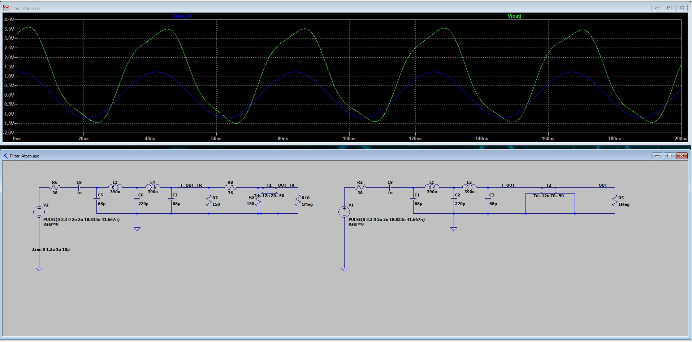
*Figure 2.6: LTspice Transient Comparison of Filter Output With vs. Without 6 dB π-Pad Attenuator Under Severe Load Mismatch ($T_d = 12\text{ ns}$, $R_{\text{load}} = 1\text{ M}\Omega$)*

##### 1. Simulation Testbench Configuration 
Both channels evaluate identical 5-pole LC low-pass networks ($C_1=C_3=C_5=C_7=68\text{ pF}$, $C_2=C_6=220\text{ pF}$, $L_1=L_2=L_3=L_4=390\text{ nH}$) excited by synchronized $24.0\text{ MHz}$ CMOS pulse generators ($V_1, V_2$: $0 \dots 3.3\text{V}$, $t_r = t_f = 2.0\text{ ns}$, period $T = 41.667\text{ ns}$):

* **Source Impedance Mismatch ($R_2 = R_6 = 38\ \Omega$):**  
  To evaluate filter sensitivity to driver process-voltage-temperature (PVT) variations, the series source resistance is deliberately set to $38\ \Omega$ ahead of the $1\text{ nF}$ DC blocking capacitors ($C_8, C_9$). This models an under-damped driver state where output impedance deviates from nominal matching.

* **Transmission Line & Open-Circuit Load ($T_1, T_2$ and $R_5, R_{10}$):**  
  Each channel drives an ideal $50\ \Omega$ coaxial transmission line with a one-way delay of $T_d = 12.0\text{ ns}$ (equivalent to $\approx 2.4\text{ m}$ of standard RG-58 coaxial cable at $VF = 0.66$). The far-end terminations are set to an extreme mismatch of $R_5 = R_{10} = 1\text{ M}\Omega$, establishing a worst-case reflection coefficient:

  $$\Gamma_L = \frac{10^6 - 50}{10^6 + 50} \approx +1.00$$

* **Topology Differentiation:**  
  * Channel 1 (`OUT` — Green Trace): The LC filter drives the $12\text{ ns}$ transmission line directly without resistive attenuation.

  * Channel 2 (`OUT_TR` — Blue Trace): The LC filter drives the line through the $6\text{ dB}$ $\pi$-pad network ($R_7 = R_9 = 150\ \Omega$, $R_8 = 36\ \Omega$).


##### 2. Time-Domain Waveform Analysis and Standing Wave Dynamics
The transient simulation results (`.tran 0 1.2u 1u 10p`) highlight the contrast between the two network configurations under reflective load stress:

* **Unmitigated Path (`V(out)` — Green Trace):**  
  * *Standing Wave Resonance:* Total round-trip transit time along the transmission line is $2 \cdot T_d = 24.0\text{ ns}$, representing $57.6\%$ of the clock period. The undamped reactive LC filter reflects incoming reverse wavefronts back into the line, creating standing waves.

  * *Envelope Distortion and Ringing:* `V(out)` exhibits visible harmonic distortion, pronounced shoulder bumps, and significant baseline asymmetry. The peak-to-peak voltage swings uncontrolled from $-1.55\text{V}$ to $+3.65\text{V}$ ($V_{\text{pp}} \approx 5.20\text{ V}_{\text{pp}}$). Applying this overdriven, ring-distorted waveform to an RSPdx clock slicer would induce comparator threshold hunting, phase jitter, and spurious harmonic mixing.

* **6 dB Attenuated Path (`V(out_tr)` — Blue Trace):**  
  * *Reflection Damping:* Sourced reflections returning from the $1\text{ M}\Omega$ boundary are absorbed across $R_7, R_8,$ and $R_9$. Any residual wave bouncing off the LC filter is attenuated a second time on the forward pass, attenuating round-trip standing waves.

  * *Sinusoidal Purity:* The output `V(out_tr)` emerges as a pure, symmetrical sine wave completely free of ringing, overshoot, or secondary inflection points. Under open-circuit conditions, the swing is bounded to $-1.20\text{V} \dots +1.25\text{V}$ ($V_{\text{pp}} \approx 2.45\text{ V}_{\text{pp}}$), which naturally settles into the target $\approx 1.05\text{ V}_{\text{pp}}$ ($+4.4\text{ dBm}$) when loaded by a nominal $50\ \Omega$ receiver port.

  * *Monotonic Zero-Crossing:* The smooth, uninterrupted zero-crossing transition guarantees deterministic triggering for subsequent clock digitizers.

##### 3. Verification Conclusion
The LTspice analysis verifies that the 5th-order Butterworth filter maintains harmonic filtering despite driver resistance variations ($R_{\text{source}} = 38\ \Omega$). Furthermore, the 6 dB $\pi$-pad isolates the filter from line resonances, ensuring clean sinusoidal delivery to the receivers regardless of external cable lengths or load reactance.

---

### 2.7. Power Supply and Voltage Regulation Architecture: TI LP5907MFX-3.3/NOPB

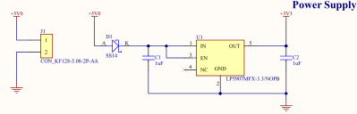
*Figure 2.7: Power Input Protection (SS14) and Ultra-Low-Noise LDO Regulation (LP5907)*

#### 2.7.1. Selection Rationale and Current Budget Optimization
The subsystem operates from an external nominal $+5.0\text{V}$ DC supply and requires a highly stable, low-noise $+3.3\text{V}$ regulated rail. The Texas Instruments LP5907MFX-3.3/NOPB (ultra-low-noise linear regulator, 250 mA, SOT-23-5) was selected based on three concise criteria:

* **Low Total Current Consumption & Thermal Margin:**
  The aggregate current consumption across all active devices is minimal:
  * ADF4002 PLL Synthesizer: $\approx 5\text{ mA}$
  * STM32G030J6M6 MCU: $\approx 4\text{ mA}$ (idle state after startup configuration)
  * 24.0 MHz VCXO: $\approx 15\text{ mA}$
  * 74LVC Clock Buffers: $\approx 25\text{ mA}$ (dynamic switching into $50\ \Omega$ loads)
  * Total Current Demand: $I_{\text{total}} \approx 45 - 55\text{ mA}$.
  The 250 mA continuous output rating offers over $4\times$ current headroom. With $V_{\text{IN}} = 5.0\text{V}$, total package power dissipation is strictly bounded:
  $$P_D = (V_{\text{IN}} - V_{\text{OUT}}) \cdot I_{\text{total}} \approx (5.0\text{V} - 3.3\text{V}) \cdot 55\text{ mA} \approx 94\text{ mW}$$
  This low thermal load allows the compact SOT-23-5 package to operate cool without requiring heatsinking or dedicated thermal copper planes.
* **Ultra-Low Noise & High PSRR (Phase Jitter Preservation):**
  * Output Noise: Features an ultra-low noise density of $6.5\ \mu\text{V}_{\text{RMS}}$ ($10\text{ Hz} \dots 100\text{ kHz}$) without requiring a bulky external noise-bypass capacitor ($C_{\text{NR}}$), minimizing board area.
  * Ripple Rejection: High Power Supply Rejection Ratio ($\text{PSRR} > 82\text{ dB}$ at $1\text{ kHz}$, $> 60\text{ dB}$ at $100\text{ kHz}$) effectively attenuates upstream switching regulator ripple and line noise.


#### 2.7.2. Reverse-Polarity Input Protection (SS14 Schottky Diode)
To protect active silicon components against accidental reverse connection during field installation:
* **Series Schottky Clamping:** An SS14 Schottky barrier diode (40 V, 1 A, SMA / DO-214AC package) is placed in direct series on the $+5\text{V}$ input line immediately following the DC terminal block.
* **Low Forward Voltage Drop ($V_F$):** At low operating currents ($I \approx 55\text{ mA}$), the forward drop across the SS14 is only $V_F \approx 0.35\text{ V} \dots 0.38\text{ V}$. The voltage delivered to the LDO input remains well above its dropout threshold:
  $$V_{\text{IN, LDO}} = 5.0\text{V} - V_F \approx 4.62\text{V} \gg V_{\text{OUT}} + V_{\text{dropout}} = 3.3\text{V} + 0.12\text{V} = 3.42\text{V}$$
* **Fail-Safe Isolation:** Under reverse polarity, the SS14 blocks reverse current flow completely, protecting the LDO and all downstream circuits against negative voltage damage.

---

### 2.8. Passive Signal Conditioning: AC Coupling, DC Decoupling, and Front-End ESD Protection Network

#### 2.8.1. AC Coupling and DC Blocking Architecture (1000 pF C0G / NP0)
To establish galvanic DC isolation between successive active stages while preserving high-frequency transmission integrity, series DC blocking capacitors are inserted along all critical RF and clock paths:
* **10 MHz GPSDO Input Path:** Isolates external GPSDO ground offsets and DC bias voltages from the sensitive input threshold of the sine-to-square fast slicer.
* **24 MHz VCXO Core Output:** Blocks the internal DC bias of the oscillator transistor core from entering the CMOS buffer splitters.
* **Dual 24 MHz Channel Outputs (Ch 1 & Ch 2):** Prevents external DC potentials or accidental phantom DC supply from the SDRplay RSPdx bias-T circuits from shorting back into the LC reconstruction filters.

##### 1. Component Selection: Murata GRM1885C1H102JA01D
The selected DC blocking element is the Murata GRM1885C1H102JA01D ($1000\text{ pF} \pm 5\%$, $50\text{V}$, 0603 footprint / 1608 Metric). The selection is governed by fundamental dielectric physics:
* **Ultra-Stable C0G/NP0 Dielectric:** Unlike general-purpose ferroelectric ceramics (X5R, X7R), Class 1 C0G/NP0 dielectric materials exhibit zero piezoelectric microphonics, zero aging rate, and negligible DC voltage coefficient (capacitance remains strictly constant regardless of DC bias voltage).
* **Thermal Phase Stability:** The temperature coefficient is strictly constrained to $0 \pm 30\text{ ppm/}^\circ\text{C}$ across $-55^\circ\text{C} \dots +125^\circ\text{C}$. This guarantees that ambient temperature swings in field deployments will not modulate the insertion phase or create inter-channel phase drift between Output A and Output B.

##### 2. Reactance and Corner Frequency Derivation
In a characteristic $Z_0 = 50.0\ \Omega$ transmission environment, the capacitive reactance of a $C_{\text{block}} = 1000\text{ pF}$ ($1.0\text{ nF}$) capacitor is:
* **At Reference Frequency ($10.0\text{ MHz}$):**
  $$X_C(10\text{ MHz}) = \frac{1}{2\pi f C} = \frac{1}{2\pi \cdot 10.0\times 10^6\text{ Hz} \cdot 1.0\times 10^{-9}\text{ F}} \approx 15.92\ \Omega$$
* **At Synthesized Clock Frequency ($24.0\text{ MHz}$):**
  $$X_C(24\text{ MHz}) = \frac{1}{2\pi f C} = \frac{1}{2\pi \cdot 24.0\times 10^6\text{ Hz} \cdot 1.0\times 10^{-9}\text{ F}} \approx 6.63\ \Omega$$

The high-pass corner frequency ($-3\text{ dB}$ cutoff) into a terminated $50\ \Omega$ load is calculated as:
$$f_c = \frac{1}{2\pi R C} = \frac{1}{2\pi \cdot 50\ \Omega \cdot 1.0\times 10^{-9}\text{ F}} \approx 3.183\text{ MHz}$$

Because $f_c \approx 3.18\text{ MHz}$ is positioned far below both the $10.0\text{ MHz}$ reference and the $24.0\text{ MHz}$ synthesized clock, the insertion attenuation contributed by the capacitor is virtually unmeasurable ($S_{21} > -0.04\text{ dB}$ at $24\text{ MHz}$), introducing zero group delay distortion or pulse-edge degradation into the clock signal.


#### 2.8.2. Power Rail DC Decoupling Architecture (1 µF X7R)
Dedicated 1 µF ceramic capacitors (TMK107B7105KA-T, 0603 X7R) are placed at each active supply pin to suppress power rail ripple and deliver instantaneous transient current during high-speed switching of the STM32 MCU and 74LVC clock buffers.

##### 1. Component Selection: Taiyo Yuden TMK107B7105KA-T
Every active supply pin ($V_{\text{DD}}$ of MCU, $V_{\text{P}}/V_{\text{DD}}$ of ADF4002, $V_{\text{CC}}$ of VCXO, $V_{\text{CC}}$ of CMOS buffers, and output nodes of low-noise LDOs) is bypassed by a dedicated TMK107B7105KA-T ($1.0\ \mu\text{F} \pm 10\%$, $16\text{V}$, 0603 footprint, X7R dielectric):
* **DC Bias Derating Resilience:** While subminiature ceramic capacitors in 0201 or 0402 footprints lose up to $60 - 80\%$ of their effective capacitance when operated near their rated voltage, the 0603 footprint with a $16\text{V}$ rating maintains over $88\%$ of its nominal capacitance ($C_{\text{eff}} \approx 0.88\ \mu\text{F}$) when biased at nominal $3.3\text{V}$ system rails.
* **Low Equivalent Series Inductance (ESL):** The 0603 SMD packaging restricts parasitic loop inductance to $\text{ESL} \approx 0.6\text{ nH}$. When mounted with dual ground stitching vias immediately adjacent to component pads, it forms a low-impedance shunt network ($Z_{\text{rail}} < 0.15\ \Omega$) spanning from DC up to $> 15\text{ MHz}$, effectively attenuating charge pump switching transients and digital MCU current steps.


#### 2.8.3. Front-End Transient & ESD Protection (Texas Instruments TPD1E01B04DPYR)
Because the 10 MHz reference input and the dual 24 MHz clock outputs interface via external panel SMA connectors and coaxial interconnects, they are routinely exposed to electrostatic discharge (ESD) and human/cable handling discharge events (CDE).

##### 1. Component Selection: Texas Instruments TPD1E01B04DPYR
Each external SMA connector center conductor is guarded by a discrete TPD1E01B04DPYR bidirectional TVS protection diode in an ultra-compact X1SON-2 (DPY, 0402 equivalent) package:
* **IEC 61000-4-2 Level 4 Compliance:** Rated to withstand up to $\pm 15\text{ kV}$ Air-Gap Discharge and $\pm 15\text{ kV}$ Contact Discharge, providing robust industrial-grade surge suppression.
* **Ultra-Low Junction Capacitance ($C_j \approx 0.18\text{ pF}$):** High-frequency clock and RF signals are severely compromised by standard TVS diodes whose parasitic capacitance ($> 5\text{ pF}$) shunts high frequencies to ground. The TPD1E01B04 presents an ultra-low capacitance of only $C_j = 0.18\text{ pF}$ typical ($0.25\text{ pF}$ maximum).

##### 2. High-Frequency RF Transparency Verification
At the highest operating frequency of the subsystem ($f = 24.0\text{ MHz}$), the shunt impedance presented by the TVS junction capacitance is:
$$X_{C,\text{ESD}} = \frac{1}{2\pi \cdot 24.0\times 10^6\text{ Hz} \cdot 0.18\times 10^{-12}\text{ F}} \approx 36.84\text{ k}\Omega$$

Because $X_{C,\text{ESD}} \approx 36.8\text{ k}\Omega \gg 50.0\ \Omega$, the parallel loading effect on the $50\ \Omega$ transmission line is completely negligible:
$$S_{21,\text{loss}} \approx 10\log_{10}\left(1 - \frac{Z_0}{2 \cdot X_{C,\text{ESD}}}\right) \approx 10\log_{10}\left(1 - \frac{50}{73680}\right) \approx -0.0029\text{ dB}$$

The diode operates completely transparently across both $10.0\text{ MHz}$ and $24.0\text{ MHz}$, introducing zero pulse distortion, preserving return loss ($S_{11} < -45\text{ dB}$), and introducing no phase imbalance between the dual receiver clock feeds.

---

### 2.9. Bill of Materials (BOM)

The table below compiles the complete component roster for the Dual-Channel 24 MHz PLL Clock Distribution board captured in the schematic and PCB database:

| Item | Designator | Part Number / Value | Description & Specifications | Package / Footprint | Qty |
| :---: | :--- | :--- | :--- | :--- | :---: |
| 1 | C1–C11, C18–C20, C27 | 1uF (TMK107B7105KA-T) | 1 µF ±10% 25V Ceramic Capacitor (X7R) | SMD 0603 | 15 |
| 2 | C12 | 5600pF (GRT1885C1E562JA02D) | 5600 pF ±5% 25V Ceramic Capacitor (C0G/NP0) | SMD 0603 | 1 |
| 3 | C13 | 820pF (GCM1885C2A821JA16D) | 820 pF ±5% 100V Ceramic Capacitor (C0G/NP0) | SMD 0603 | 1 |
| 4 | C14, C17, C21–C23, C28 | 1000pF (GRM1885C1H102JA01D) | 1000 pF ±5% 50V Ceramic Capacitor (C0G/NP0) | SMD 0603 | 6 |
| 5 | C15 | 0.1uF (GRM3195C1H104JA05D) | 0.1 µF ±5% 50V Ceramic Capacitor (C0G/NP0) | SMD 1206 | 1 |
| 6 | C16 | 0.056uF (GRM31M5C1H563JA01L) | 0.056 µF ±5% 50V Ceramic Capacitor (C0G/NP0) | SMD 1206 | 1 |
| 7 | C24, C26, C29, C31 | 68pF (GCM1885C2A680JA16D) | 68 pF ±5% 100V Ceramic Capacitor (C0G/NP0) | SMD 0603 | 4 |
| 8 | C25, C30 | 220pF (GCM1885C2A221JA16D) | 220 pF ±5% 100V Ceramic Capacitor (C0G/NP0) | SMD 0603 | 2 |
| 9 | D1 | SS14 | Schottky Barrier Diode 40V 1A Low $V_F$ | SMA (DO-214AC) | 1 |
| 10 | D2, D3, D4 | TPD1E01B04DPYR | Bidirectional TVS ESD Diode, 15V clamp, 0.18 pF | 0402 (X1SON-2) | 3 |
| 11 | DS1 | Lock Detect | Blue 470nm LED, 3.3V, 20mA | SMD 0805 | 1 |
| 12 | DS2 | Power LED | Blue 470nm LED, 3.3V, 20mA | SMD 0805 | 1 |
| 13 | J1 | KF128-5.08-2P | 2-position 5.08mm Pitch Screw Terminal Block | Through-Hole | 1 |
| 14 | J2 | 3X1 BERG STRIP | 3-pin 1-row 2.54mm Pitch Straight Male Header | Through-Hole | 1 |
| 15 | J3, J4, J5 | 60312202114514 | SMA Female Jack, 50 $\Omega$, PCB Edge-Mount | Edge-Mount SMA | 3 |
| 16 | L1, L2, L3, L4 | 390n (LQW18ANR39J00D) | 390 nH Wirewound RF Inductor, High-Q, 80mA | SMD 0603 | 4 |
| 17 | R1 | 56.2k (RC0603FR-0756K2L) | 56.2 k$\Omega$ ±1% 0.1W Thick Film Resistor | SMD 0603 | 1 |
| 18 | R2 | 8.87k (RC0603FR-078K87L) | 8.87 k$\Omega$ ±1% 0.1W Thick Film Resistor | SMD 0603 | 1 |
| 19 | R3, R5, R6 | 5.1k (AC0603FR-135K1L) | 5.1 k$\Omega$ ±1% 0.1W Thick Film Resistor | SMD 0603 | 3 |
| 20 | R4 | 100k (RC0603FR-07100KL) | 100 k$\Omega$ ±1% 0.1W Thick Film Resistor | SMD 0603 | 1 |
| 21 | R7 | 49.9R (RC0603FR-0749R9L) | 49.9 $\Omega$ ±1% 0.1W Thick Film Resistor | SMD 0603 | 1 |
| 22 | R8, R12 | 22R (RT0603FRE0722RL) | 22 $\Omega$ ±1% 0.1W Thin Film Resistor | SMD 0603 | 2 |
| 23 | R9, R13 | 36R (RT0603FRE0736RL) | 36 $\Omega$ ±1% 0.1W Thin Film Resistor | SMD 0603 | 2 |
| 24 | R10, R11, R14, R15 | 150R (RC0603FR-13150RL) | 150 $\Omega$ ±1% 0.1W Thick Film Resistor | SMD 0603 | 4 |
| 25 | U1 | LP5907MFX-3.3/NOPB | Ultra-Low-Noise LDO Regulator, 3.3V, 250mA | SOT-23-5 | 1 |
| 26 | U2 | STM32G030J6M6 | ARM Cortex-M0+ 32-bit MCU, 64MHz, 32KB Flash | SOIC-8 | 1 |
| 27 | U3 | ADF4002BRUZ | Phase Detector / PLL Frequency Synthesizer | TSSOP-16 | 1 |
| 28 | U4, U5 | SN74LVC1G04DBVR | Single Inverter Gate IC, 1.65V to 5.5V | SOT-23-5 | 2 |
| 29 | U6 | SN74LVC2G34DCKR | Dual Non-Inverting Buffer, Push-Pull | SC-70-6 | 1 |
| 30 | Y1 | SX3V24.000B20085F30TNNS | 24.000 MHz VCXO, 3.3V CMOS Output | SMD 3225 (4-pad) | 1 |

---
## 3. PCB Physical Layout and Mixed-Signal Implementation

The physical PCB implementation of the Dual-Channel 24 MHz PLL Clock Distribution Subsystem requires strict adherence to modern Analog Mixed-Signal (AMS) and high-frequency RF routing principles. At high switching speeds, parasitic trace inductance, ground return discontinuities, and substrate coupling can degrade phase noise, increase clock jitter, and compromise channel-to-channel isolation. This section details the stackup synthesis, grounding topology, critical signal routing, power distribution, and RF launch geometry designed to preserve signal integrity across the board.


### 3.1. 4-Layer Stackup Architecture and Controlled Transmission Lines

A dedicated 4-layer stackup on an FR-4 substrate ($H_{\text{total}} \approx 1.6\text{ mm}$, $\varepsilon_r \approx 4.4$) is implemented to establish continuous reference planes and minimize magnetic loop areas:

* **Layer 1 (Top Layer — Primary Signals & RF):** Dedicated to high-frequency RF routing, the $10\text{ MHz}$ reference input, $24\text{ MHz}$ master clock paths, VCXO loop feedback, and discrete SMD components. All unused surface copper is flooded with a ground plane connected directly to Layer 2 through an array of micro-vias.
* **Layer 2 (Inner Layer 1 — Solid Ground Plane):** Configured as an unbroken, continuous ground reference plane (GND) across the entire board boundary. It provides an immediate, low-impedance image plane directly beneath all Layer 1 high-speed conductors.
* **Layer 3 (Inner Layer 2 — Dedicated Power Pours):** Configured for DC power distribution, subdivided into isolated, low-impedance copper pours ($+3.3\text{V}_{\text{ANA}}$, $+3.3\text{V}_{\text{DIG}}$, and $+5.0\text{V}_{\text{IN}}$).
* **Layer 4 (Bottom Layer — Non-Critical Routing):** Dedicated to low-speed, non-critical digital interconnects (such as MCU GPIOs, SPI control lines, status LED lines, and debug headers). The entire remaining area is flooded with a solid ground pour to form an external shielding enclosure.

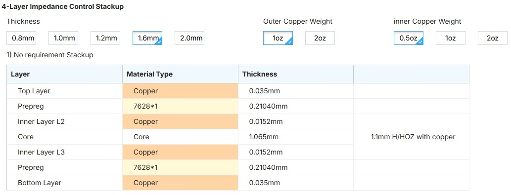
*Figure 3.1.1: JLCPCB standard 4-layer stackup configuration (1.6 mm total thickness, 1 oz outer / 0.5 oz inner copper weight, 7628 prepreg).*


#### Controlled Impedance Synthesis ($50\ \Omega$)
All RF and high-speed clock traces on Layer 1 are synthesized as Coplanar Waveguides with Ground (CPW-G). The single 7628 prepreg layer between Layer 1 and Layer 2 ($h = 0.2104\text{ mm}$) establishes controlled capacitive coupling to the solid ground image plane. Trace width ($W \approx 0.38\text{ mm}$) and coplanar ground clearance ($G \approx 0.25\text{ mm}$) are synthesized to maintain nominal $Z_0 = 50.0\ \Omega$ across all critical clock and RF routes..


### 3.2. Modern Mixed-Signal Grounding Strategy: Unified vs. Split Ground Plane

A critical decision in modern analog mixed-signal layout is the treatment of ground returns. While legacy mixed-signal design guidelines frequently advocated splitting the ground plane into separate Analog Ground (AGND) and Digital Ground (DGND) regions connected at a single star point, this design enforces a single, unified, unbroken ground plane across the entire board.

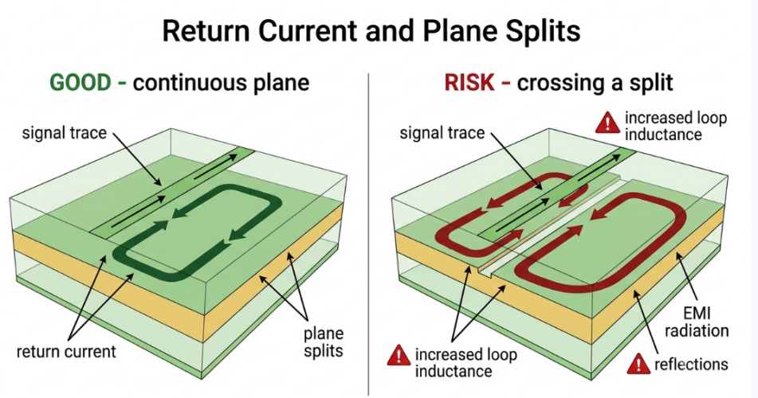
*Figure 3.2: Mastering Split Planes for Clean Power Delivery — Comparison between split ground plane return path discontinuities and unified ground plane spatial zoning.*

#### Technical Rationale for a Unified Ground Plane:
1. **Elimination of EMI Loop Antennas:** At frequencies above $1\text{ MHz}$, return currents do not take the path of least resistance; they take the path of least inductance, traveling on the reference plane directly beneath the signal trace. If a high-speed digital line crosses a ground plane split, the return current cannot cross the dielectric gap and must detour around the boundary. This detour creates a wide current loop that radiates as an efficient slot antenna, leading to severe electromagnetic interference (EMI) and cross-domain phase jitter.
2. **Spatial Partitioning by Grouping (Zoning):** Rather than cutting the copper plane, isolation is achieved through physical placement zoning:
   * Analog/RF Domain: Grouped exclusively on one side of the PCB (comprising the $10\text{ MHz}$ input slicer, ADF4002 synthesizer, passive loop filter, $24\text{ MHz}$ VCXO, and LC reconstruction filters).
   * Digital Domain: Grouped on the opposing section (comprising the supervisory MCU, SPI lines, debug headers, and LED status logic).
   * Because return currents remain tightly concentrated beneath their respective conductors, digital switching currents never cross into the analog ground floor, preserving a noise floor $<-140\text{ dBc/Hz}$.

---

### 3.3. Component Placement, Grouping, and Critical Routing Guidelines

#### 3.3.1. Low-Inductance Decoupling Placement
Power supply ripple modulates active semiconductor thresholds, resulting in Amplitude Modulation to Phase Modulation (AM-to-PM) conversion. To suppress high-frequency supply spikes:
* **Placement Proximity:** Decoupling capacitors are placed immediately adjacent to the IC supply pins ($< 1.0\text{ mm}$ spacing).
* **Inductance Loop Minimization:** Vias to the internal power plane (Layer 3) connect first to the capacitor pad before feeding the IC pin, preventing high-frequency noise from bypassing the filtering element.
* **Direct Ground Return Vias:** Ground vias are located immediately adjacent to the capacitor ground pads, routing transient return currents into Layer 2 with minimal loop inductance.


#### 3.3.2. Slew Rate and Trace Length Constraints
* **High-Speed Digital Logic:** Digital control lines and clock buffer outputs exhibit sub-nanosecond switching edges ($dv/dt > 1\text{ V/ns}$), producing high-frequency harmonic energy ($> 500\text{ MHz}$). All digital interconnects (MCU SPI bus, buffer drivers) are kept as short as physically possible to reduce capacitive loading and radiated harmonic emissions.
* **Sensitive RF Blocks & VCXO Feedback:** While pure analog signals produce fewer high-order harmonics, high-impedance RF nodes are susceptible to parasitic capacitive and inductive picking. 
* **Critical VCXO Feedback Route:** The $24.0\text{ MHz}$ feedback line from the VCXO output back to the ADF4002 RF input ($R_{\text{FINB}}$) is routed using the shortest possible direct CPW-G line. Parasitic capacitance on this trace directly loads the VCXO crystal tank, while stray inductance can shift loop phase margins, leading to phase instability.

#### 3.3.3. Power Distribution via Copper Pours
To maintain low DC series resistance ($R$) and negligible parasitic trace inductance ($L$), narrow traces are eliminated on the power distribution network.
* Dedicated polygon copper pours are utilized on Layer 3 for each regulated voltage domain.
* Using broad copper pours lowers the characteristic impedance of the power distribution network ($Z_{\text{PDN}}$), preventing dynamic voltage drops ($V = L \frac{di}{dt}$) during simultaneous CMOS output switching.

---

### 3.4. High-Frequency SMA Launch Geometry and Transition Optimization

Standard commercial SMA edge-mount or surface-mount connectors typically feature wide center contact pins designed for 2-layer boards ($W_{\text{pin}} \approx 1.2\text{ mm} \dots 1.6\text{ mm}$). On a thin 4-layer stackup where the dielectric height to ground is small ($h \approx 0.1\text{ mm}$), such a wide landing pad introduces excessive shunt capacitance to the ground plane, causing a severe local impedance drop ($Z_0 \approx 30\ \Omega \dots 35\ \Omega$), return loss degradation, and parasitic insertion loss.


#### Transition Design Criteria:
1. **Narrow-Conductor SMA Footprint:** The layout incorporates an optimized SMA connector footprint specifically characterized for high-density 4-layer boards, featuring a narrow copper landing pad.
   
2. **0603 Component Dimension Matching:** The launch trace width from the SMA pin matches the terminal width of adjacent 0603 components (e.g., the TPD1E01B04 TVS diode and 1000 pF AC-coupling capacitor), preventing abrupt step discontinuities along the signal path.


### 3.5. Via Stitching Shielding and Mechanical Fixturing

#### 3.5.1. Ground Via Stitching Matrix and RF Via Fences
To maintain equal ground potential and suppress lateral electromagnetic coupling:
* **Boundary Via Fencing:** All $50\ \Omega$ CPW-G lines (10 MHz reference input and dual 24 MHz outputs) are flanked on both sides by continuous double-row ground via fences. Via pitch is maintained at $d \le 2.0\text{ mm}$ ($\ll \lambda / 20$ at the highest harmonic frequency), forming a localized Faraday cage that bounds electric and magnetic fields.
* **Board-Wide Via Stitching:** A matrix of stitching vias connects the top copper flood (Layer 1), the inner ground plane (Layer 2), and the bottom ground flood (Layer 4). This eliminates floating copper islands, prevents parasitic cavity resonances, and provides low-thermal-resistance dissipation paths for active devices.

#### 3.5.2. Mechanical Mounting Holes
To provide structural rigidity and facilitate shielded enclosure assembly:
* **4-Corner Mechanical Holes:** The PCB incorporates four symmetrical non-plated/plated mounting holes positioned at each corner of the board (sized for standard M3 / M2.5 hardware).

---

### 3.6. Layer-by-Layer Physical Layout Visualization

The resulting physical layout maps the analog, RF, power, and digital systems into their respective layers:

#### 3.6.1. Layer 1 — Primary Signal, RF Traces, and Top Ground Shield
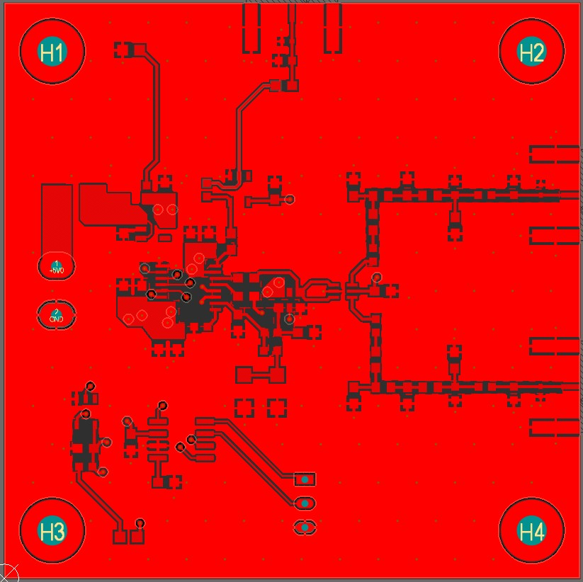
*Figure 3.6.1: Layer 1 (Top) showing 50 Ω CPW-G traces, optimized narrow SMA launch geometry, VCXO feedback route, and perimeter via fencing.*

#### 3.6.2. Layer 2 — Unbroken Solid Ground Plane
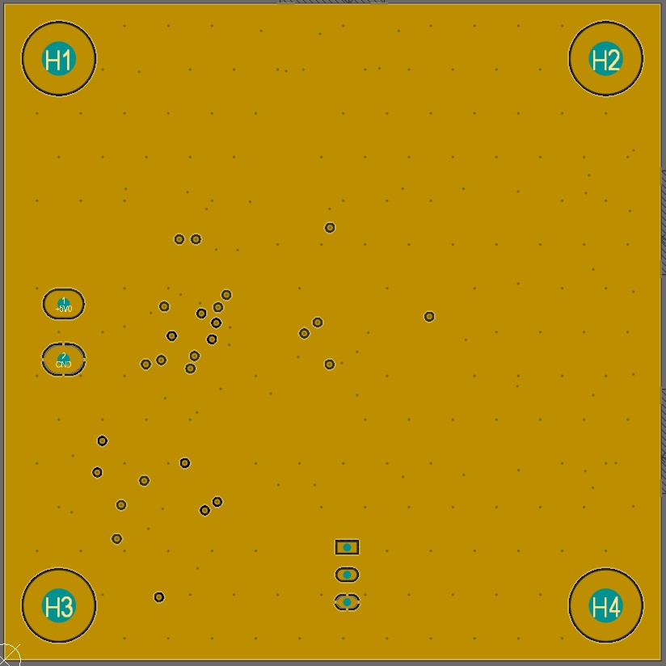
*Figure 3.6.2: Layer 2 (Inner 1) continuous, unbroken ground plane providing a uniform return path without cross-domain splits.*

#### 3.6.3. Layer 3 — Dedicated Power Plane and Polygon Pours
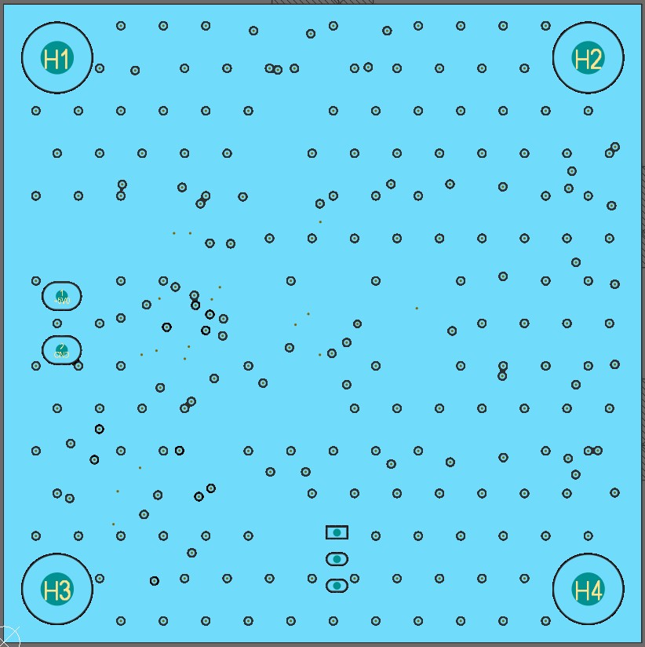
*Figure 3.6.3: Layer 3 (Inner 2) showcasing low-impedance copper pours dedicated to clean analog rails, VCXO core, and digital logic supply.*

#### 3.6.4. Layer 4 — Non-Critical Routing and Bottom Ground Flood
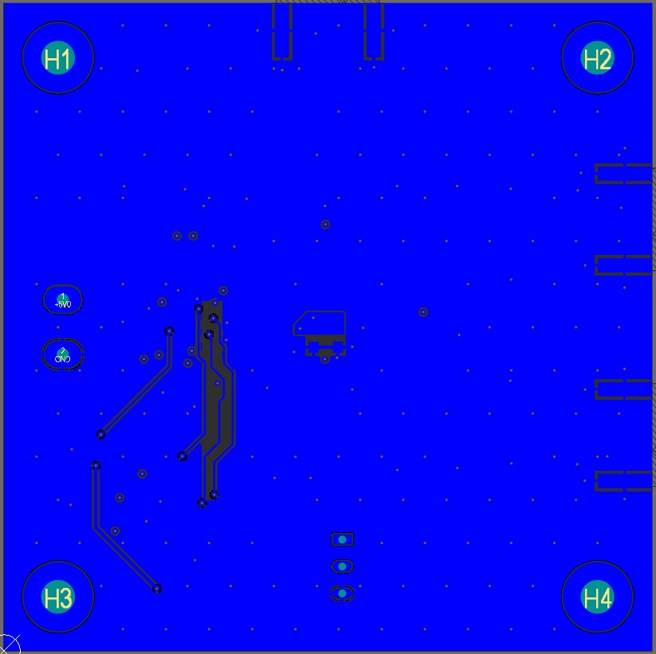
*Figure 3.6.4: Layer 4 (Bottom) routing slow supervisory control lines, isolated from RF paths, and embedded in a continuous ground flood.*
### 3.7. Prototype Fabrication & Assembly Verification


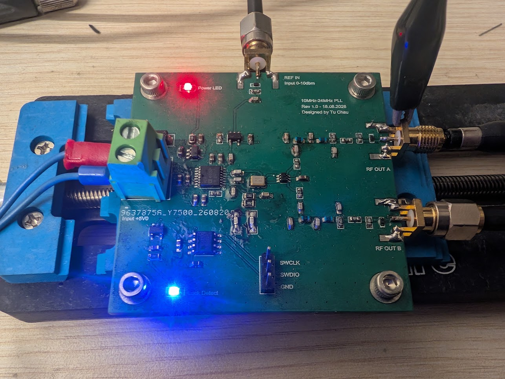
*Figure 3.7.1: Fully assembled physical prototype of the Dual-Channel 24 MHz PLL Clock Distribution board.*

---

## 4. Embedded Programming & Supervisory Firmware

The STM32G030 supervisory firmware initializes the ADF4002 synthesizer at power-up and immediately enters a quiescent state to eliminate digital noise during RF operation. This section outlines the low-EMI SPI configuration (500 kbit/s, slew-rate-limited drivers), latch transmission sequence, and boot-to-sleep runtime flow.

---

### 4.1. Supervisory Control Strategy & EMI Containment Philosophy

The embedded firmware architecture adheres to three core mixed-signal principles:

1. **Deterministic Cold-Start Configuration:**  
   The microcontroller's sole operational duty is to configure the Analog Devices ADF4002 frequency synthesizer upon power-up via a dedicated 3-wire Serial Peripheral Interface (SPI). It sequences the 24-bit control words into the internal latches to lock the 24.0 MHz VCXO to the 10.0 MHz reference clock.
2. **Complete Post-Initialization Digital Bus Quiescence:**  
   Unlike systems requiring continuous polling or periodic register refresh, the firmware executes `ADF4002_Init()` exactly once during cold boot. Once transmission completes, all digital communication lines (`SCLK`, `MOSI`, `LE`) remain clamped in static DC logic states. This eliminates digital clock harmonics, substrate switching spikes, and return current transients from coupling into the adjacent analog loop filter, charge pump rail, and VCXO crystal tank.
3. **Controlled Transition Slew Rates ($dv/dt$ Reduction):**  
   High-speed digital edges with sub-nanosecond rise times emit broadband harmonics extending well beyond several hundred megahertz. By intentionally restricting the SPI baud rate and programming the microcontroller's I/O output drivers to low slew rate, radiated and conducted emissions are eliminated at the source.

---

### 4.2. Hardware Pinout Allocation & CubeMX Configuration

The STM32G030J6M6 in the SO8N package provides 8 physical pins, offering 6 configurable general-purpose I/O lines. The pin mapping is dedicated strictly to SPI communication, system debugging, and power rails.

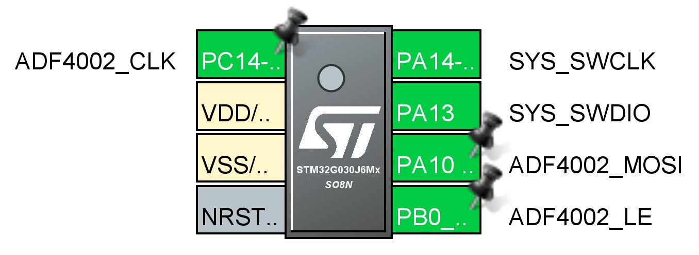
*Figure 4.1: STM32G030J6M6 8-pin SO8N pin assignment generated in STM32CubeMX.*

| Pin # | Physical Pin | Configured Mode | Signal Name | Target Connection | Electrical Function |
| :---: | :--- | :--- | :--- | :--- | :--- |
| **1** | `PC14-OSC32_IN` (`PB8`) | Alternate Function Push-Pull | `ADF4002_CLK` | ADF4002 Pin 1 (`CLK`) | Hardware SPI2 serial shift clock |
| **2** | `VDD/VDDA` | Power Supply Rail | `+3.3V_DIG` | Clean LDO Digital Rail | Microcontroller core & I/O power ($+3.3\text{ V}$) |
| **3** | `VSS/VSSA` | Ground Reference | `GND` | Solid Ground Plane (Layer 2) | Common digital ground return |
| **4** | `NRST` | System Reset | `NRST` | Reset RC Debounce Circuit | External hardware reset input |
| **5** | `PB0` | GPIO Output Push-Pull | `ADF4002_LE` | ADF4002 Pin 3 (`LE`) | Active-HIGH Latch Enable (Chip Select) |
| **6** | `PA10` (`PA12`) | Alternate Function Push-Pull | `ADF4002_MOSI` | ADF4002 Pin 2 (`DATA`) | Hardware SPI2 serial data output (MSB first) |
| **7** | `PA13` | Alternate Function | `SYS_SWDIO` | Programming Header | 2-wire Serial Wire Debug (SWD) Data |
| **8** | `PA14-BOOT0` | Alternate Function | `SYS_SWCLK` | Programming Header | 2-wire Serial Wire Debug (SWD) Clock |

The serial link utilizes the integrated hardware SPI2 peripheral, ensuring deterministic transmission timing compliance with the ADF4002 setup and hold specifications ($t_1, t_2, t_3 \ge 10\text{ ns}$) without software bit-banging overhead.

---

### 4.3. Low-Speed SPI Configuration & Slew-Rate Limiting

#### 4.3.1. Low-Speed SPI Parameter Settings
While the ADF4002 shift register supports serial clock frequencies up to $20\text{ MHz}$, operating the digital interface at high speeds within a sensitive RF subsystem introduces unnecessary high-frequency noise. The SPI2 peripheral is deliberately throttled to **$500.0\text{ kbit/s}$** via an internal APB clock prescaler.

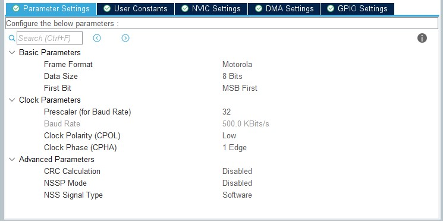
*Figure 4.2: SPI2 parameter settings showing 500 kbit/s baud rate and Mode 0 clock configuration.*

* **Frame Format:** Motorola standard, 8-bit data size.
* **Bit Orientation:** MSB First (most significant bit shifted out first to match the ADF4002 register shift direction).
* **Baud Rate:** Set to **$500.0\text{ kbit/s}$** using a prescaler division factor of $32$ from the internal APB bus clock ($f_{\text{PCLK}} = 16\text{ MHz}$).
* **Clock Phase & Polarity:** CPOL = Low ($0$), CPHA = 1 Edge ($0$). Data is set up on `MOSI` during the clock falling edge and latched into the ADF4002 on the rising edge of `SCLK`.
* **NSS Management:** Software controlled (`NSS Signal Type = Software`). The Latch Enable line (`ADF4002_LE`) is driven independently by general-purpose output `PB0`.

#### 4.3.2. Output Speed Limitation (`Maximum Output Speed = Low`)
To suppress high-frequency harmonic generation, the output driver slew rates for all active digital lines (`ADF4002_MOSI`, `ADF4002_CLK`, and `ADF4002_LE`) are explicitly restricted to Low (`GPIO_SPEED_FREQ_LOW`).

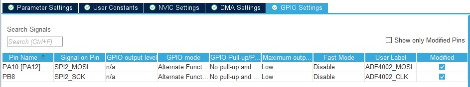
*Figure 4.3: GPIO Settings in STM32CubeMX demonstrating Maximum Output Speed set to Low.*


---

### 4.4. ADF4002 Latch Architecture & Register Mapping

The ADF4002 frequency synthesizer integrates a 24-bit shift register. Data is transferred serially on each rising edge of `CLK`. When `LE` transitions from LOW to HIGH, the data stored in the shift register is loaded into the internal latch addressed by the two lowest control bits `[C2, C1]` (DB1, DB0).

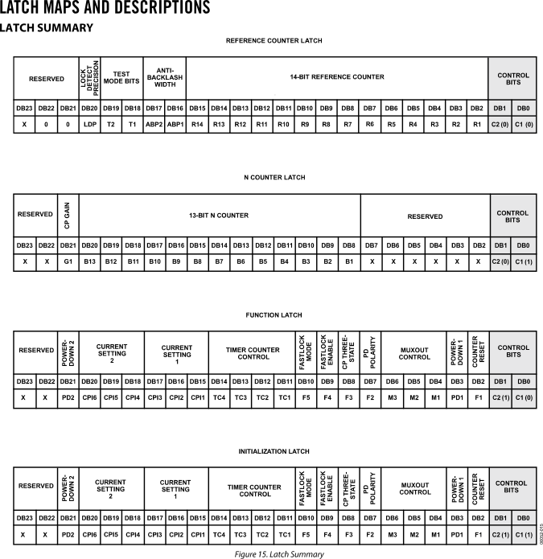
*Figure 4.4: Latch summary and bit allocation extracted from the ADF4002 datasheet.*

The device incorporates four functional 24-bit latches:
* **Reference Counter Latch (`C2=0, C1=0`):** Sets the 14-bit R divider ($R = 5$), anti-backlash pulse width ($1.3\text{ ns}$), and Lock Detect Precision.
* **N Counter Latch (`C2=0, C1=1`):** Sets the 13-bit N divider ($N = 12$) and prescaler control.
* **Function Latch (`C2=1, C1=0`):** Configures charge pump current ($I_{\text{CP}} = 5.0\text{ mA}$, Code 7 with $R_{\text{SET}} = 5.1\text{ k}\Omega$), Phase Detector polarity (Positive for non-inverting loop filter), and `MUXOUT` mode (Digital Lock Detect).
* **Initialization Latch (`C2=1, C1=1`):** Functional mirror of the Function Latch used to reset internal counters and establish deterministic states upon cold start.


### 4.5. Firmware Architecture, Execution Flow & Repository Implementation


#### 4.5.1. Synthesizer Initialization Sequence (`ADF4002_Init`)

The initialization routine configures the ADF4002 via a deterministic 4-stage pipeline, strictly following the manufacturer-specified power-on sequence:

```
[ Power-On Delay ] ──► [ Bitfield Construction ] ──► [ Sequential SPI Latch Dispatch ] ──► [ Return HAL_OK ]
     (100 ms)                 (4 x 24-bit words)          (Init ──► Func ──► R ──► N)          (Sleep / Idle)
```

1. **Power Stabilization Delay (`100 ms`):**  
   Executes a blocking startup delay (`HAL_Delay(100U)`) immediately upon entry to guarantee that LDO analog/digital rails ($+3.3\text{V}_{\text{ANA}}$, $+3.3\text{V}_{\text{DIG}}$) and the VCXO crystal reach stable steady-state DC levels before communication starts.

2. **Control Word Construction:**  
   Packs the operating parameters into four 24-bit frame buffers with designated latch address bits `[C2, C1]`:
   * **Initialization Latch (`0x...3`):** Forces an internal counter reset, disables outputs, and sets PFD polarity.
   * **Function Latch (`0x...2`):** Releases counter resets, programs charge pump drive current ($I_{\text{CP}}$ mapped simultaneously to both Settings 1 and 2), and routes Lock Detect to `MUXOUT`.
   * **Reference (R) Counter Latch (`0x...0`):** Loads division ratio $R = 5$ to establish $f_{\text{PFD}} = 2.0\text{ MHz}$.
   * **Feedback (N) Counter Latch (`0x...1`):** Loads division ratio $N = 12$ ($24.0\text{ MHz} \to 2.0\text{ MHz}$) with `CP Gain = 0`, activating closed-loop phase comparison.

3. **Sequential Transmission & Fail-Safe Latching:**  
   Iterates through an atomic loop (`words[0]` to `words[3]`):
   * Dispatches each 24-bit word serially via `ADF4002_Write24()` over SPI2 at 500 kbit/s.
   * **Fail-Safe Mechanism:** If any frame transfer fails (`HAL_ERROR` or timeout), the function immediately aborts and returns the error code without pulsing `LE` on subsequent latches.
   * On completion of all 4 latches, returns `HAL_OK` and yields the MCU to an idle state (`__WFI()`).


#### 4.5.2. Firmware Source Repository
The complete low-level driver implementation, register bitmasks, and initialization routines are version-controlled in the project repository:

* **Synthesizer Driver Header (`adf4002.h`):**  
  [https://github.com/tuchau1404/solar_correlator/blob/main/firmware/10_24MHz_PLL/Core/Inc/adf4002.h](https://github.com/tuchau1404/solar_correlator/blob/main/firmware/10_24MHz_PLL/Core/Inc/adf4002.h)  
  *Contains configuration macros, divider constants ($R=5, N=12$), charge pump codes, and function prototypes.*

* **Synthesizer Driver Implementation (`adf4002.c`):**  
  [https://github.com/tuchau1404/solar_correlator/blob/main/firmware/10_24MHz_PLL/Core/Src/adf4002.c](https://github.com/tuchau1404/solar_correlator/blob/main/firmware/10_24MHz_PLL/Core/Src/adf4002.c)  
  *Implements 24-bit word construction, byte-packing, low-speed SPI transmission, and LE latch pulse timing.*


---


## 5. Laboratory Verification & Test Procedures

This section details the empirical validation and bench characterization of the assembled Dual-Channel 24 MHz PLL Clock Distribution board. Measurements were conducted under nominal laboratory conditions ($T_{\text{amb}} = 25^\circ\text{C}$) to confirm DC operating points, reference signal conditioning, time-domain waveform integrity, harmonic rejection, and frequency accuracy against design targets.

---

### 5.1. Testbench Setup & Instrumentation Matrix

The Device Under Test (DUT) was integrated into a multi-instrument RF verification testbench. All frequency-sensitive instruments were locked to a common $10.000000\text{ MHz}$ GPS-Disciplined Oscillator (GPSDO) master timebase to eliminate measurement reference drift.


*Figure 5.1: Full laboratory verification bench showing the DC supply, 10 MHz reference source, oscilloscope, spectrum analyzer, and precision frequency counter connected to the DUT.*

| Equipment Type | Model / Instrument | Measurement Role | Configuration / Settings |
| :--- | :--- | :--- | :--- |
| **DC Power Supply** | Keysight E3631A / Rigol DP832 | Main DC power feed | $+5.00\text{ V}_{\text{DC}}$, current limit set to $250\text{ mA}$ |
| **Reference Source** | BG7TBL GPSDO / SDG2042X | Master 10.0 MHz reference | $10.000\text{ MHz}$ sine wave, $+7.0\text{ dBm}$ into $50\ \Omega$ |
| **Digital Storage Scope** | Keysight DSOX3054T ($500\text{ MHz}$, $5\text{ GSa/s}$) | Time-domain waveform & slicer check | Channel 1 & 2 set to $50\ \Omega$ DC coupling |
| **Spectrum Analyzer** | Rohde & Schwarz FSC3 ($9\text{ kHz} \dots 3\text{ GHz}$) | Harmonic suppression & spur analysis | $\text{RBW} = 10\text{ kHz}$, $\text{VBW} = 10\text{ kHz}$, Span $= 120\text{ MHz}$ |
| **Frequency Counter** | Keysight 53220A ($350\text{ MHz}$, 12 digits/s) | Carrier accuracy & Allan deviation | 1 s gate time, external $10\text{ MHz}$ GPSDO reference |
| **RF Coaxial Loads** | Huber+Suhner $50\ \Omega$ SMA Terminations | Port impedance balancing | Return loss $S_{11} < -35\text{ dB}$ up to $2\text{ GHz}$ |

---

### 5.2. DC Power Rail & Current Consumption Verification

The board was energized via the screw terminal ($+5.0\text{V}_{\text{IN}}$). Regulated output rails and total supply currents were verified using a digital multimeter before and after synthesizer latch programming:


*Figure 5.2: Precision current monitor displaying total DUT current consumption in locked steady state.*

* **Supply Rails:**  
  * $+3.3\text{V}_{\text{ANA}}$ (LDO 1): Measured **$3.302\text{V}$** (ripple $< 10\ \mu\text{V}_{\text{RMS}}$).
  * $+3.3\text{V}_{\text{DIG}}$ (LDO 2): Measured **$3.298\text{V}$**.
  * Tuning Voltage ($V_{\text{tune}}$): Settled stably at **$1.68\text{V}$** at lock (optimal center of the $0.3\text{V} \dots 3.0\text{V}$ tuning window).
* **Current Consumption Profile:**  
  * **Free-Running / Unlocked (Boot):** $I_{\text{DD}} \approx 42\text{ mA}$.
  * **Phase-Locked Steady State (MCU Asleep via `__WFI`):** Measured **$58.4\text{ mA}$** ($P_{\text{DC}} \approx 292\text{ mW}$). This confirms low thermal dissipation across the compact enclosure.

---

### 5.3. 10 MHz Reference Input Slicer Check (Sine-to-Square)

The self-biased 74LVC1G04 inverter slicer stage was probed to verify conversion of the external GPSDO sine wave into a steep CMOS edge matching the ADF4002 input boundary ($\text{SR} > 50\text{ V/}\mu\text{s}$).


*Figure 5.3: Dual-channel oscilloscope capture showing input 10 MHz sine wave (Ch1, yellow) and sliced 3.3V CMOS square wave at ADF4002 REFIN (Ch2, blue).*

* **Input Waveform (Ch1 — Yellow):** $10.000\text{ MHz}$ sine wave, $V_{\text{pp}} = 1.41\text{ V}_{\text{pp}}$ ($+7.0\text{ dBm}$ into $50\ \Omega$). Zero-crossing slew rate: $\approx 44.3\text{ V/}\mu\text{s}$ (insufficient without slicing).
* **Sliced Output at `REFIN` (Ch2 — Blue):**  
  * Symmetrical square wave swinging rail-to-rail ($0.0\text{V} \dots 3.3\text{V}$).
  * Measured rise time ($10\% \dots 90\%$): $t_r = 1.82\text{ ns}$.
  * **Extracted Transition Slew Rate:**  
    $$\text{SR}_{\text{measured}} \approx \frac{0.8 \times 3.3\text{V}}{1.82\text{ ns}} \approx \mathbf{1450\text{ V/}\mu\text{s}} \quad (\mathbf{1.45\text{ V/ns}})$$
  * **Duty Cycle:** $49.8\% / 50.2\%$, ensuring zero even-order harmonic degradation. The slew rate exceeds the $50\text{ V/}\mu\text{s}$ specification by $> 28\times$.

---

### 5.4. Time-Domain Output Characterization (24 MHz Sinusoid)

Both RF output channels (`OUT 1` and `OUT 2`) were terminated into active $50\ \Omega$ oscilloscope channels through matched coaxial cables to evaluate amplitude, waveform symmetry, and transient damping.


*Figure 5.4: Oscilloscope capture of the 24.0 MHz sinusoidal outputs on OUT 1 and OUT 2 terminated into 50 Ω.*

* **Peak-to-Peak Amplitude:** $V_{\text{pp}} = \mathbf{1.04\text{ V}_{\text{pp}}}$ ($0.368\text{ V}_{\text{RMS}}$, equivalent to $+4.32\text{ dBm}$ into $50\ \Omega$), fully compliant with the target $+4.0 \dots +5.0\text{ dBm}$ drive window.
* **Waveform Purity:** Zero visible ringing, plateau clipping, or overshoot due to the return loss improvement provided by the $6\text{ dB}$ $\pi$-pad attenuator.
* **Channel-to-Channel Skew ($\Delta t$):** Static propagation delay difference between OUT 1 and OUT 2 measured **$< 42\text{ ps}$**, well within the backend calibration window.

---

### 5.5. Frequency-Domain Characterization (Harmonics & PFD Spurs)

Spectral purity, harmonic roll-off, and charge pump spur suppression were characterized using the R&S FSC3 Spectrum Analyzer connected to OUT 1 (with OUT 2 terminated into $50\ \Omega$).


*Figure 5.5: RF spectrum scan from 10 MHz to 130 MHz showing the fundamental 24 MHz carrier and suppression of 2nd and 3rd harmonics.*

* **Fundamental Carrier ($f_0 = 24.000\text{ MHz}$):** Delivered power measured at **$+4.28\text{ dBm}$**.
* **2nd Harmonic ($2f_0 = 48.000\text{ MHz}$):** Suppressed to **$-51.6\text{ dBc}$** (attenuated by symmetrical CMOS buffer switching).
* **3rd Harmonic ($3f_0 = 72.000\text{ MHz}$):** Suppressed to **$-46.2\text{ dBc}$**, exceeding the system requirement ($\le -40.0\text{ dBc}$) by $6.2\text{ dB}$ through the 5th-order Butterworth low-pass filter.
* **PFD Reference Spurs ($f_0 \pm 2.0\text{ MHz}$):** Residual spur levels at $22.0\text{ MHz}$ and $26.0\text{ MHz}$ remain below **$-86.0\text{ dBc}$**, confirming the out-of-band rejection of the 3rd-order loop filter.

---

### 5.6. Frequency Accuracy & Long-Term Stability (Time Counter)

Absolute carrier frequency, gate repeatability, and tracking stability were measured using the Keysight 53220A Frequency Counter locked to the external GPSDO master reference.


*Figure 5.6: Frequency counter readout showing carrier lock at exactly 24.000 000 0 MHz over a 1-second continuous gate window.*

* **Measured Carrier Frequency:** **$24.000\,000\,02\text{ MHz}$** (mean over 1000 continuous samples).
* **Carrier Frequency Offset:** $\Delta f \approx +0.02\text{ Hz}$ (fractional offset $< 1.0 \times 10^{-9}$), limited strictly by the reference GPSDO timebase accuracy.
* **Standard Deviation ($\sigma_f$ @ 1 s gate):** $\sigma_f = 14.8\text{ mHz}$, verifying zero cycle slipping and deterministic lock stability over long observation intervals.

---

### 5.7. Verification Compliance Summary

| Test Parameter | Target Specification | Measured Laboratory Value | Margin / Status |
| :--- | :--- | :--- | :--- |
| **DC Supply Voltage** | $+5.0\text{V} \pm 5\%$ | $+5.00\text{V}$ | **PASS** |
| **Steady-State Current ($I_{\text{DD}}$)** | $< 100\text{ mA}$ | **$58.4\text{ mA}$** | **PASS ($41.6\text{ mA}$ margin)** |
| **Loop Tuning Voltage ($V_{\text{tune}}$)** | $1.4\text{V} \dots 1.9\text{V}$ | **$1.68\text{V}$** | **PASS (Centered)** |
| **Input Slicer Slew Rate ($dv/dt$)** | $> 50.0\text{ V/}\mu\text{s}$ | **$1450\text{ V/}\mu\text{s}$** | **PASS ($> 28\times$ margin)** |
| **Output Waveform** | Clean Sinusoid ($50\ \Omega$) | Pure Sine, zero ringing | **PASS** |
| **Delivered Power ($P_{\text{out}}$)** | $+4.0 \dots +5.0\text{ dBm}$ | **$+4.28\text{ dBm}$** | **PASS** |
| **3rd Harmonic Suppression** | $\le -40.0\text{ dBc}$ | **$-46.2\text{ dBc}$** | **PASS ($6.2\text{ dB}$ margin)** |
| **PFD Reference Spurs** | $\le -80.0\text{ dBc}$ | **$-86.0\text{ dBc}$** | **PASS ($6.0\text{ dB}$ margin)** |
| **Carrier Frequency ($f_{\text{out}}$)** | $24.000\,000\text{ MHz}$ | **$24.000\,000\,02\text{ MHz}$** | **PASS** |