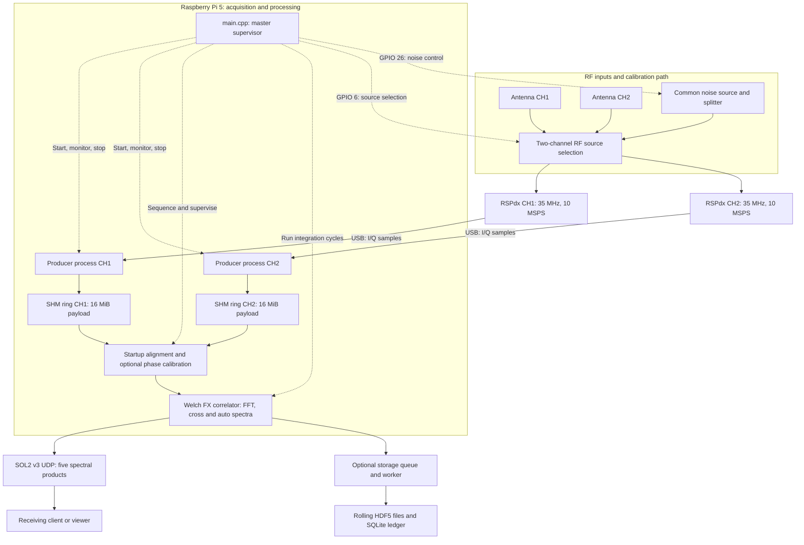
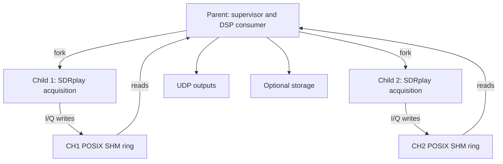
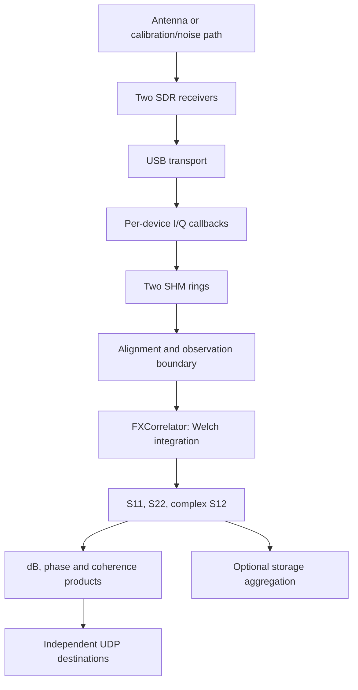

# System Architecture and Master Orchestrator

This document specifies the process model, synchronization contract, DSP data path, output interfaces, and failure policy of the Solar Radio Interferometer. The target system uses a Raspberry Pi 5 and two SDRplay RSPdx receivers, with a nominal complex-sampled RF interval of 30–40 MHz.

**Implementation baseline:** [`ad810d5364a2a10ef51be5429cdf0a49234edcb4`](https://github.com/tuchau1404/solar_correlator/tree/ad810d5364a2a10ef51be5429cdf0a49234edcb4). The supplied `main(1).cpp` is byte-identical to `src/main.cpp` at this revision. Descriptions below refer to this baseline and the checked-in configuration. Runtime timing, physical switch settling, RF calibration accuracy and installed SDK behavior require deployment measurements; source inspection does not certify those properties.

## 1. Purpose, scope, and system contract

### 1.1 System block diagram

Figure 1 presents the complete signal path and the software blocks that control it. Solid arrows carry RF signals, I/Q samples or spectral products. Dashed arrows carry control commands. The RF switching block represents the two-channel antenna/calibration selection function, rather than a component-level wiring schematic.



*Figure 1. System-level signal and control architecture. RF source selection feeds two independent receiver/producer paths; paired sample consumption produces live telemetry and optional scientific archives.*

The two acquisition paths remain separate through the SHM rings. The parent consumes paired samples, establishes the startup alignment/calibration state and then repeatedly runs the correlator. The startup block describes a lifecycle phase, not a separate process or an alignment filter executed on every integration. The master supervisor controls acquisition and processing; it is not an additional sample-copy stage.

The processing chain is **RF selection → dual acquisition → shared-memory buffering → paired DSP → telemetry and storage**. Alignment preserves a relative integer-sample relationship between channels; the software stream gates do not act as a hardware trigger. The detailed process topology in Section 2 and Welch dataflow in Section 4 expand the corresponding blocks of this overview.

### 1.2 Master supervisor and consumer

`main()` is the lifecycle and data-publication coordinator. It validates command-line options, acquires a single-instance lock, discovers receiver serial numbers, launches two acquisition processes, attaches to their shared-memory buffers, initializes DSP and output resources, performs startup alignment and optional phase calibration, and supervises continuous integration. It also coordinates GPIO commands and orderly termination.

The orchestration connects four functional domains:

1. **Acquisition:** SDRplay callbacks in one producer process per receiver.
2. **Startup conditioning:** sample alignment and optional static phase calibration.
3. **Correlation:** the `FXCorrelator` consumer operating on both sample streams.
4. **Publication:** UDP telemetry and an optional storage pipeline.

This grouping is an architectural organization of the visible calls, not a claim about the repository's module numbering. Signal-processing algorithms reside behind included interfaces; `main.cpp` primarily establishes their ordering and operating conditions.

**Design rationale.** Separating acquisition from the consumer permits receiver callbacks to continue while the parent performs integration and publication. Shared-memory buffers decouple short-term producer/consumer scheduling differences. This does not establish hard real-time behavior or unlimited tolerance to consumer stalls.

### 1.3 Configured operating parameters

| Parameter | Value | Implementation |
|---|---:|---|
| RF center | 35 MHz | `config.hpp` |
| Complex sample rate | 10 MSPS per channel | `dsp_config.hpp` |
| Analog IF filter | 8 MHz | `config.hpp`, `sdrplay_api_BW_8_000` |
| Input representation | Signed int16 I + signed int16 Q; 4 bytes/sample | `ComplexSample`, size assertion |
| Antenna input | RSPdx antenna A | `config.hpp` |
| Gain control | AGC disabled; IF gain reduction 30 dB; LNA state 8 | `config.hpp`, producer initialization |
| FFT length N | 2048 | `dsp_config.hpp` |
| Welch hop H | 1024 | Half the FFT length |
| Integration frames M | 1953 | Integer truncation of fs × 0.2 / H |
| Alignment snapshot | 131,072 samples; 13.1072 ms | `config.hpp` |
| Ring capacity | 4,194,304 complex samples/channel | `config.hpp` |
| Integer residual accepted by main | 0 samples | `StartupAlignment::Options` override |
| Fresh alignment confirmations | 3 | `startup_alignment.hpp` |
| Effective startup PNR threshold | 20 dB | Startup default; stricter than aligner's 10 dB validity threshold |
| Alignment attempts | 8 by default; CLI range 1–1000 | `CliOptions` |
| Phase-calibration threshold | Coherence amplitude ≥ 0.10 | `main.cpp` |

The 30–40 MHz interval is the sampled frequency span. The configured analog filter is 8 MHz, so a 10 MHz sampled span must not be interpreted as a measured flat 10 MHz analog passband.

### 1.4 Sample throughput and output reduction

For two receivers delivering four bytes per complex sample:

\[
R_{IQ}=2\times10^7\times4=80{,}000{,}000\ \mathrm{B/s}=80\ \mathrm{MB/s}.
\]

This is sample payload; it excludes transport overhead and memory-copy traffic. Each ring has 16 MiB of payload plus a 384-byte control block: 16,777,600 bytes per mapping, or 33,555,200 bytes for two rings. Capacity corresponds to 419.4304 ms per channel; usable scheduling headroom depends on current occupancy.

At a nominal five output frames/s:

| Output configuration | Spectrum payload rate | Reduction relative to raw I/Q |
|---|---:|---:|
| One float32 spectrum, 2048 bins | 40,960 B/s | 99.9488% |
| Five float32 spectra | 204,800 B/s | 99.744% |
| Five spectra including SOL2 headers | 215,200 B/s | 99.731% |

The actual sample cadence is 199.9872 ms, slightly faster than five frames/s. The table uses the nominal cadence for readability and excludes UDP/IP/link overhead. These are reductions through integration and spectral processing, not lossless compression ratios. Storage retains four linear components rather than the five display products.

## 2. Process and IPC architecture

### 2.1 Process ownership



Each child receives a serial number and SHM name. Each opens its own SDRplay API connection, finds that serial, selects tuner A, retrieves device parameters, initializes callbacks, and marks its ring ready. The parent attaches using the ring constructor's consumer argument `false`; children use producer argument `true`.

The implementation isolates receiver selection and callbacks in separate processes. This is the program's device-ownership model; no vendor-wide single-device restriction is asserted here. The vendor SDK's process and fork requirements remain external interface constraints, rather than properties demonstrated by this application.

### 2.2 Discovery before fork

The parent opens the API, enumerates devices, copies serial numbers, and closes the API before either fork. With no manual serial selection, exactly two discovered devices are required; serials are sorted before assignment. More than two requires explicit selection. Manual serial options must appear together and must differ.

**Design rationale.** Closing the discovery connection keeps receiver acquisition sessions local to their owning child processes. API discovery is complete before process creation; each child subsequently establishes its own API session. This sequence does not replace the vendor SDK’s fork-safety contract.

```cpp
    ChildProcessGuard children;
    children.pid1 = ::fork();
    if (children.pid1 < 0) {
        std::cerr << "[LỖI HỆ THỐNG] Lỗi fork() tiến trình con Kênh 1: " << std::strerror(errno) << "\n";
        return 1;
    }
    if (children.pid1 == 0) {
        instance_lock.close_in_child();
        run_sdr_producer_process(1, ser_ch1, SolarConfig::SHM::CH1_NAME);
    }
```

*Source: `src/main.cpp`, lines 861–870; analogous CH2 branch at lines 872–882.*

### 2.3 Single-instance exclusion

`SingleInstanceLock::acquire()` uses an exclusive, nonblocking file lock before the parent removes old SHM names. The core excerpt below is verbatim from the uploaded source; surrounding error-handling lines are omitted.

```cpp
        fd_ = ::open(lock_path_.c_str(), O_CREAT | O_RDWR | O_CLOEXEC, 0666);
        if (fd_ < 0) {
            err_msg = "Không thể mở lock file " + lock_path_ + ": " + std::strerror(errno);
            return false;
        }
        if (::flock(fd_, LOCK_EX | LOCK_NB) != 0) {
            const int e = errno;
            ::close(fd_);
            fd_ = -1;
            err_msg = "Đã có một phiên solar_correlator hoặc bài test phần cứng khác đang giữ khóa (" +
                      lock_path_ + ": " + std::strerror(e) + "). Từ chối khởi chạy để bảo vệ SHM!";
            return false;
        }
```

*Source: `src/main.cpp`, lines 326–338.*

The lock path is `/tmp/solar_correlator.lock`. Acquisition failure aborts startup. A successful acquisition writes the owner PID. Child branches close their inherited lock descriptor using `close_in_child()`. The parent's release path unlocks and closes but deliberately leaves the inode in place; deleting and recreating the path could permit independent locks on different inodes.

The lock coordinates programs that honor the same locking convention. It is not an access-control boundary against unrelated processes that ignore the lock. The parent retains its lock object until after the later hardware guards are destroyed.

### 2.4 Lock-free SPSC ring buffers

`ring_buffer.hpp` implements one producer and one consumer per ring. `ComplexSample` contains two `int16_t` fields and is statically constrained to four bytes. A 384-byte, cache-line-aligned control block places head, tail, overflow count, readiness and stream gate on separate 64-byte boundaries. Compile-time assertions require `atomic<uint32_t>` and `atomic<bool>` to be always lock-free.

The producer owns head; the consumer owns tail. Producer publication is a release store to head after writing samples. The consumer acquires head before copying samples and release-stores tail after consumption. The producer acquires tail before reusing capacity. Own-index reads use relaxed ordering. Unsigned head-minus-tail arithmetic represents occupancy; indexing uses `(position & (capacity-1))`. Capacity must be a power of two no larger than 2^31, and an observed occupancy above capacity is an invariant violation.

A write is all-or-nothing: if an incoming callback block exceeds free capacity, `write()` increments `overflow_cnt` once and returns zero. Existing samples are not overwritten. The counter measures rejected write events, not the number of lost samples. `main()` treats that short write as a producer fault and stops acquisition.

`read()` and `skip()` advance by at most available occupancy; `peek_from_tail()` requires the complete requested snapshot and does not advance tail. `flush()` copies a committed head snapshot into tail. It discards queued data and does not establish a hardware start epoch.

Producer construction uses `shm_open(O_CREAT|O_EXCL|O_RDWR, 0600)`, sizes the object, and maps it with `MAP_SHARED`. Placement initialization constructs atomic objects and touches the payload. Attachment validates mapping size, magic, ABI version, capacity and mask. Creation and attachment use `flock()` with a five-second internal deadline; the lock-free claim applies to sample transfer, not bootstrap. The parent's nominal ten-second attachment loop contains these constructor calls and is not an exact upper bound on total attachment latency.

On Linux the objects are normally visible through `/dev/shm`. They are shared virtual-memory mappings, not a distinct class of “virtual RAM.” The implementation neither locks pages into memory nor establishes hard real-time scheduling. Its IPC contract explicitly targets Linux/GCC or Clang, a shared ABI and coherent normal memory; it is not a portable ISO C++ interprocess abstraction. Only the consumer may call read/peek/skip/flush/available-read, and teardown must not run concurrently with transfers.

### 2.5 Callback continuity monitoring

`sdr_stream_callback()` discards callbacks before the write gate is opened. Once enabled, it tracks the expected next `firstSampleNum`. Reset, absent callback parameters, sequence mismatch, short ring writes, or exceptions cause `ready=false` and `g_child_running=false`.

```cpp
    auto& rb = *ctx->ring;
    if (!rb.is_stream_started()) return;
    auto fail = [&] { rb.set_ready(false); g_child_running.store(false, std::memory_order_relaxed); };
    if (reset || !params) { fail(); return; }
    if (!numSamples) return;
    if (ctx->have_expected && params->firstSampleNum != ctx->expected_sample) { fail(); return; }
    ctx->expected_sample = static_cast<uint32_t>(params->firstSampleNum + numSamples);
    ctx->have_expected = true;
    try { if (rb.write(xi, xq, numSamples) != numSamples) fail(); }
    catch (...) { fail(); }
```

*Source: `src/main.cpp`, lines 459–468.*

The child's main loop sleeps in 25 ms intervals while callbacks perform acquisition. After the running flag clears, it calls `Uninit`, `ReleaseDevice`, and `Close`, then `_exit(0)`. Consequently, a callback-detected fault does not necessarily produce a nonzero child exit code. The parent also monitors readiness and process termination. The event callback is empty, so no event-specific recovery or overload acknowledgement can be attributed to it.

## 3. State machine and startup sequencing

### 3.1 Enum state versus displayed operating label

Seven enum values exist. `ALIGNED` and `ALIGNED+CAL` are display labels derived from `RUNNING` plus two flags; they are not additional enum states.

```mermaid
stateDiagram-v2
    [*] --> STARTUP
    STARTUP --> ALIGNING: normal startup
    STARTUP --> UNALIGNED: skip alignment
    ALIGNING --> CALIBRATING: alignment returns; cal-phase enabled
    ALIGNING --> RUNNING: alignment returns; no phase calibration
    CALIBRATING --> RUNNING: calibration and observation preparation complete
    UNALIGNED --> RUNNING: observation preparation complete
    RUNNING --> RECOVERING: integration failure or detected overflow
    RECOVERING --> RUNNING: diagnostic recovery succeeds
    RECOVERING --> STOPPING: aligned mode or recovery failure
    STARTUP --> STOPPING: startup failure or cancellation
    ALIGNING --> STOPPING: failure or cancellation
    CALIBRATING --> STOPPING: failure or cancellation
    UNALIGNED --> STOPPING: failure or cancellation
    RUNNING --> STOPPING: signal or health failure
    STOPPING --> [*]
```

This diagram summarizes conceptual transitions. Some startup failures return before the common shutdown block and rely on the guards already constructed. Other health failures throw directly into the outer exception handler without entering `RECOVERING`. Source selection and priming are actions between the depicted stages, not separate enum states.

| Enum | Meaning in this file |
|---|---|
| STARTUP | Validation, discovery, producer launch and resource preparation |
| ALIGNING | Startup alignment acquisition |
| UNALIGNED | Diagnostic startup branch selected by skip-align |
| CALIBRATING | Optional one-cycle static phase measurement |
| RUNNING | Repeated integration/publication; display depends on alignment/calibration flags |
| RECOVERING | Handling a failed/discarded integration; restart is restricted to diagnostic mode |
| STOPPING | Termination requested or fatal condition reached |

### 3.2 Hardware controls and safe defaults

`set_gpio_level()` runs `pinctrl set <pin> op dh/dl` through `std::system()` and reports command success. `force_antenna_off()` attempts both commands, driving the noise-control and RF-switch outputs LOW. Despite its name, the function commands noise OFF and antenna selection; it does not turn the antenna signal path off.

Normal alignment startup constructs `HardwareGuard`, explicitly reasserts RF switch HIGH and noise HIGH, and waits `WARMUP_DELAY_MS`. At observation selection, antenna corresponds to LOW/OFF and noise corresponds to HIGH/ON. `SafeGpioOnExit` issues the LOW commands again at destruction.

The configured outputs are GPIO 6 for the RF switch and GPIO 26 for the noise-source control. Both use active-HIGH calibration commands. `HardwareGuard` waits 200 ms during construction; `main()` then reasserts and checks both HIGH commands and waits another 200 ms. Thus normal startup contains two configured 200 ms warm-up waits before SHM attachment, in addition to the later 200 ms stream-gate warm-up. Antenna source selection waits 100 ms; noise selection waits the larger of warm-up and switch-settle delays, currently 200 ms.

The GPIO controls an external noise-source supply path. Software command completion is not physical readback of switch position or the nominal 15 V supply. `HardwareGuard` itself ignores `system()` status; the orchestrator supplements it with checked commands.

### 3.3 Resource preparation and stream gate

**Startup order:**

1. Validate CLI; optionally perform configuration-only checking and exit.
2. Install SIGINT/SIGTERM handlers and ignore SIGPIPE.
3. Acquire the instance lock; load optional storage configuration and run storage startup checks.
4. Construct the exit GPIO guard, command noise OFF/antenna, and unlink old SHM names.
5. Discover receiver serials and close the discovery API connection.
6. Fork both producers.
7. For normal alignment, select calibration/noise and wait for hardware warm-up.
8. Attach both SHM rings, with a nominal 10 s attachment deadline.
9. Construct the correlator, optional aligner, vectors, UDP senders, and optional storage object.
10. Wait for both `ready` flags, with a 15 s deadline measured from that wait's start.
11. Open the two SHM write gates sequentially, wait 200 ms, then flush both rings.
12. Perform alignment or select the diagnostic branch, optionally calibrate phase, select observation source, and prime the correlator.

The correlator creates its two single-precision FFTW forward plans with `FFTW_MEASURE` before ring writes are enabled. The alignment plans use `FFTW_ESTIMATE`. Two adjacent `set_start_stream(true)` calls are a software gate, not a simultaneous hardware sampling trigger.

### 3.4 Sample alignment

`StartupAlignment::acquire()` receives the two rings, snapshot size, retry limit, a callback that waits for sufficient samples, and a measurement callback invoking `TimeAligner::measure_offset_from_buffers()`. Snapshot waiting uses a 3000 ms timeout and health checks before and after. The maximum accepted integer residual is zero. If acquisition returns normally, the parent sets `is_sample_aligned=true` and checks health again.

`TimeAligner` peeks 131,072 samples from each tail without consuming them. It subtracts each channel's complex DC mean, computes two forward FFTs, multiplies X1 by conj(X2), and performs an inverse FFT. The inverse is divided by snapshot length before finding the maximum complex correlation magnitude. The peak index is converted to a signed circular lag; an exact half-snapshot peak is rejected as ambiguous.

The noise floor is the mean correlation magnitude outside a circular ±16-sample exclusion region around the peak. The estimator computes:

\[
\mathrm{PNR}=20\log_{10}\frac{r_{\mathrm{peak}}}{\overline{r}_{\mathrm{outside}}+10^{-6}}.
\]

Estimator validity requires finite PNR ≥ 10 dB. Startup acceptance additionally requires PNR ≥ 20 dB and |lag| < snapshot_size/2. Positive lag advances CH1; negative lag advances CH2. Each attempt begins with independent flushes; a correction is followed by three fresh verification snapshots. Before each verification both tails advance by a complete snapshot, so candidate samples are not reused. Every verification must satisfy the confidence test and residual exactly zero in the main application. Failed verification restarts the attempt sequence; exhausted attempts throw.

The accepted condition is zero measured integer lag. It is not an assertion of zero fractional delay, absolute UTC synchronization or indefinite phase stability. This revision uses 131,072 samples, superseding the 65,536-sample value in the initial documentation brief.

### 3.5 Optional static phase calibration

`--cal-phase` requires alignment; CLI validation rejects its combination with `--skip-align`/`--no-align`. While the calibration noise path remains selected, the parent primes the correlator and executes one integration with initially zero phase correction. It rejects failed integration, newly observed overflow, nonfinite phase/coherence, or a result where no bin meets the coherence threshold.

```cpp
                        if (coherence[k] >= kMinCalCoherence) {
                            // Output k is shifted; phi is indexed in natural FFT order.
                            phi_rad[(k + n_bins / 2) % n_bins] = phase_rad[k];
                            locked_phase_bins++;
                        } else {
                            phi_rad[(k + n_bins / 2) % n_bins] = 0.0f;
                        }
                    }
```

*Source: `src/main.cpp`, lines 1156–1163.*

Bins meeting `coherence >= 0.10` contribute a measured phase. Other bins receive zero correction. The code translates shifted output indices to natural FFT order using `(k+n_bins/2)%n_bins`. `is_phase_calibrated=true` means at least one bin passed, not that every bin was calibrated. There is no repeated calibration loop in `main()`.

The threshold applies to coherence amplitude gamma, not gamma squared. Phase calibration is a single startup measurement; it neither estimates channel gain nor establishes an absolute astronomical flux scale.

### 3.6 Observation source and paired discard

The fixed source for the session is `antenna` by default or `noise` when requested. In applicable branches the parent commands the source, waits the configured settling delay, and removes queued samples using a common boundary:

```cpp
                const uint32_t boundary = std::max(rb1.available_read(), rb2.available_read());
                skip_pair(boundary);
                check_alignment_health();
                mark("observation_source.paired_boundary");
```

*Source: `src/main.cpp`, lines 1212–1215.*

The local `skip_pair()` helper waits until both rings contain the requested count, then advances both consumers by that count:

```cpp
        auto skip_pair = [&](uint32_t count) {
            if (!wait_for_samples(count, 3000))
                throw std::runtime_error("Paired discard timeout/cancellation");
            if (rb1.skip(count) != count || rb2.skip(count) != count)
                throw std::runtime_error("Short paired discard");
        };
```

*Source: `src/main.cpp`, lines 1073–1078.*

**Design rationale.** Equal advancement preserves an already established relative sample-index relationship, provided no samples were lost and the ring operations satisfy their assumed contract. Independently flushing each ring after alignment would not provide the same paired-advance property.

The boundary is the maximum currently committed occupancy of either ring. It is explicitly not a bound on samples still in SDR/USB transport. Therefore this step cannot by itself certify that all switching transients are absent from future observations. A physical settling measurement would be needed for that claim. Overflow counts are checked around switching.

## 4. Signal processing and publication

### 4.1 End-to-end dataflow



### 4.2 Welch state and integration execution

`FXCorrelator` allocates sample, FFT, accumulation and output arrays during construction. It builds a symmetric Hann window and computes energy from the actual stored float coefficients. Two single-precision FFTW plans use `FFTW_FORWARD` and `FFTW_MEASURE`.

`prime_buffers()` records the overflow baselines, reads exactly H=1024 paired samples, and marks the correlator primed. Each integration reads M further paired hops. Alternating sample-array halves preserve 50% overlap without shifting the entire time-domain window. The final half of an integration becomes the initial overlap of the next integration.

Each input component is scaled by 1/32768 and windowed before the FFT. Cross real/imaginary and both auto powers accumulate in double precision. On AArch64, unless `SOLAR_DISABLE_NEON` is defined, the X-engine processes two complex bins at a time with NEON: FP32 FFT values are widened to FP64 before multiplication. Other targets use a scalar loop. This explicit NEON path belongs to correlation/accumulation; the selected FFTW library's internal SIMD configuration is a separate build dependency.

A cycle-wide five-second deadline, cancellation checks and overflow-baseline checks run while waiting for hops and at completion. Exceptions invalidate priming. Fast-math compilation is rejected in `correlator.cpp`; CMake also supplies `-fno-fast-math -ffp-contract=off` for GNU/Clang.

The parent wrapper supports boolean- or void-returning APIs. In this revision `process_integration_cycle()` and `prime_buffers()` return void: a normal return plus the running flag is reported as success; processing faults throw.

```cpp
                    bool cycle_ok = false;
                    std::string cycle_err_msg;
                    try {
                        cycle_ok = api_bridge::invoke_integration_cycle(
                            fx, rb1, rb2, phi_rad, s12_db, phase_rad, coherence);
                    } catch (const std::exception& ex) {
                        cycle_ok = false;
                        cycle_err_msg = ex.what();
                    }
```

*Source: `src/main.cpp`, lines 1272–1280.*

After an accepted cycle, `main()` converts auto powers to dB, creates a host timestamp, sends enabled products, and submits the four linear spectral components to storage.

### 4.3 Frequency axis

`bin_to_freq_mhz()` uses:

\[
f[k]=f_c+\left(k-\frac{N}{2}\right)\frac{f_s}{N},\qquad 0\le k<N.
\]

For the configured N=2048, fs=10 MHz and fc=35 MHz:

\[
\Delta f=4.8828125\ \mathrm{kHz},\qquad
f[k]=35\ \mathrm{MHz}+(k-1024)\times4.8828125\ \mathrm{kHz}.
\]

Bin 0 is centered at 30 MHz; bin 1024 at 35 MHz; bin 2047 at 39.9951171875 MHz. The nominal upper band edge of 40 MHz is not the last bin center. This is bin spacing, not a measured passband or proof of usable edge sensitivity.

### 4.4 DSP convention and normalization

For channel i and Welch frame m, define the unnormalized transform of ADC-count samples:

\[
w[n]=\frac12\left(1-\cos\frac{2\pi n}{N-1}\right),\quad
X_{i,m}[k]=\sum_{n=0}^{N-1}w[n]x_i[n+mH]e^{-j2\pi kn/N}.
\]

Let U be the sum of squares of the actual stored window coefficients. The reported spectra are:

\[
S_{ii}[k]=\frac{1}{MNU}\sum_{m=0}^{M-1}|X_{i,m}[k]|^2,
\]

\[
S_{12}[k]=\frac{e^{-j\phi_{\mathrm{cal}}[k]}}{MNU}
\sum_{m=0}^{M-1}X_{1,m}[k]X_{2,m}^{*}[k].
\]

Internally the transform input is divided by 32768; the final normalization multiplies by 32768² to restore ADC-count² units. Static phase rotation is applied once after accumulation because it commutes with the frame sum. It changes complex phase but not magnitude or auto powers.

The cross-product convention is X1 × conj(X2). For a cross sum a+jb, rotation by exp(-j phi) gives real=a cos(phi)+b sin(phi) and imaginary=b cos(phi)-a sin(phi). Reversing channel order changes the phase sign.

The correlator reports amplitude coherence:

\[
\gamma[k]=\frac{|S_{12}[k]|}{\sqrt{S_{11}[k]}\sqrt{S_{22}[k]}}.
\]

A zero denominator yields zero. Nonfinite output, negative powers or gamma greater than 1+10^-9 raise an exception; accepted gamma is clamped to [0,1]. Phase is atan2(Im,Re), with zero phase for zero magnitude. All output arrays are FFT-shifted using j=(k+N/2) mod N, while the phase-correction vector uses natural FFT order.

The normalization yields mean power per input FFT bin in ADC-count². It is not a power spectral density per Hz, dBm measurement or calibrated flux density. The nominal bin spacing is distinct from Hann equivalent noise bandwidth.

### 4.5 dB conversion and units

`convert_linear_auto_power_to_db()` replaces nonfinite or negative inputs with 10^-12, clamps other inputs to at least that floor, and computes:

\[
P_{\mathrm{dB}}=10\log_{10}\left(\max(P,10^{-12})\right)
\]

for finite nonnegative P. The floor produces -120 dB. S12 uses the same 10 log10 rule on the complex cross-spectrum magnitude inside the correlator.

The display unit is dB re 1 ADC-count² per input FFT bin. Frequency grouping is described as a linear mean of input-bin powers, not a sum over grouped bandwidth; this distinction matters when interpreting output units.

### 4.6 Integration timing

For N=2048, H=1024, M=1953, and fs=10 MHz:

\[
T_{\mathrm{advance}}=\frac{MH}{f_s}=199.9872\ \mathrm{ms},
\]

\[
T_{\mathrm{support}}=\frac{N+(M-1)H}{f_s}=200.0896\ \mathrm{ms}.
\]

The first is the nominal sample advance per successive integration; the second is the sample support of M overlapping transforms. The configured sample geometry therefore gives a nominal 200 ms integration. CPU runtime, queue latency and output cadence must be measured. The archived host tests do not establish sustained Raspberry Pi throughput or hard real-time deadline compliance.

## 5. UDP telemetry and optional storage

### 5.1 SOL2 v3 nonblocking telemetry

All enabled senders share a nonzero random session identifier created by `getrandom()`. Each accepted integration uses a common frame ID and timestamp across products. Defaults are defined by `config.hpp` and `network_config.hpp`:

| Product | Type ID | Port |
|---|---:|---:|
| Cross-spectrum magnitude, dB | 1 | 9999 |
| CH1 auto power, dB | 2 | 9998 |
| CH2 auto power, dB | 3 | 9997 |
| Phase, rad | 4 | 9996 |
| Amplitude coherence gamma | 5 | 9995 |

The default IPv4 destination is `192.168.10.1`. S12 cannot be disabled; port zero disables another product. Active ports must differ.

`TelemetrySender` creates `SOCK_DGRAM | SOCK_NONBLOCK | SOCK_CLOEXEC` sockets, requests a 256 KiB send buffer and uses `MSG_DONTWAIT`. Path-MTU discovery is set to `IP_PMTUDISC_DO`: an undersized path produces a send error rather than deliberate IP fragmentation. The send path performs no user-space allocation, retry or sleep.

Each spectrum is split into eight application-level chunks of 256 bins. A datagram contains a 52-byte header and 1024-byte payload, totaling 1076 bytes before UDP/IP headers. Integers and IEEE-754 binary32 payload words use big-endian order; no native C++ struct is serialized.

| Byte offset | Width | Field |
|---:|---:|---|
| 0 | 4 | Magic 0x534F4C32, SOL2 |
| 4 | 2 | Version, 3 for typed products |
| 6 | 2 | Header size, 52 |
| 8 | 8 | Session ID |
| 16 | 8 | Frame ID |
| 24 | 8 | Host timestamp, microseconds |
| 32 | 4 | Integration frame count, 1953 |
| 36 | 4 | Flags: bit 0 FFT-shifted; payload type shifted left by 8 |
| 40 | 2 | Total bins, 2048 |
| 42 | 2 | Chunk index, 0–7 |
| 44 | 2 | Chunk count, 8 |
| 46 | 2 | Bins per chunk, 256 |
| 48 | 4 | Starting bin offset |
| 52 | 1024 | Float32 spectrum values |

All payload values must be finite. On any failed datagram, the sender abandons the remainder of that product's frame and records the error and successfully queued chunk count. There is no retransmission or receiver acknowledgement. `queued=true` means that all eight datagrams were accepted by the local kernel; receiver delivery and complete reassembly remain separate concerns. The two-argument constructor retains legacy v2 behavior, but `main()` explicitly constructs typed v3 senders.

### 5.2 Timestamp semantics

`current_utc_timestamp_us()` reads `system_clock` and converts its epoch duration to microseconds. It is called after successful integration and auto-power conversion, before publication. This is a host processing-time timestamp, not an ADC sample's hardware timestamp. USB, SHM and processing latency are not measured by this timestamp; deployment clock discipline determines UTC accuracy.

Storage estimates sample support from a processing-time anchor at the start of a segment. It advances relative sample positions by M×H and preserves original backend timestamps. A nonconsecutive frame ID starts a new segment and anchor. These estimated UTC fields carry the UTC_ESTIMATED quality flag; they are not hardware timestamps.

### 5.3 Storage worker, aggregation and HDF5 lifecycle

CMake enables `SOLAR_BUILD_STORAGE` by default. The target links HDF5, SQLite3 and nlohmann_json, and defines `SOLAR_STORAGE_ENABLED` for the acquisition application. Runtime archiving additionally requires `--config` and `storage.enabled=true`. Configuration-only checking exits before SDR and GPIO initialization.

The pipeline is constructed with deferred startup. After optional phase calibration, `start_observation()` copies the current calibration, updates alignment metadata, and starts a worker thread. This occurs before observation-source switching; actual records are submitted only after source selection and final DSP priming.

```cpp
                    if (storage) storage->try_submit(telemetry_frame_id,timestamp_us,
                        fx.auto_power1(),fx.auto_power2(),fx.cross_real(),fx.cross_imag());
```

*Source: `src/main.cpp`, lines 1355–1356.*

The DSP thread submits four double-precision arrays: S11, S22, Re(S12), Im(S12). A preallocated SPSC queue copies them into owned slots. Full queues and disabled/paused/error states reject records and increment a drop counter; `main()` does not inspect the returned enum. Storage failures can therefore degrade archival completeness while UDP/DSP continue. This differs from sample-continuity failures, which stop aligned acquisition.

The worker aggregates whole contiguous integrations to meet or exceed the requested save interval. The count is ceil(requested_interval/source_cadence). Frequency grouping computes linear means of contiguous bins. Temporal accumulation is weighted by valid FFT-frame counts, and all four components share a strict invalid-bin mask. Calibration changes and discontinuities terminate an aggregation window according to the configured emit/discard policy. Derived magnitude and phase must be computed from the averaged complex components rather than averaged dB or phase angles.

The checked-in `config/solar_storage.json` selects:

| Setting | Value |
|---|---:|
| Save interval | 0.1999872 s; one source integration |
| Saved frequency bins | 2048 |
| Queue capacity | 150 records |
| Append batch / HDF5 chunk rows | 16 / 16 |
| Rotation | 15 minutes and observation-day boundaries |
| Compression | none; writer also supports gzip |
| Periodic flush | 10 s |
| Shutdown drain timeout | 15 s |
| Per-file byte cap | 200,000,000 bytes |
| Daily budget | 24,000,000,000 bytes |

These settings preserve the input frequency grid and integration cadence; coarser archival reduction requires a different configuration. A file cap is enforced by the custom HDF5 VFD. It is not a promise of successful size-triggered rolling: cap/I/O failures enter quarantine/error handling. Free-space and budget checks may pause storage.

Files are created exclusively with a `.tmp` suffix. Normal closure appends remaining batch data, flushes/closes HDF5, publishes using no-replace `renameat2`, fsyncs the containing directory, and marks the artifact ready in the SQLite budget ledger. The custom VFD uses fsync for file flushes. Power-loss durability still depends on the filesystem and storage device.

| HDF5 location | Contents |
|---|---|
| `/metadata` | Configuration hash, session/source, revision, normalization, calibration and quality declarations |
| `/frequency_hz` | Float64 centers of saved frequency groups |
| `/calibration_phi_rad_unshifted` | Float32 phase-correction vector in natural FFT order |
| `/data/s11_linear`, `/data/s22_linear` | Extendable float32 auto spectra |
| `/data/s12_real`, `/data/s12_imag` | Extendable float32 phase-corrected cross spectra |
| `/data` timing/identity fields | Sample support, estimated UTC start/end/midpoint, backend timestamps, frame ranges and valid FFT count |
| `/data/quality_flags` | UTC estimate, invalid bin, partial window, discontinuity, calibration boundary and coherence-violation bits |

`Pipeline::stop()` requests termination and joins its worker. The worker drains within the configured deadline, discards remaining queued records after that deadline, and handles its last partial aggregation according to policy. The drain timeout bounds queue-drain logic, not every possible blocking filesystem operation.

### 5.4 Automatic maintenance

`AutoMaintenance` launches `scripts/storage_auto.py` using `posix_spawnp` in a separate process group. The parent checks its process status every observation iteration; an unexpected exit throws and stops the observation. Shutdown sends SIGTERM to the group, waits up to five seconds, and uses SIGKILL as necessary.

The checked-in configuration enables quicklook generation, rclone-based remote synchronization and retention. These are delegated maintenance services, not work performed in the DSP integration loop. Configuration includes remote verification and cleanup policies; credentials, remote availability and successful execution are deployment requirements. The acquisition state machine and storage worker state machine remain distinct.

## 6. Health supervision and fail-closed policy

### 6.1 Health checks at multiple boundaries

The parent monitors child termination using `waitpid(..., WNOHANG)`, ring readiness, and overflow counters. Alignment-mode health checks compare overflow counters against baselines initialized to zero; those baselines are not advanced in this file. Overflow from the stream-gate period is therefore treated as fatal even outside an integration boundary.

```cpp
        auto check_alignment_health = [&]() {
            std::string err;
            if (!children.check_children_alive(err) || !rb1.is_ready() || !rb2.is_ready()) {
                mark("health.producer_failure");
                throw std::runtime_error("[ALIGNMENT_LOST] Producer stopped/reset: " + err);
            }
            if (!cli.skip_align &&
                (rb1.get_overflow_count() != aligned_drops1 ||
                 rb2.get_overflow_count() != aligned_drops2)) {
                mark("health.overflow");
                throw std::runtime_error("[ALIGNMENT_LOST] Sample drop since stream gate");
            }
        };
```

*Source: `src/main.cpp`, lines 1060–1072.*

The code also captures counts immediately before and after integration. A false cycle result, caught integration exception, or changed counter discards that cycle and enters the explicit recovery branch. A later health check occurs before output publication. Startup, source selection and calibration have additional checks.

These checks observe discrete boundaries. They do not form a transaction with callback execution or network transmission; a producer fault can occur after a health snapshot. Overflow counting uses a wrapping uint32_t rejected-write counter; callbacks stop on the first rejected write.

### 6.2 Why aligned acquisition stops on loss

A discontinuity can change the relationship between sample positions in the two channels. Static phase correction was obtained for a particular acquisition relationship. Resuming after arbitrary independent flushes would not demonstrate that this relationship still holds. The software therefore treats observed continuity loss as invalidating the existing observation contract instead of silently declaring alignment retained.

**Failure handling:**

| Condition | Visible response |
|---|---|
| Child terminated or readiness false | Health exception or supervisor stop; no automatic producer restart |
| Overflow seen by normal-mode health check | Exception and shutdown, potentially bypassing RECOVERING |
| Failed cycle or overflow detected inside cycle boundary, phase calibrated | Discard integration and stop |
| Same cycle failure with skip-align enabled | Independent flushes, re-prime and resume if permitted |
| Same cycle failure in aligned, noncalibrated mode | Stop |
| More than five diagnostic recovery attempts | Stop |
| Failed diagnostic re-prime | Stop |

The diagnostic recovery counter is cumulative for the session; it is not reset after a successful cycle. The frame ID is incremented for a discarded integration so subsequent output can contain a visible gap. This does not identify packet losses that occur elsewhere.

### 6.3 Graceful shutdown and scope lifetimes

**Common shutdown path:**

1. Exit the processing scope. Locally constructed DSP, sender, ring-reader and optional storage objects are destroyed as that scope ends.
2. Set state to STOPPING and clear the parent running flag.
3. Request `HardwareGuard::turn_off()` if present.
4. Explicitly command noise OFF and antenna selection, including noise observations that skipped alignment.
5. Send SIGTERM to remaining children and poll `waitpid` for up to 3000 ms.
6. SIGKILL any remaining child and perform a blocking `waitpid` reap.
7. Stop automatic maintenance when compiled in.
8. Unlink both SHM names.
9. On function exit, later-scope guards are destroyed before the instance lock is released. The GPIO exit guard repeats the safe-level commands.

This order matters: the storage pointer is inside the try scope, whereas maintenance and the hardware guard are outside it. The pipeline destructor calls `stop()` and joins the storage worker before the explicit post-scope acquisition teardown. Maintenance is stopped later by its own process-group shutdown routine. Some early returns follow different subsets of the sequence.

SIGINT/SIGTERM handlers set flags; they do not directly run teardown. The signal handlers use atomic boolean stores; the ring header statically requires `atomic<bool>` to be always lock-free for supported builds. The intended graceful path cannot cover power loss, SIGKILL of the parent, or failed physical actuators. Process reaping and GPIO command attempts are software actions, not physical-state certification.

## 7. Command-line reference

The following defaults are compiled from the baseline configuration.

| Option | Default | Validation and behavior |
|---|---|---|
| `--dest-ip <ip>` | `192.168.10.1` | IPv4 literal validated by `inet_pton` |
| `--port-s12 <port>` | 9999 | 1–65535; cannot disable |
| `--port-s11 <port>` | 9998 | 0–65535; 0 disables |
| `--port-s22 <port>` | 9997 | 0–65535; 0 disables |
| `--port-phase <port>` | 9996 | 0–65535; 0 disables |
| `--port-coherence <port>` | 9995 | 0–65535; 0 disables |
| `--skip-align`, `--no-align` | false | Diagnostic branch; incompatible with cal-phase |
| `--input-source <antenna\|noise>` | antenna | Fixed observation source selected after startup conditioning |
| `--cal-phase` | false | One startup phase-calibration cycle after alignment |
| `--max-align-retries <n>` | 8 | Integer 1–1000 |
| `--serial-ch1 <serial>` | automatic | Must be supplied with serial-ch2; serials must differ |
| `--serial-ch2 <serial>` | automatic | Must match a discovered device |
| `--config <path>` | absent | Requires storage-enabled build; parser message refers to `SOLAR_BUILD_STORAGE=ON` |
| `--check-config` | false | Requires config; validates/prints estimate and exits before SDR/GPIO startup |
| `-h`, `--help` | false | Prints usage and exits |

Enabled output ports must be pairwise distinct. Unknown options are rejected. Legacy `--port-aux` and `--aux-mode` are explicitly rejected with migration guidance. Help returns early during parsing, so it is not equivalent to validating all other supplied arguments.

### 7.1 Operation examples

The executable, serials, IP and configuration paths below are placeholders. Replace them with verified deployment values. These are invocation examples, not records of successful hardware runs.

```bash
# Aligned antenna observation; no static phase calibration requested.
/path/to/solar_correlator --input-source antenna

# Aligned antenna observation with one startup static phase calibration.
/path/to/solar_correlator --cal-phase --input-source antenna

# CW or dummy-load diagnostic acquisition; sample alignment is skipped.
/path/to/solar_correlator --skip-align --input-source antenna

# Noise observation following normal sample alignment.
/path/to/solar_correlator --input-source noise

# Noise observation following sample alignment and phase calibration.
/path/to/solar_correlator --cal-phase --input-source noise

# Explicit channel mapping and receiver destination.
/path/to/solar_correlator --serial-ch1 CH1_SERIAL --serial-ch2 CH2_SERIAL \
  --dest-ip 192.0.2.10 --port-s12 9999 --port-s11 9998 --port-s22 9997 \
  --port-phase 9996 --port-coherence 9995

# Storage-enabled observation using an existing configuration file.
/path/to/solar_correlator --config /path/to/observation.json --cal-phase

# Configuration-only validation and estimate; no receiver initialization.
/path/to/solar_correlator --config /path/to/observation.json --check-config
```

A dummy load or CW input is an external setup; selecting skip-align does not connect such a source. Selecting noise does not itself enable phase calibration. These distinctions should remain explicit in deployment procedures.

## 8. Implementation references and validation boundary

The implementation baseline is pinned at the beginning of this document. The source map below is the entry point for maintenance and review; source comments and older narrative documents do not override executable code or active configuration.

| Concern | Primary source |
|---|---|
| Lifecycle, CLI, process supervision | [src/main.cpp](https://github.com/tuchau1404/solar_correlator/blob/ad810d5364a2a10ef51be5429cdf0a49234edcb4/src/main.cpp) |
| RF, GPIO, SHM and alignment constants | [src/config.hpp](https://github.com/tuchau1404/solar_correlator/blob/ad810d5364a2a10ef51be5429cdf0a49234edcb4/src/config.hpp) |
| FFT, sample rate and cadence | [src/dsp_config.hpp](https://github.com/tuchau1404/solar_correlator/blob/ad810d5364a2a10ef51be5429cdf0a49234edcb4/src/dsp_config.hpp) |
| Destination address and protocol magic | [src/network_config.hpp](https://github.com/tuchau1404/solar_correlator/blob/ad810d5364a2a10ef51be5429cdf0a49234edcb4/src/network_config.hpp) |
| Shared-memory ABI and SPSC operations | [src/ring_buffer.hpp](https://github.com/tuchau1404/solar_correlator/blob/ad810d5364a2a10ef51be5429cdf0a49234edcb4/src/ring_buffer.hpp) |
| Lag estimator and startup acceptance | [src/time_alignment.cpp](https://github.com/tuchau1404/solar_correlator/blob/ad810d5364a2a10ef51be5429cdf0a49234edcb4/src/time_alignment.cpp), [src/startup_alignment.hpp](https://github.com/tuchau1404/solar_correlator/blob/ad810d5364a2a10ef51be5429cdf0a49234edcb4/src/startup_alignment.hpp) |
| Hardware guard | [src/hardware_control.hpp](https://github.com/tuchau1404/solar_correlator/blob/ad810d5364a2a10ef51be5429cdf0a49234edcb4/src/hardware_control.hpp) |
| Welch, normalization and NEON X-engine | [src/correlator.cpp](https://github.com/tuchau1404/solar_correlator/blob/ad810d5364a2a10ef51be5429cdf0a49234edcb4/src/correlator.cpp) |
| SOL2 serializer and nonblocking sockets | [src/telemetry_sender.hpp](https://github.com/tuchau1404/solar_correlator/blob/ad810d5364a2a10ef51be5429cdf0a49234edcb4/src/telemetry_sender.hpp) |
| Storage queue and aggregation | [src/storage/storage_queue.hpp](https://github.com/tuchau1404/solar_correlator/blob/ad810d5364a2a10ef51be5429cdf0a49234edcb4/src/storage/storage_queue.hpp), [src/storage/storage_aggregator.cpp](https://github.com/tuchau1404/solar_correlator/blob/ad810d5364a2a10ef51be5429cdf0a49234edcb4/src/storage/storage_aggregator.cpp) |
| HDF5 pipeline and file limits | [src/storage/storage_pipeline.cpp](https://github.com/tuchau1404/solar_correlator/blob/ad810d5364a2a10ef51be5429cdf0a49234edcb4/src/storage/storage_pipeline.cpp), `hdf5_writer.cpp`, `bounded_hdf5_vfd.cpp` |
| Maintenance process and configuration | [src/storage/storage_config.cpp](https://github.com/tuchau1404/solar_correlator/blob/ad810d5364a2a10ef51be5429cdf0a49234edcb4/src/storage/storage_config.cpp), [config/solar_storage.json](https://github.com/tuchau1404/solar_correlator/blob/ad810d5364a2a10ef51be5429cdf0a49234edcb4/config/solar_storage.json) |
| Dependencies and compile flags | [CMakeLists.txt](https://github.com/tuchau1404/solar_correlator/blob/ad810d5364a2a10ef51be5429cdf0a49234edcb4/CMakeLists.txt) |

### 8.1 Existing test evidence

The repository contains archived test results under `docs/audit_v2/evidence`. `ctest.log` records passes for telemetry-sender, storage-core and startup-alignment contracts. `dsp.log` records tone/phase tests, comparison against long-double DFT results, Parseval checks, cross-cycle overlap continuity, invalid-input and discontinuity cases. `callback.log` records callback sequence-wrap, gap, reset and full-ring cases. `deferred.log` records a queue-to-aggregation-to-HDF5/SQLite/quicklook smoke test.

These are checked-in historical results, not tests rerun for this documentation update. The DSP evidence explicitly limits itself to the host architecture and does not certify ARM execution time. It must not be presented as a new Raspberry Pi throughput or RF performance measurement.

### 8.2 Instrument-level limits

The implemented calibration contract consists of startup integer-sample alignment and optional static phase correction. A zero integer residual is not a fractional-delay measurement or hardware UTC anchor. Phase-calibrated status does not imply every frequency bin passed the calibration threshold. Fixed gain settings are not gain calibration, and ADC-count spectra are not calibrated solar flux measurements.

Absolute timing, analog passband flatness, receiver reference-lock state, long-term phase/gain stability and physical switching transients require instrument measurements. The software gates, sample counters, timestamp estimates and output metadata expose the corresponding software contracts without substituting for those measurements.
