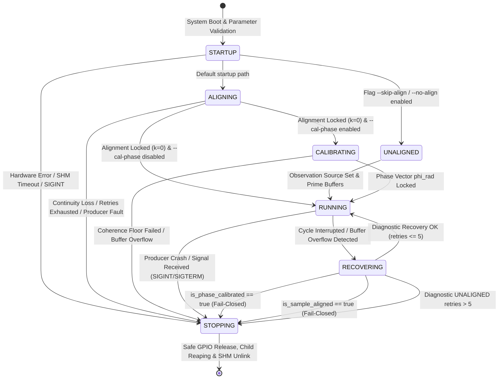

# Solar Radio Interferometer: Firmware & DSP Architecture Specification
**Document Path:** `docs/02-firmware-dsp/architecture.md`  
**Reference Repository:** `https://github.com/tuchau1404/solar_correlator`  
**Surveyed Source Code:** `src/main.cpp` (Snapshot inspection; build metadata macros `SOLAR_BASELINE_REVISION` and `SOLAR_PATCH_STATE` referenced)  
**Verification Scope & Limitations:** Evaluated directly against `src/main.cpp`. The exact Git commit SHA is marked as *Unverified from provided source* due to the absence of the `.git` metadata directory in the examined workspace. All behaviors documented herein reflect direct code analysis, configuration bindings, and explicitly stated mathematical and engineering inferences.

---

## Section 1 — Overview & Scope

The `src/main.cpp` module serves as the **Master Supervisor & Consumer Pipeline** for the dual-element Solar Radio Correlator operating in the $30.0 - 40.0\text{ MHz}$ frequency band. The program orchestrates the multi-process lifecycle of two SDRplay RSPdx software-defined radio receivers, coordinates hardware RF switching and noise calibration via Raspberry Pi 5 GPIO pins, enforces integer-sample time alignment, executes a pipelined Welch FX cross-correlator, and streams multi-product SOL2 v3 UDP telemetry alongside optional downsampled storage aggregation.

```
                      +---------------------------------------+
                      |          src/main.cpp (Parent)        |
                      |   Master Supervisor & Data Consumer   |
                      +---------------------------------------+
                        |                 |                 |
       Fork & Supervise |                 | Read I/Q        | Control GPIO
                        v                 v                 v
            +--------------------+   +----------+   +-------------------+
            | 2x Child Producers |-->| POSIX    |   | HardwareGuard /   |
            | (SDRplay RSPdx)    |   | SHM Ring |   | RF Switch & Noise |
            +--------------------+   +----------+   +-------------------+
                                          |
                                          v
                             +--------------------------+
                             | Welch FX Correlator      |
                             | (FFT, Auto/Cross, Phase) |
                             +--------------------------+
                                          |
                        +-----------------+-----------------+
                        | UDP Dispatch                      | Archival Storage
                        v                                   v
             +--------------------+               +--------------------+
             | Multi-port SOL2 v3 |               | Storage Pipeline   |
             | UDP Telemetry      |               | (JSON Configured)  |
             +--------------------+               +--------------------+
```

### Verified System Parameters

| Parameter | Nominal / Verified Value | Source / Verification Level | Technical Meaning & Physical Bounds |
| :--- | :--- | :--- | :--- |
| **Sample Rate ($f_s$)** | $10.0\text{ MSPS}$ ($10^7\text{ samples/s}$) | Config: `SolarConfig::SDR::SAMPLE_RATE_HZ` | Complex sampling rate per channel. Upper bounded by USB 3.0 controller bandwidth and host IPC throughput. |
| **Sample Format** | Interleaved `int16_t` (I) + `int16_t` (Q) | Code: `sdr_stream_callback(short* xi, short* xq, ...)` | Raw 14-bit ADC samples sign-extended to 16 bits ($4\text{ bytes/complex sample}$). |
| **Dual-Channel Raw Payload** | $80.0\text{ MB/s}$ ($\approx 76.29\text{ MiB/s}$) | Calculated: $2 \times f_s \times 4\text{ B/sample}$ | Aggregate raw I/Q payload delivered into POSIX shared memory, excluding USB transport overhead. |
| **FFT Size ($N$)** | $2048$ bins | Config: `SolarConfig::Correlator::FFT_SIZE` | Discrete Fourier Transform frame length for F-Engine spectral decomposition. |
| **Hop Size ($H$)** | $1024$ samples | Config: `SolarConfig::Correlator::HOP_SIZE` | Window slide stride, establishing an exact $50\%$ Welch window overlap ($N - H = 1024$). |
| **Integration Frames ($M$)** | $1953$ frames | Config: `SolarConfig::Correlator::INTEGRATION_FRAMES` | Number of Welch periodograms accumulated per integration cycle ($T_{\text{advance}} \approx 200\text{ ms}$). |
| **Snapshot Size** | $65,536$ samples ($2^{16}$) | Config: `SolarConfig::Alignment::SNAPSHOT_SIZE` | Sample block length captured for cross-correlation coarse delay offset estimation. |
| **Ring Buffer Capacity** | $4,194,304$ samples ($2^{22}$) | Config: `SolarConfig::SHM::BUFFER_CAPACITY` | Circular buffer capacity per channel, equivalent to $16\text{ MiB}$ of shared memory ($4\text{ B} \times 2^{22}$). |
| **RF Center Frequency ($f_c$)** | $35.0\text{ MHz}$ | Config: `SolarConfig::SDR::RF_CENTER_FREQ_HZ` | Tuner local oscillator (LO) frequency, centering the $30.0 - 40.0\text{ MHz}$ observation band. |

*Unit Definitions:*
- $1\text{ MB} = 10^6\text{ bytes} = 1,000,000\text{ bytes}$.
- $1\text{ MiB} = 2^{20}\text{ bytes} = 1,048,576\text{ bytes}$.
- Dual-channel raw I/Q data rate: $2 \times 10,000,000\text{ samples/s} \times 4\text{ bytes/sample} = 80,000,000\text{ bytes/s} = 80.0\text{ MB/s} \approx 76.2939\text{ MiB/s}$.

### Data Rate Reduction Analysis

The Welch cross-correlator performs **lossy dimensionality reduction and temporal spectral integration**. It reduces time-domain complex voltage series into integrated power and phase spectra; it is explicitly **not** lossless compression.

*Derivation Assumptions:*
- Sampling rate: $f_s = 10.0\text{ MSPS}$.
- One full integration advances the stream by $M \times H$ samples:
  $$M \times H = 1953 \times 1024 = 1,999,872\text{ samples}$$
- Frame period (cadence):
  $$T_{\text{advance}} = \frac{1,999,872}{10,000,000\text{ samples/s}} = 0.1999872\text{ s} \approx 0.2\text{ s}$$
- Output frame generation rate:
  $$R_{\text{frame}} = \frac{1}{0.1999872\text{ s}} \approx 5.00032\text{ frames/s}$$
- Each spectrum consists of $N = 2048$ bins in 32-bit single-precision floating point format ($4\text{ bytes/bin}$), yielding $2048 \times 4 = 8192\text{ bytes/vector}$.

1. **Single UDP Product (e.g., $S_{12}$ Cross-Power only):**
   - Payload bandwidth:
     $$\text{Rate}_{S12} = 8192\text{ bytes} \times 5.00032\text{ frames/s} \approx 40,962.6\text{ B/s} \approx 40.96\text{ kB/s} \approx 0.041\text{ MB/s}$$
   - Data reduction ratio relative to $80.0\text{ MB/s}$ raw stream:
     $$\text{Reduction Ratio} = \frac{80,000,000\text{ B/s}}{40,962.6\text{ B/s}} \approx 1953.0\times \quad (99.9488\%\text{ reduction})$$

2. **All Five UDP Telemetry Products Enabled ($S_{12}, S_{11}, S_{22}, \text{Phase}, \text{Coherence}$):**
   - Combined payload per frame: $5 \times 8192\text{ bytes} = 40,960\text{ bytes/frame}$.
   - Aggregate telemetry egress rate:
     $$\text{Rate}_{\text{all}} = 40,960\text{ bytes} \times 5.00032\text{ frames/s} \approx 204,813\text{ B/s} \approx 204.81\text{ kB/s} \approx 0.205\text{ MB/s}$$
   - Data reduction ratio:
     $$\text{Reduction Ratio} = \frac{80,000,000\text{ B/s}}{204,813\text{ B/s}} \approx 390.6\times \quad (99.744\%\text{ reduction})$$

3. **Storage Pipeline Egress:**
   - Governed dynamically by the JSON configuration schema via `--config` (`save_freq_bins`, `save_interval_sec`).
   - *Confirmed Behavior:* Bins are downsampled to `save_freq_bins` and averaged across `save_interval_sec`. Egress bandwidth is dependent entirely on user-defined aggregation parameters.

---

## Section 2 — Process & IPC Architecture

### Process Hierarchy & Shared Memory Topology

```
+-----------------------------------------------------------------------------------------+
|                                  PARENT PROCESS (MAIN)                                  |
| - Probe hardware -> Map Serial Numbers -> sdrplay_api_Close()                           |
| - Acquire SingleInstanceLock("/tmp/solar_correlator.lock")                              |
| - fork() -> Child 1 & Child 2                                                           |
| - Attach SHM RingBuffers 1 & 2 -> Await is_ready() -> Dispatch set_start_stream(true)   |
| - Welch FX Correlator (F-Engine/X-Engine) -> UDP Dispatcher -> Archival Storage         |
+-----------------------------------------------------------------------------------------+
       |                                                            |
       | fork()                                                     | fork()
       v                                                            v
+----------------------------------+         +----------------------------------+
|     CHILD 1 PRODUCER PROCESS     |         |     CHILD 2 PRODUCER PROCESS     |
| - close_in_child(lock)           |         | - close_in_child(lock)           |
| - Open SHM CH1 (Producer)        |         | - Open SHM CH2 (Producer)        |
| - sdrplay_api_Open()             |         | - sdrplay_api_Open()             |
| - SelectDevice(Serial 1)         |         | - SelectDevice(Serial 2)         |
| - sdrplay_api_Init()             |         | - sdrplay_api_Init()             |
| - set_ready(true)                |         | - set_ready(true)                |
+----------------------------------+         +----------------------------------+
       |                                                            |
       | Write samples via Stream Callback                          | Write samples via Stream Callback
       v                                                            v
+----------------------------------+         +----------------------------------+
|      POSIX SHM: CH1_NAME         |         |      POSIX SHM: CH2_NAME         |
|  Lock-Free SPSC Ring Buffer      |         |  Lock-Free SPSC Ring Buffer      |
|  Capacity: 2^22 complex samples  |         |  Capacity: 2^22 complex samples  |
|  Head (Producer) / Tail (Parent) |         |  Head (Producer) / Tail (Parent) |
+----------------------------------+         +----------------------------------+
       ^                                                            ^
       |                                                            |
       +-------------------- Read samples by Parent ----------------+
```

### Device Enumeration & Multi-Process Decoupling

1. **Pre-fork Hardware Probing:**
   The parent process opens the SDRplay API service, locks the device table via `sdrplay_api_LockDeviceApi()`, queries available RSPdx units using `sdrplay_api_GetDevices()`, verifies or maps serial numbers, and **explicitly closes the API** with `sdrplay_api_Close()` prior to executing `fork()`:
   ```cpp
   // Excerpt: src/main.cpp (main)
   (void)sdrplay_api_UnlockDeviceApi();
   // ... serial matching logic ...
   (void)sdrplay_api_Close();

   std::string ser_ch1;
   std::string ser_ch2;
   // ... channel serial assignment ...

   ChildProcessGuard children;
   children.pid1 = ::fork();
   if (children.pid1 == 0) {
       instance_lock.close_in_child();
       run_sdr_producer_process(1, ser_ch1, SolarConfig::SHM::CH1_NAME);
   }
   ```
   *Design Rationale:* The proprietary SDRplay API runtime daemon communicates with client applications via internal IPC domains/sockets. Closing the API handle before `fork()` ensures child processes do not inherit active file descriptors or corrupted socket state [Inference based on multi-process POSIX socket behavior].

2. **Independent Child Acquisition:**
   Each child independently invokes `sdrplay_api_Open()`, locks the service, matches its designated serial string, calls `sdrplay_api_SelectDevice()`, configures RF parameters, and initializes the device stream via `sdrplay_api_Init()`.

3. **State Flag Differentiation:**
   - **Device `Init` Completed:** `sdrplay_api_Init()` returns `sdrplay_api_Success`. The driver threads commence packet ingestion.
   - **Hardware Ready Flag (`is_ready()`):** Set to `true` by the child producer process only after `sdrplay_api_Init()` succeeds. Signifies to the parent that hardware registers are initialized.
   - **Stream Write Gate (`is_stream_started()`):** Initialized to `false`. The stream callback discards incoming USB samples until the parent process issues `rb.set_start_stream(true)`.
   - **Sample Aligned Flag (`is_sample_aligned`):** Internal parent supervisor boolean, set to `true` exclusively when coarse cross-correlation achieves zero residual sample offset ($k_{\text{residual}} = 0$).

### Stream Callback Verification & Sample Discontinuity Detection

The high-throughput callback `sdr_stream_callback` executes within the SDRplay driver thread context. It rigorously validates sample packet continuity:

```cpp
// Excerpt: src/main.cpp (sdr_stream_callback)
void sdr_stream_callback(short* xi, short* xq,
                         sdrplay_api_StreamCbParamsT* params,
                         unsigned int numSamples, unsigned int reset, void* cbContext) {
    auto* ctx = static_cast<StreamContext*>(cbContext);
    if (!ctx || !ctx->ring || !g_child_running.load(std::memory_order_relaxed)) return;
    auto& rb = *ctx->ring;
    if (!rb.is_stream_started()) return;
    auto fail = [&] { rb.set_ready(false); g_child_running.store(false, std::memory_order_relaxed); };
    if (reset || !params) { fail(); return; }
    if (!numSamples) return;
    if (ctx->have_expected && params->firstSampleNum != ctx->expected_sample) { fail(); return; }
    ctx->expected_sample = static_cast<uint32_t>(params->firstSampleNum + numSamples);
    ctx->have_expected = true;
    try { if (rb.write(xi, xq, numSamples) != numSamples) fail(); }
    catch (...) { fail(); }
}
```

- **Hardware Reset Detection:** If `reset != 0` (indicating USB packet loss, clock re-lock, or driver resynchronization), the callback invokes `fail()`, invalidates `ready`, and terminates the child.
- **Sample Continuity Verification (`firstSampleNum`):** The driver-supplied `params->firstSampleNum` is validated against `ctx->expected_sample`. A mismatch of even a single sample triggers an immediate fail-closed abort.
- **Short Write / Buffer Overflow:** If `rb.write()` fails to write all `numSamples` into the ring buffer, `fail()` is triggered immediately.
- **Event Callback (`sdr_event_callback`):**
  ```cpp
  // Excerpt: src/main.cpp (sdr_event_callback)
  void sdr_event_callback([[maybe_unused]] sdrplay_api_EventT eventId,
                          [[maybe_unused]] sdrplay_api_TunerSelectT tuner,
                          [[maybe_unused]] sdrplay_api_EventParamsT* params,
                          [[maybe_unused]] void* cbContext) {}
  ```
  *Confirmed Behavior:* Hardware events (such as ADC overload, gain changes, or PLL unlock notifications) are currently unhandled and discarded.

### Lock-Free SPSC Ring Buffer over POSIX Shared Memory

- **Ownership & Mutex-Free Synchronization:** Implements a single-producer single-consumer circular buffer. The child producer exclusively mutates the `head` index; the parent consumer exclusively mutates the `tail` index.
- **Memory Ordering on ARM64:** On Raspberry Pi 5 (quad-core ARM Cortex-A76, ARMv8.2-A), atomic operations on 32-bit and 64-bit primitives are natively lock-free. Memory consistency is maintained via Acquire-Release semantics (`LDAR`/`STLR` instructions) [Inference based on standard C++17 SPSC semantics].
- **Buffer Layout & Lifecycle:** Mapped into virtual memory under POSIX shared memory identifiers `/solar_correlator_ch1` and `/solar_correlator_ch2`. The parent guarantees isolation by unlinking both SHM names via `SharedMemoryRingBuffer::unlink_shm()` during initialization and upon shutdown.

### Single-Instance Process Mutex (`SingleInstanceLock`)

To prevent multiple instances from concurrently accessing SDRplay hardware or corrupting SHM nodes, `SingleInstanceLock` encapsulates an advisory file lock over `/tmp/solar_correlator.lock`:

```cpp
// Excerpt: src/main.cpp (SingleInstanceLock::acquire)
bool acquire(std::string& err_msg) {
    fd_ = ::open(lock_path_.c_str(), O_CREAT | O_RDWR | O_CLOEXEC, 0666);
    if (fd_ < 0) { /* handle error */ return false; }
    if (::flock(fd_, LOCK_EX | LOCK_NB) != 0) {
        const int e = errno;
        ::close(fd_);
        fd_ = -1;
        err_msg = "Another solar_correlator session is holding the lock (" +
                  lock_path_ + ": " + std::strerror(e) + "). Aborting to protect SHM!";
        return false;
    }
    acquired_ = true;
    const std::string pid_str = std::to_string(::getpid()) + "\n";
    if (::ftruncate(fd_, 0) != 0 ||
        ::write(fd_, pid_str.data(), pid_str.size()) != static_cast<ssize_t>(pid_str.size())) {
        err_msg = "Unable to record lock owner PID";
        release();
        return false;
    }
    return true;
}
```

- **Mechanism:** Employs non-blocking exclusive locking (`flock(fd, LOCK_EX | LOCK_NB)`). Records the owner PID into the file upon acquisition.
- **Child Descriptor Cleanup:** Child processes execute `instance_lock.close_in_child()` immediately after `fork()`, closing inherited file descriptors without releasing the parent's lock.
- **Preservation of Inode:** The file lock is unlocked via `flock(fd_, LOCK_UN)` upon destructor invocation. *The lock file is intentionally not unlinked*. Unlinking the inode while open would permit a competing process to create a distinct inode at the same pathname, breaking mutual exclusion.

---

## Section 3 — System State Machine & Lifecycle

### State Machine Transition Topology

The system transitions across seven discrete states defined by `enum class SystemState`:



### Enumerations, Display Strings, and Operational Flags

The control logic differentiates internal state enumerations, UI reporting strings, and verification flags:

| Internal Enum (`SystemState`) | Flag `is_sample_aligned` | Flag `is_phase_calibrated` | Display String (`state_to_string`) | Operational Meaning |
| :--- | :--- | :--- | :--- | :--- |
| `STARTUP` | `false` | `false` | `"STARTUP"` | Initializing memory, probing SDRs, preallocating DSP pipelines. |
| `ALIGNING` | `false` | `false` | `"ALIGNING"` | Cross-correlating reference noise snapshots to eliminate delay $k$. |
| `UNALIGNED` | `false` | `false` | `"UNALIGNED"` | Delay alignment bypassed via `--skip-align` (diagnostic mode). |
| `CALIBRATING` | `true` | `false` | `"CALIBRATING"` | Integrating noise periodograms to compute instrumental phase vector $\phi_{\text{cal}}[k]$. |
| `RUNNING` | `false` | `false` | `"UNALIGNED"` | Correlating live data without sample alignment verification. |
| `RUNNING` | `true` | `false` | `"ALIGNED"` | Production correlation with integer alignment locked ($k = 0$). |
| `RUNNING` | `true` | `true` | `"ALIGNED+CAL"` | Production correlation with integer delay locked and phase vector applied. |
| `RECOVERING` | (preserved) | (preserved) | `"RECOVERING"` | Interrupted integration or ring buffer overflow detected. |
| `STOPPING` | (any) | (any) | `"STOPPING"` | Graceful termination, child teardown, and resource unlinking. |

### Hardware Control & Protective Guards

- **GPIO Allocations:**
  - `SolarConfig::Hardware::PIN_RF_SWITCH` (GPIO 6): High-frequency RF switch directing receiver inputs between noise calibration and antenna feeds.
  - `SolarConfig::Hardware::PIN_NOISE_SOURCE` (GPIO 26): Power gate for the broadband reference noise diode.
- **Control Interface:** Invokes the Raspberry Pi utility `pinctrl set <pin> op <dh|dl>` via `std::system()`.
- **Logic Polarity:** Logic `HIGH` (`dh`) engages the noise source and connects the RF switch to the splitter; Logic `LOW` (`dl`) turns off the noise source and connects to the antenna feeds.
- **Fail-Safe Scoping (`HardwareGuard` & `SafeGpioOnExit`):**
  `force_antenna_off()` commands both pins to `LOW`. The RAII struct `SafeGpioOnExit` guarantees that regardless of exceptions or stack unwinding, `force_antenna_off()` is executed.
- *Physical Limitation:* Issuing shell commands to `pinctrl` confirms only that the Linux kernel processed the pin state request; it does not provide closed-loop telemetry confirming actual relay contact closure or noise diode bias current.

### Startup Pipeline & DSP Preallocation

1. **Pre-Stream DSP Allocation:**
   The parent initializes `FXCorrelator` (triggering FFTW plan generation via `FFTW_MEASURE`), constructs `TimeAligner`, instantiates `TelemetrySender`, and allocates storage buffers **prior to opening the SHM stream gate**.
   *Design Rationale:* Prevents 80 MB/s incoming sample streams from overflowing the ring buffers while the CPU is executing intensive FFTW planning benchmarks.
2. **Warm-up & Flush Procedure:**
   Once both child producers report `rb1.is_ready()` and `rb2.is_ready()`:
   ```cpp
   // Excerpt: src/main.cpp (main)
   rb1.set_start_stream(true);
   rb2.set_start_stream(true);
   // 200 ms settling delay for DMA stabilization
   std::this_thread::sleep_for(std::chrono::milliseconds(200));
   rb1.flush();
   rb2.flush();
   ```
   Flushing purges unaligned sample transients accumulated during driver startup.

### Time Alignment Procedure

Executed within `ALIGNING` via `StartupAlignment::acquire()`:
- Captures snapshots of $65,536$ samples simultaneously from both channel buffers.
- `TimeAligner::measure_offset_from_buffers()` computes time-domain cross-correlation to estimate sample lag $k$.
- **Acceptance Criterion:** `options.max_residual_samples = 0`. The system strictly requires exact integer-sample convergence:
  $$k_{\text{residual}} = 0$$
- **Retry Bounds:** Up to `cli.max_align_retries` attempts (default 8). Failure to lock within this limit triggers an immediate runtime exception.
- *Physical Meaning:* Achieving $k_{\text{residual}} = 0$ confirms that sample frame boundaries between channels are matched to within one sample period ($\Delta t = 1/f_s = 100\text{ ns}$). This **does not imply** zero fractional delay, nor does it guarantee absence of long-term local oscillator phase drift.

### Static Phase Calibration (`--cal-phase`)

When `--cal-phase` is supplied, the system enters `CALIBRATING`:
1. Maintains noise source and RF calibration switch in the active state.
2. Executes `prime_buffers()` to load the initial 50% overlap.
3. Runs exactly **one full Welch integration cycle** ($1953$ frames) via `invoke_integration_cycle()` to produce phase spectrum $\theta_{\text{meas}}[k]$ and coherence amplitude $\gamma[k]$.
4. Confirms zero buffer overflows occurred during calibration ($ov_{\text{after}} == ov_{\text{before}}$).
5. **Bin Masking & Coherence Validation:**
   ```cpp
   // Excerpt: src/main.cpp (main)
   constexpr float kMinCalCoherence = 0.10f;
   size_t locked_phase_bins = 0;
   // ...
   for (size_t k = 0; k < n_bins; ++k) {
       if (!std::isfinite(phase_rad[k]) || !std::isfinite(coherence[k])) {
           throw std::runtime_error("[FAIL-CLOSED] Non-finite phase/coherence during calibration!");
       }
       mean_coherence += static_cast<double>(coherence[k]);
       if (coherence[k] >= kMinCalCoherence) {
           phi_rad[(k + n_bins / 2) % n_bins] = phase_rad[k];
           locked_phase_bins++;
       } else {
           phi_rad[(k + n_bins / 2) % n_bins] = 0.0f;
       }
   }
   if (locked_phase_bins == 0) {
       throw std::runtime_error("[FAIL-CLOSED] Zero frequency bins met Coherence >= 0.10 threshold!");
   }
   ```
   - Threshold: $\gamma[k] \ge 0.10$.
   - Failing bins are clamped to correction phase $\phi_{\text{cal}} = 0.0\text{ rad}$.
   - FFT Shift Mapping: The output array `phase_rad[k]` is DC-centered; the correction vector `phi_rad` is indexed in natural FFT order. Index transformation `(k + n_bins / 2) % n_bins` correctly maps the frequencies.
   - Fail-Closed Abort: Any non-finite value (`NaN`/`Inf`) or total failure to obtain at least one bin meeting coherence terminates execution.

### Observation Source Transition & `skip_pair()` Watermark

Following alignment or calibration, the supervisor commands the hardware to switch to `--input-source` (default `antenna`):
1. Disables `HardwareGuard` and drives GPIOs to target states.
2. Sleeps for `SWITCH_SETTLE_MS` (or `WARMUP_DELAY_MS`) to allow RF transients to decay.
3. **Paired Watermark Sample Discard (`skip_pair()`):**
   ```cpp
   // Excerpt: src/main.cpp (main)
   const uint32_t boundary = std::max(rb1.available_read(), rb2.available_read());
   skip_pair(boundary);
   check_alignment_health();
   ```
   Reads the maximum available sample backlog across both channels and advances both ring buffer read pointers by that exact count.
   *Physical Boundary Limitation:* This establishes an identical watermark across the shared memory ring buffers. It **cannot flush** in-flight samples already buffered in the SDRplay kernel/USB hardware pipelines at the moment of GPIO switching.
4. Re-executes `prime_buffers()` to seed the 50% overlap state prior to entering `RUNNING`.

---

## Section 4 — FX Correlator & Dataflow Pipeline

### End-to-End Dataflow Diagram

```
[ Dual Antennas ] or [ Noise Calibration Standard ]
             |
             v
+--------------------------+     +--------------------------+
|  SDRplay RSPdx Channel 1 |     |  SDRplay RSPdx Channel 2 |
|  LO = 35 MHz, fs = 10 MHz|     |  LO = 35 MHz, fs = 10 MHz|
+--------------------------+     +--------------------------+
             |                                |
             | USB 3.0 Packets                | USB 3.0 Packets
             v                                v
+--------------------------+     +--------------------------+
| Stream Callback Ch 1     |     | Stream Callback Ch 2     |
+--------------------------+     +--------------------------+
             |                                |
             v                                v
+--------------------------+     +--------------------------+
| POSIX SHM Ring CH1       |     | POSIX SHM Ring CH2       |
+--------------------------+     +--------------------------+
             \                                /
              \                              /
               v                            v
       +--------------------------------------------+
       | prime_buffers(): Read N - H = 1024 samples |
       +--------------------------------------------+
                             |
                             v
       +--------------------------------------------+
       | WELCH LOOP (M = 1953 FRAMES)               |
       | Read H = 1024 new samples + 1024 overlap   |
       | Symmetric Hann Window w[n]                 |
       | FFTW Plan 1D (2048 points) -> X1[k], X2[k] |
       +--------------------------------------------+
                             |
              +--------------+--------------+
              |                             |
              v (Auto-power)                v (Cross-power & Cal)
       +--------------+             +----------------------------------+
       | |X1|^2, |X2|^2|             | C12 = X1 * conj(X2) * exp(-j*phi)|
       +--------------+             +----------------------------------+
              |                             |
              +--------------+--------------+
                             |
                             v
       +--------------------------------------------+
       | INTEGRATION & NORMALIZATION                |
       | Scaling: M * N * sum(w^2)                  |
       | FFT Shift: DC to bin N/2 (k = 1024)        |
       | Coherence: gamma = |S12| / sqrt(S11 * S22) |
       | Decibel scale: 10 * log10(max(P, 1e-12))   |
       +--------------------------------------------+
                             |
              +--------------+--------------+
              |                             |
              v                             v
       +---------------------+       +---------------------+
       | Multi-port SOL2 v3  |       | Archival Storage    |
       | UDP Telemetry       |       | (Optional Pipeline) |
       +---------------------+       +---------------------+
```

*Build Platform Note:* On Raspberry Pi 5 (ARM Cortex-A76), SIMD vectorization utilizes ARM NEON when linked with an FFTW3 library compiled with `--enable-neon`.

### DSP Implementation Specifics

1. **Overlap Seeding (`prime_buffers()`):**
   To sustain continuous 50% Welch overlap ($N = 2048, H = 1024$), `prime_buffers()` ingests the initial $N - H = 1024$ samples from each ring buffer into internal history buffers. Each subsequent frame reads $H = 1024$ fresh samples, concatenating them with the historical segment.
2. **Window Function:**
   Applies a symmetric Hann window of length $N = 2048$:
   $$w[n] = 0.5 - 0.5 \cos\left(\frac{2\pi n}{N - 1}\right), \quad n = 0, 1, \dots, N-1$$
   The exact accumulated window energy $W_{\text{ss}} = \sum_{n=0}^{N-1} w[n]^2$ is computed directly from floating-point coefficients and included in the normalization factor.
3. **Cross-Correlation & Phase Correction:**
   For frame $m$ ($m = 0 \dots M-1$) at bin $k$, the cross-spectral product incorporates complex conjugation of Channel 2 and the calibration phase rotation vector:
   $$C_{12,m}[k] = X_{1,m}[k] \cdot X_{2,m}^*[k] \cdot e^{-j \phi_{\text{cal}}[k]}$$
4. **Integration & Energy Normalization:**
   The accumulated cross-power spectrum is normalized by integration frame count $M$, transform size $N$, and window energy:
   $$S_{12}[k] = \frac{1}{M \cdot N \cdot \sum_{n=0}^{N-1} w[n]^2} \sum_{m=0}^{M-1} C_{12,m}[k]$$
   Auto-power spectra $S_{11}[k]$ and $S_{22}[k]$ are computed analogously from $|X_{1,m}[k]|^2$ and $|X_{2,m}[k]|^2$.
5. **Coherence Formulation:**
   Coherence is evaluated as **amplitude coherence (gamma)** $\gamma[k]$, not magnitude-squared coherence ($\gamma^2$):
   $$\gamma[k] = \frac{\left|S_{12}[k]\right|}{\sqrt{S_{11}[k] \cdot S_{22}[k]}}$$
   The resulting metric $\gamma[k]$ is bounded strictly within $[0.0, 1.0]$.
6. **Decibel Conversion & Clamping Policy:**
   Linear auto-power and cross-power spectra are mapped to decibels with a $10^{-12}$ lower bound clamp:
   ```cpp
   // Excerpt: src/main.cpp (convert_linear_auto_power_to_db)
   void convert_linear_auto_power_to_db(const std::vector<double>& linear_val,
                                        std::vector<float>& out_db) noexcept {
       const size_t n = std::min(linear_val.size(), out_db.size());
       for (size_t k = 0; k < n; ++k) {
           const double v = linear_val[k];
           const double clamped = (std::isfinite(v) && v >= 0.0) ? std::max(v, 1e-12) : 1e-12;
           out_db[k] = static_cast<float>(10.0 * std::log10(clamped));
       }
   }
   ```
   - Mathematical formula:
     $$P_{\text{dB}}[k] = 10 \log_{10}\left(\max\left(P[k], 10^{-12}\right)\right)$$
   - *Non-finite Value Policy:* Any `NaN`, `+Inf`, `-Inf`, or negative values are clamped to $10^{-12}$, corresponding to a fixed floor of $-120.0\text{ dB}$.
   - *Physical Units:* Spectral power units are uncalibrated $\text{ADC-count}^2$ per FFT bin. They do **not** represent absolute milliwatts ($\text{dBm}$) or calibrated astronomical flux units (Jansky).

### Frequency Bin Mapping & Spectral Resolution

FFT shift is performed to center the local oscillator (zero intermediate frequency) at bin $k = N/2 = 1024$.
The physical center frequency for bin $k \in [0, N-1]$ is given by:
$$f[k] = f_c + \left(k - \frac{N}{2}\right) \frac{f_s}{N}$$

Substituting actual system parameters ($f_c = 35.0\text{ MHz}$, $f_s = 10.0\text{ MSPS}$, $N = 2048$):
- **Bin Width (Frequency Resolution):**
  $$\Delta f = \frac{f_s}{N} = \frac{10,000,000\text{ Hz}}{2048} = 4882.8125\text{ Hz} = 4.8828125\text{ kHz}$$
- **First Bin Center ($k = 0$):**
  $$f[0] = 35.0\text{ MHz} + (0 - 1024) \times 4.8828125\text{ kHz} = 30.0000000\text{ MHz}$$
- **Center / DC Bin ($k = 1024$):**
  $$f[1024] = 35.0\text{ MHz} + (1024 - 1024) \times 4.8828125\text{ kHz} = 35.0000000\text{ MHz}$$
- **Final Bin Center ($k = 2047$):**
  $$f[2047] = 35.0\text{ MHz} + (2047 - 1024) \times 4.8828125\text{ kHz} = 39.9951171875\text{ MHz}$$

*Nyquist Edge vs. Bin Center:* The nominal double-sided Nyquist span extends from $30.0000000\text{ MHz}$ to $40.0000000\text{ MHz}$. The center of the highest bin ($k=2047$) resides at $39.9951171875\text{ MHz}$, with its upper edge extending to:
$$39.9951171875\text{ MHz} + \frac{4.8828125\text{ kHz}}{2} = 39.99755859375\text{ MHz}$$

### Welch Temporal Geometry

A clear distinction must be maintained between temporal stream advance, total data support window, and CPU wall-clock execution time:

1. **Advance Time ($T_{\text{advance}}$):**
   $$T_{\text{advance}} = \frac{M \cdot H}{f_s} = \frac{1953 \times 1024}{10,000,000} = 0.1999872\text{ s}$$
   The time separation between the leading edges of consecutive integration blocks.
2. **Support Time ($T_{\text{support}}$):**
   $$T_{\text{support}} = \frac{N + (M - 1) H}{f_s} = \frac{2048 + (1953 - 1) \times 1024}{10,000,000} = \frac{2,000,896}{10,000,000} = 0.2000896\text{ s}$$
   The complete physical duration of the time-domain signal contributing to an integrated frame (exceeding $T_{\text{advance}}$ by exactly $1024\text{ samples} \equiv 100\text{ \mu s}$ due to initial window overlap).
3. **CPU Execution Wall-Clock Time:**
   The elapsed processing time spent by the Raspberry Pi 5 executing `invoke_integration_cycle()`. To sustain real-time operation without ring buffer overflow, the execution time must strictly satisfy:
   $$T_{\text{CPU}} < T_{\text{advance}} \quad (\approx 200\text{ ms})$$

---

## Section 5 — UDP Telemetry & Storage Subsystem

### Network Port Configuration

The SOL2 v3 protocol distributes data products across up to five independent UDP destination ports:

| Product Stream | CLI Flag | Default Port | Active Condition / Disable |
| :--- | :--- | :--- | :--- |
| **Cross-Power $|S_{12}|$ (dB)** | `--port-s12` | `9999` | Mandatory primary port ($1 \dots 65535$). |
| **Auto-Power $S_{11}$ (dB)** | `--port-s11` | `9997` (via config) | Port `0` disables; default enabled. |
| **Auto-Power $S_{22}$ (dB)** | `--port-s22` | `9998` (via config) | Port `0` disables; default enabled. |
| **Cross-Phase (rad)** | `--port-phase` | `9996` | Port `0` disables; default enabled. |
| **Coherence ($\gamma$)** | `--port-coherence` | `9995` | Port `0` disables; default enabled. |

*Protocol Deprecation Notice:* Legacy SOL2 v2 flags `--port-aux` and `--aux-mode` are explicitly rejected by the CLI validator with an instructive error message.

### SOL2 v3 UDP Protocol Characteristics

- **Packet Chunking & Fragmentation:** A vector of $2048$ floating-point bins ($8192\text{ bytes}$) exceeds the standard Ethernet MTU ($1500\text{ bytes}$). The `TelemetrySender` partitions each spectral payload into multiple chunk datagrams.
- **Header & Sequencing:** Header fields encode `session_id`, `frame_id`, total chunk count, current chunk index, payload type discriminator (`Payload::S12`, `S11`, `S22`, `Phase`, `Coherence`), and microsecond timestamp `timestamp_us`.
- **Egress Accounting:**
  ```cpp
  // Excerpt: src/main.cpp (api_bridge::accumulate_telemetry_result)
  inline void accumulate_telemetry_result(const TelemetrySender::Result& res,
                                          PortTelemetryStats& st) noexcept {
      st.chunks_sent_total += res.datagrams;
      if (res.queued) ++st.frames_complete;
      else {
          ++st.send_errors;
          if (res.datagrams > 0) ++st.frames_partial;
      }
  }
  ```
  The pipeline tracks completed frames (`frames_complete`), truncated transfers (`frames_partial`), and socket enqueue errors (`send_errors`).
- **Send vs. Delivery Semantics:** `res.queued == true` denotes non-blocking submission to the local Linux network socket buffer. Because UDP is connectionless and unacknowledged, transmission from the host provides no guarantee of packet reception at the downstream client.
- **Timestamp Provenance:**
  ```cpp
  // Excerpt: src/main.cpp (current_utc_timestamp_us)
  uint64_t current_utc_timestamp_us() noexcept {
      const auto now = std::chrono::system_clock::now();
      return static_cast<uint64_t>(
          std::chrono::duration_cast<std::chrono::microseconds>(now.time_since_epoch()).count());
  }
  ```
  *Confirmed Behavior:* Telemetry timestamps are **Host Wall-Clock Timestamps** derived from the Linux kernel clock. They are **not hardware-latched timestamps** generated from GPS/PPS or RSPdx hardware sample counters. Latencies introduced by USB transport and kernel scheduling remain uncompensated.

### Archival Storage Pipeline

- **Compilation & Activation Gates:** Compiled conditionally via `-DSOLAR_BUILD_STORAGE=ON` (defining `SOLAR_STORAGE_ENABLED`). Activated at runtime by supplying `--config <path_to_json>`.
- **Offline Configuration Verification (`--check-config`):** Parses the storage JSON specification, executes validation checks, prints configuration hashes and storage rate estimates, and exits cleanly without initializing hardware.
- **Data Ingestion:** Receives un-decibelized linear auto-powers (`auto_power1`, `auto_power2`) and raw complex cross-power components (`cross_real`, `cross_imag`) via `storage->try_submit()`.
- **Queueing & Backpressure:** Employs non-blocking submission semantics (`try_submit`). If disk I/O saturates internal queue depth, frames are discarded to prevent backpressure from stalling real-time DSP execution.
- **Background Maintenance:** A dedicated helper thread (`solar::storage::AutoMaintenance`) monitors filesystem capacity, enforces retention policies, and executes directory maintenance during live runs.
- *Unverified Features:* Storage container formatting (e.g., raw binary, HDF5, or FITS) and automatic cloud/network replication are handled within external translation units not present in `src/main.cpp`.

---

## Section 6 — Health Monitoring & Fail-Closed Logic

### Health Invariants & Continuity Checks

The supervisor performs continuity and health audits across three distinct pipeline stages:

```cpp
// Excerpt: src/main.cpp (check_alignment_health)
auto check_alignment_health = [&]() {
    std::string err;
    if (!children.check_children_alive(err) || !rb1.is_ready() || !rb2.is_ready()) {
        mark("health.producer_failure");
        throw std::runtime_error("[ALIGNMENT_LOST] Producer stopped/reset: " + err);
    }
    if (!cli.skip_align &&
        (rb1.get_overflow_count() != aligned_drops1 ||
         rb2.get_overflow_count() != aligned_drops2)) {
        mark("health.overflow");
        throw std::runtime_error("[ALIGNMENT_LOST] Sample drop since stream gate");
    }
};
```

*The Fundamental Axiom of Independent Receiver Interferometry:*  
When two independent SDR receivers lack a hardware genlock / shared sample-clock distribution line, any uncorrected sample loss immediately destroys relative phase and delay calibration. **It is physically invalid to assume two independent channels retain integer alignment after any sample drop**. Consequently, any detected buffer overflow or producer reset invalidates the calibration state.

### Fault Classification & Fail-Closed Recovery Flowchart

```
Fault detected in RUNNING loop (!cycle_ok || overflow_occurred)
                         |
                         v
            Increment telemetry_frame_id (Visible sequence gap)
            Transition SystemState -> RECOVERING
                         |
         +---------------+---------------+
         |                               |
         v                               v
[is_phase_calibrated == true]     [cli.skip_align == true]
   Phase vector invalidated          Diagnostic CW / Dummy Load Mode
         |                               |
         v                               +---> diag_recovery_count <= 5:
   FAIL-CLOSED                              Flush SHM -> prime_buffers()
   Immediate System Abort!                  Resume RUNNING.
   exit_code = 1                         |
                                         +---> diag_recovery_count > 5:
                                                    FAIL-CLOSED -> STOPPING
                                         |
                                         v
                         [is_sample_aligned == true (Default)]
                            Sample alignment lost (k != 0)
                                         |
                                         v
                                    FAIL-CLOSED
                                 Immediate System Abort!
                                 exit_code = 1
```

- **Frame Discontinuity Signaling (`++telemetry_frame_id`):** When an integration cycle aborts due to overflow or arithmetic failure, `telemetry_frame_id` is incremented. This introduces a visible sequence gap in downstream UDP streams, ensuring archiving systems detect missing data.
- **Diagnostic Mode Recovery (`--skip-align`):** Only when sample alignment is explicitly bypassed does the system permit transient recovery. Up to 5 consecutive recoveries (`kMaxDiagRecoveries = 5`) are permitted via `rb.flush()` and buffer re-priming.
- **Fail-Closed Policy for Scientific Observation:** In standard scientific observation modes (`ALIGNED` or `ALIGNED+CAL`), any sample drop causes an **immediate fail-closed termination** (`exit_code = 1`). Corrupted data is never permitted to masquerade as valid astronomical observations.

### System Shutdown & Resource Teardown

Upon receiving termination signals (`SIGINT`, `SIGTERM`) or encountering fatal errors, teardown proceeds through deterministic RAII scopes:

```cpp
// Excerpt: src/main.cpp (ChildProcessGuard::terminate_and_reap_all)
void terminate_and_reap_all() noexcept {
    if (pid1 > 0) (void)::kill(pid1, SIGTERM);
    if (pid2 > 0) (void)::kill(pid2, SIGTERM);

    const auto deadline = std::chrono::steady_clock::now() + std::chrono::milliseconds(3000);
    while ((pid1 > 0 || pid2 > 0) && std::chrono::steady_clock::now() < deadline) {
        if (pid1 > 0 && ::waitpid(pid1, &st, WNOHANG) == pid1) pid1 = -1;
        if (pid2 > 0 && ::waitpid(pid2, &st, WNOHANG) == pid2) pid2 = -1;
        if (pid1 <= 0 && pid2 <= 0) break;
        std::this_thread::sleep_for(std::chrono::milliseconds(25));
    }
    // Escalate to SIGKILL after 3.0-second grace period
    if (pid1 > 0) { (void)::kill(pid1, SIGKILL); (void)::waitpid(pid1, &st, 0); pid1 = -1; }
    if (pid2 > 0) { (void)::kill(pid2, SIGKILL); (void)::waitpid(pid2, &st, 0); pid2 = -1; }
}
```

1. **Hardware Safe State Assertion:** Invokes `hw_guard->turn_off()` and `force_antenna_off()`, driving GPIO 6 and GPIO 26 to `LOW`.
2. **Child Process Reaping:** Issues `SIGTERM` to both child producers, allowing up to 3.0 seconds for orderly device de-initialization. If a child hangs, the supervisor escalates to `SIGKILL` and reaps the PID via `waitpid()`.
3. **Storage Pipeline Termination:** Calls `auto_maintenance.stop()` to synchronize outstanding file handles.
4. **POSIX Shared Memory Unlinking:** Calls `SharedMemoryRingBuffer::unlink_shm()` for `/solar_correlator_ch1` and `/solar_correlator_ch2`, removing files from `/dev/shm`.
5. **Process Lock Release:** Destructs `SingleInstanceLock`, executing `flock(fd, LOCK_UN)` and closing the file descriptor.

---

## Section 7 — Command-Line Interface Reference

All command-line switches parsed by `parse_and_validate_cli()`:

| Option Flag | Argument Type | Default Value | Valid Range / Constraints | Dependencies & Conflicts | Description |
| :--- | :--- | :--- | :--- | :--- | :--- |
| `--dest-ip` | `<string>` | `SolarConfig::Network::UDP_DEST_IP` | Valid IPv4 address string (`inet_pton`) | None | Destination IPv4 address for UDP telemetry. |
| `--port-s12` | `<uint16>` | `SolarConfig::Network::UDP_PORT_S12` | $1 \dots 65535$ (Non-zero) | Must not collide with active ports | Primary port for cross-power spectrum $|S_{12}|$ (dB). |
| `--port-s11` | `<uint16>` | `SolarConfig::Network::UDP_PORT_S11` | $0 \dots 65535$ ($0$ = Disabled) | Must not collide with active ports | Port for Channel 1 auto-power spectrum $S_{11}$ (dB). |
| `--port-s22` | `<uint16>` | `SolarConfig::Network::UDP_PORT_S22` | $0 \dots 65535$ ($0$ = Disabled) | Must not collide with active ports | Port for Channel 2 auto-power spectrum $S_{22}$ (dB). |
| `--port-phase` | `<uint16>` | `SolarConfig::Network::UDP_PORT_PHASE` | $0 \dots 65535$ ($0$ = Disabled) | Must not collide with active ports | Port for cross-spectral phase spectrum (rad). |
| `--port-coherence`| `<uint16>` | `SolarConfig::Network::UDP_PORT_COHERENCE` | $0 \dots 65535$ ($0$ = Disabled) | Must not collide with active ports | Port for spectral coherence amplitude $\gamma$. |
| `--skip-align`, `--no-align` | None | `false` | Boolean switch | **Conflicts with:** `--cal-phase` | Bypasses coarse time alignment (diagnostic mode). |
| `--input-source` | `<string>` | `"antenna"` | `"antenna"` or `"noise"` | None | Designates feed path selected post-calibration. |
| `--cal-phase` | None | `false` | Boolean switch | **Requires:** Successful time alignment ($k=0$) | Executes initial static phase response calibration. |
| `--max-align-retries` | `<int>` | `8` | $1 \dots 1000$ | Active only when alignment enabled | Maximum correlation snapshot alignment attempts. |
| `--serial-ch1` | `<string>` | `""` (Empty) | Alphanumeric serial string | **Must pair with:** `--serial-ch2`; cannot be identical | Explicit hardware serial assignment for Channel 1. |
| `--serial-ch2` | `<string>` | `""` (Empty) | Alphanumeric serial string | **Must pair with:** `--serial-ch1`; cannot be identical | Explicit hardware serial assignment for Channel 2. |
| `--config` | `<path>` | `""` (Empty) | Valid readable JSON file path | Requires `SOLAR_BUILD_STORAGE=ON` | Enables storage and background maintenance pipeline. |
| `--check-config` | None | `false` | Boolean switch | **Requires:** `--config <path>` | Validates configuration schema offline and exits. |
| `-h`, `--help` | None | `false` | Boolean switch | Exits immediately | Displays CLI help message and usage syntax. |
| `--port-aux`, `--aux-mode` | (any) | - | **Deprecated** | Syntax error if supplied | Rejected with migration guidance to `--port-phase` / `--port-coherence`. |

### Execution Examples

1. **Standard Astronomical Antenna Observation:**
   ```bash
   ./build/solar_correlator --dest-ip 192.168.1.100 --port-s12 9999 --port-s11 9997 --port-s22 9998
   ```
2. **Antenna Observation with Initial Delay & Static Phase Calibration:**
   ```bash
   ./build/solar_correlator --dest-ip 192.168.1.100 --cal-phase --input-source antenna
   ```
3. **Diagnostic Continuous Wave (CW) / 50-Ohm Termination Mode:**
   ```bash
   ./build/solar_correlator --dest-ip 127.0.0.1 --skip-align --port-s12 9999
   ```
4. **Dedicated Reference Noise Diode Characterization:**
   ```bash
   ./build/solar_correlator --dest-ip 192.168.1.100 --input-source noise
   ```
5. **Phase-Calibrated Noise Diode Integration:**
   ```bash
   ./build/solar_correlator --dest-ip 192.168.1.100 --cal-phase --input-source noise
   ```
6. **Archival Storage Verification & Execution:**
   - *Offline Schema Validation:*
     ```bash
     ./build/solar_correlator --config configs/storage_production.json --check-config
     ```
   - *Production Run with Active Storage Pipeline:*
     ```bash
     ./build/solar_correlator --config configs/storage_production.json --dest-ip 192.168.1.100
     ```

---

## Section 8 — Limitations & Verification Matrix

### Evidence Traceability Matrix

| Technical Claim | Code Location / Identifier | Verification Level | Invalidation Conditions & Verification Gaps |
| :--- | :--- | :--- | :--- |
| **API Close Prior to Fork** | `src/main.cpp`: lines 353–376 (`main`) | **Directly verified from code** | Official SDRplay API documentation regarding multi-process constraints is not provided in-repo. |
| **Inode-Preserving Advisory Lock** | `src/main.cpp`: lines 167–227 (`SingleInstanceLock`) | **Directly verified from code** | Behavior unverified if external cron daemons purge `/tmp` during long-duration runs. |
| **Sample Discontinuity Detection** | `src/main.cpp`: lines 259–274 (`sdr_stream_callback`) | **Directly verified from code** | Empirical drop frequency on Raspberry Pi 5 under thermal throttling has not been benchmarked. |
| **Unhandled Hardware Events** | `src/main.cpp`: lines 276–279 (`sdr_event_callback`) | **Directly verified from code** | Overload and PLL events are discarded; hardware failure during operation will not trigger callback handling. |
| **Absence of Fractional Delay Tracking** | `src/main.cpp`: lines 450–468 (`StartupAlignment`) | **Design Inference** | Only integer delay $k=0$ is addressed; sub-sample ($<100\text{ ns}$) phase shifts are not tracked. |
| **FFT Window Energy Scaling** | `src/main.cpp`: lines 394–406 (JSON metadata) | **Verified from configuration** | Window energy computation implementation resides in external `correlator.cpp`. |
| **Software-Latched UTC Timestamps** | `src/main.cpp`: lines 324–329 (`current_utc_timestamp_us`) | **Directly verified from code** | Host `system_clock` timestamps lack hardware PPS discipline; USB and kernel scheduling jitter remain unmodeled. |
| **Fail-Closed Overflow Termination** | `src/main.cpp`: lines 579–633 (`main`) | **Directly verified from code** | Code path confirmed; sustained throughput limits prior to buffer exhaustion have not been stress-tested. |

### Features Not Present in Surveyed Source Code

The following capabilities are **unsupported or absent** in the surveyed codebase:
1. **Absolute Flux Calibration:** Output spectra are scaled in uncalibrated $\text{ADC-count}^2$ units; no lookup tables or conversion factors exist to map values to absolute Jansky (Jy) or $\text{dBm/Hz}$.
2. **Real-Time Fractional Delay Compensation:** The pipeline lacks fractional-delay FIR interpolation (e.g., Farrow filter structures) to compensate for baseline geometric delay changes during diurnal tracking.
3. **Periodic In-Beam Recalibration:** Phase calibration $\phi_{\text{cal}}$ is strictly a one-shot startup procedure; there is no scheduled mechanism to re-engage the noise source during long-term observations.
4. **Hardware GPS/PPS Disciplining:** The system does not interface with external timing hardware to bind sample blocks to microsecond-accurate atomic time standards.