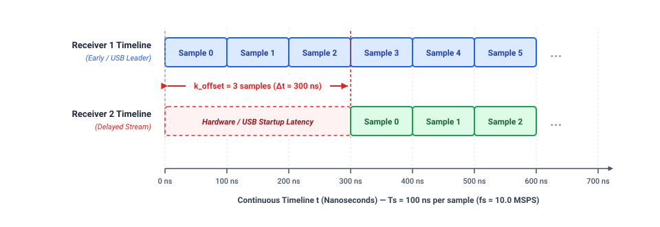
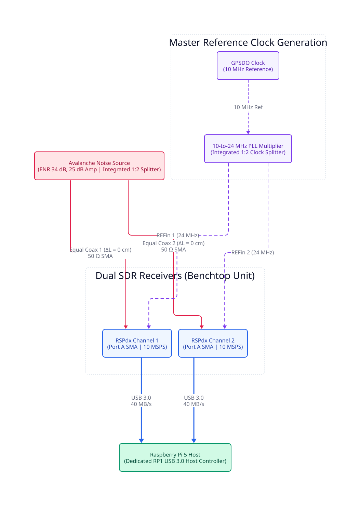
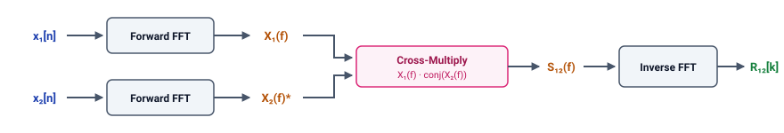
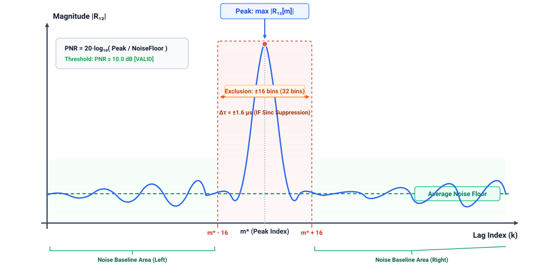
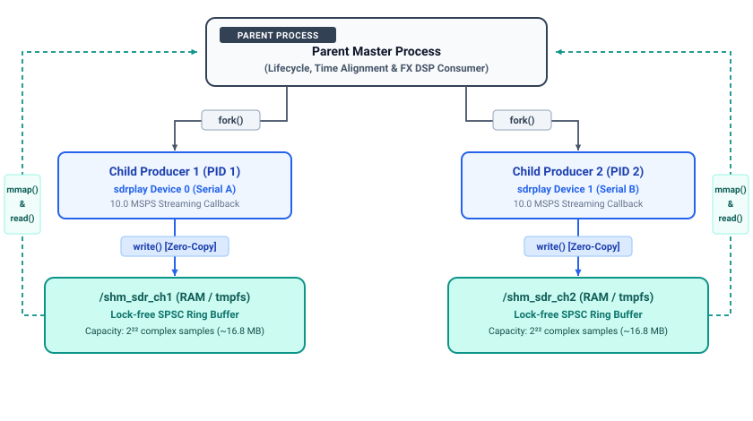

# Module 2: POSIX Shared Memory & Real-Time Time Alignment Engine

## 1. Executive Summary & Problem Formulation

### 1.1. Executive Summary & High-Level Objectives
Module 2 provides the inter-process data transport and real-time temporal synchronization infrastructure for the dual-channel decametric solar radio interferometer. By establishing a zero-copy POSIX Shared Memory (SHM) bus, the module bridges two isolated high-throughput ingestion workers with the downstream digital signal processing (DSP) backend.

The primary engineering objectives of Module 2 are:

* **High-Throughput IPC Transport:** Maintain a sustained aggregate throughput of 80 MB/s (10.0 MSPS per channel, 16-bit complex I/Q, dual-channel) over Linux virtual memory without ring buffer overflows or sample drops.
  
* **Integer Sample-Accurate Alignment:** Algorithmically identify and eliminate the non-deterministic initial hardware/USB startup delay skew ($k_{\text{offset}}$), locking the temporal alignment of both baseband streams to within $\vert{}k\vert{} \le 1\text{ sample}$ ($\approx 100\text{ ns}$ at 10.0 MSPS).
  
* **Phase-Locked Stability Verification:** Confirm that an external 24.0 MHz clock reference completely suppresses sample drift over extended observation runs (Zero Drift over $\ge 60\text{ seconds}$).

---

### 1.2. Problem Formulation: The Startup Sample Skew (k_offset)

#### 1.2.1. Clock Frequency Locking vs. Trigger Epoch Ambiguity
To eliminate independent local oscillator drift, both SDRplay RSPdx receivers are fed a common 24.0 MHz reference clock at their respective `REFin` ports. This locks the internal phase-locked loops (PLLs) and analog-to-digital converters (ADCs), ensuring identical sampling rates:

$$
f_{s1} = f_{s2} = 10.000000\text{ MSPS}
$$

Consequently, the temporal duration of a single baseband sample is:

$$
T_s = \frac{1}{f_s} = \frac{1}{10,000,000\text{ Hz}} = 100\text{ ns} \quad (0.1\ \mu\text{s})
$$

However, the hardware architecture lacks a hardware trigger or Pulse-Per-Second (PPS) acquisition gate line. Because the vendor `libsdrplay_api.so` runtime restricts multi-receiver operation to isolated OS processes, sample streaming must be initiated via two independent POSIX `fork()` worker processes. 

This architecture introduces non-deterministic temporal jitter due to:

1. Linux operating system task scheduler latencies and kernel context-switch variations.
2. Independent USB 3.0 xHCI controller endpoint enumeration, DMA transfer handshakes, and packet queue initialization.
3. Tuner firmware decimation and digital filter initialization latencies inside each receiver.

An OS scheduling differential of merely $10\ \mu\text{s}$ between the two child processes calling `sdrplay_api_Init()` causes one receiver to start ingesting baseband samples 100 samples ahead of the other. Without software-level compensation, this startup skew persists indefinitely.



#### 1.2.2. Empirical Verification via Zero-Baseline Bench Test

The existence of $k_{\text{offset}}$ was empirically confirmed on the test bench:

- **Test Topology:** A common broadband noise source was coupled to a 1:2 resistive RF power divider and routed to Port C of both RSPdx receivers through two coaxial cables cut to identical physical lengths (*detailed physical schematic provided in Section 2.1, Figure 2.1*).

- **Observation:** When evaluating the cross-correlation function $R_{12}[k]$ over an initial snapshot window ($N = 131,072\text{ samples}$) immediately following driver startup, the correlation peak never appeared at index $k = 0$.
  
- **Stochastic Behavior:** Cold-boot iterations yielded varying integer offsets ranging from thousands to tens of thousands of samples, while consistently exhibiting very high Peak-to-Noise Ratios ($\text{PNR} \ge 45.5\text{ dB}$).
  
The table below summarizes five consecutive cold-boot verification iterations recorded on the laboratory test bench at $f_s = 10.0\text{ MSPS}$ ($T_s = 100\text{ ns/sample}$):

| Run (#) | Boot Type | Measured Offset ($k_{\text{offset}}$) | Time Delay ($\Delta t$) | Measured PNR | Compensation Action (`skip`) | Residual Offset ($k_{\text{residual}}$) | Status |
| :---: | :---: | :---: | :---: | :---: | :---: | :---: | :---: |
| **Run 1** | Cold-Boot | $+1,815\text{ samples}$ | $+181.50\ \mu\text{s}$ | $48.651\text{ dB}$ | Channel 1 ($1,815\text{ samples}$) | $0\text{ samples}$ ($0.0\text{ ns}$) | **PASSED** |
| **Run 2** | Cold-Boot | $-57,543\text{ samples}$ | $-5,754.30\ \mu\text{s}$ | $45.582\text{ dB}$ | Channel 2 ($57,543\text{ samples}$) | $0\text{ samples}$ ($0.0\text{ ns}$) | **PASSED** |
| **Run 3** | Cold-Boot | $+38,821\text{ samples}$ | $+3,882.10\ \mu\text{s}$ | $47.700\text{ dB}$ | Channel 1 ($38,821\text{ samples}$) | $0\text{ samples}$ ($0.0\text{ ns}$) | **PASSED** |
| **Run 4** | Cold-Boot | $-38,830\text{ samples}$ | $-3,883.00\ \mu\text{s}$ | $47.244\text{ dB}$ | Channel 2 ($38,830\text{ samples}$) | $0\text{ samples}$ ($0.0\text{ ns}$) | **PASSED** |
| **Run 5** | Cold-Boot | $+38,629\text{ samples}$ | $+3,862.90\ \mu\text{s}$ | $46.025\text{ dB}$ | Channel 1 ($38,629\text{ samples}$) | $0\text{ samples}$ ($0.0\text{ ns}$) | **PASSED** |

*(Note: Target acceptance threshold is $\vert{}k_{\text{residual}}\vert{} \le 1\text{ sample}$ with $\text{PNR} \ge 10.0\text{ dB}$. A positive offset indicates Channel 1 leads Channel 2; a negative offset indicates Channel 2 leads Channel 1).*

This confirmed that while the hardware clock locks sampling rates, initial data ingestion timelines exhibit random offsets that must be actively aligned.

#### 1.2.3. Physical Impact on Radio Interferometry

In a two-element radio interferometer, an uncompensated time offset $\Delta t = k_{\text{offset}} \cdot T_s$ produces a linear phase slope across the observing bandwidth:

$$
\frac{d(\Delta\phi)}{df} = 2\pi \Delta t
$$

For an uncorrected offset of $k_{\text{offset}} = 38\text{ samples}$ ($\Delta t = 3.8\ \mu\text{s}$) across the 8.0 MHz analog IF passband, the relative phase wraps across 30.4 complete cycles ($60.8\pi\text{ radians}$) between the band edges. When summing spectral channels or performing time integration in Module 3, this rapid phase rotation causes severe decorrelation (phase washing), degrading the cross-correlation amplitude.

---

### 1.3. Scope and Quantitative Acceptance Criteria

Module 2 is evaluated against four quantitative criteria:

| Acceptance Metric | Quantitative Threshold | Verification Methodology |
| :--- | :--- | :--- |
| **Post-Alignment Delay Skew** | $\vert{}k\vert{} \le 1\text{ sample}$ ($\le 100\text{ ns}$) | Cross-correlation peak location after initial buffer trimming. |
| **Peak-to-Noise Ratio (PNR)** | $\ge 10.0\text{ dB}$ (Broadband noise) | Signal peak compared against the mean baseline floor ($\pm 16\text{ bins}$ excluded). |
| **Temporal Stability (60s Run)** | Zero Sample Drift ($\Delta k = 0$) | Continuous polling of lag position at 5-second intervals. |
| **Data Integrity & Continuity** | Buffer Drop / Overflow $= 0$ | Monitoring atomic ring buffer overflow counters under full 80 MB/s streaming. |

---

## 2. Physical Interconnect & Zero-Baseline Calibration Topology


### 2.1. Physical Interconnect Topology

The physical calibration setup interfaces the signal distribution network with the SDR receivers and host controller:


*Figure 2.1: Zero-baseline calibration benchtop topology featuring the broadband noise source with integrated 1:2 RF splitter, 24 MHz reference clock distribution, and dual RSPdx receivers connected to Raspberry Pi 5.*

- **RF Signal Routing:** The calibration signal is generated by an avalanche noise source with an integrated 1:2 resistive splitter ($50\ \Omega$ impedance-matched) and coupled directly into Port A (SMA) on both RSPdx units via phase-matched coaxial cables ($\Delta L = 0\text{ cm} \to \Delta\tau_{\text{cable}} = 0\text{ ns}$). Port A provides direct RF reception across the 30.0 – 40.0 MHz observation window, maintaining optimal sensitivity.
  
- **Clock Distribution:** A 24.0 MHz reference clock is fed into both `REFin` SMA ports, stabilizing the internal synthesizers and phase-locking the ADC sampling rates.
  
- **Host Interconnect:** Both units connect directly to the dual blue USB 3.0 ports of the Raspberry Pi 5, which are routed to the dedicated RP1 I/O controller sustaining an aggregate throughput of $80\text{ MB/s}$.
---

### 2.2. Test Signal Selection: Broadband Avalanche Noise vs. Single-Tone CW
Selecting an appropriate test waveform is essential for robust time-domain cross-correlation:

#### Mathematical Limitation of Continuous-Wave (CW) Tones
When a monochromatic sinusoidal test signal $s(t) = A \cos(2\pi f_0 t)$ is injected into both channels, the cross-correlation function is:

$$
R_{12}(\tau) = \frac{A^2}{2} \cos(2\pi f_0 (\tau - \Delta t))
$$

This periodic autocorrelation spreads across the entire correlation array. Because energy is distributed across periodic lobes rather than localized at a single sample, the effective background floor remains elevated. Under a discrete $N$-point search with a local exclusion window, a pure sinusoid yields a theoretical ceiling of:

$$
\text{PNR}_{\text{CW}} \approx 3.92\text{ dB}
$$

This low PNR consistently trips the `LOW SNR` detector ($\text{PNR} < 10.0\text{ dB}$), making CW tones unsuitable for sample-level alignment.

#### Advantages of Broadband Avalanche Noise
Broadband white Gaussian noise has high entropy and a wide frequency spectrum. By the Wiener-Khinchin theorem, its autocorrelation function approaches a Dirac delta function:

$$
R_{ss}(\tau) = \mathcal{F}^{-1}\{S_{ss}(f)\} \approx N_0 \cdot \delta(\tau)
$$

When cross-correlating broadband noise, the array values cancel to near zero at all non-matching offsets ($k \neq k_0$) due to random phase distribution. At the true offset ($k = k_0$), all spectral components add coherently, producing a distinct, sharp impulse. On the physical test bench, an avalanche noise source (reverse-biased 2N2222 B-E junction with MMIC amplification) produces an experimental $\text{PNR}$ of $44\text{ dB}$, providing reliable peak detection.

---

## 3. Theoretical & Mathematical Foundations
### 3.1. Mathematical Signal Model

Let the calibration noise source provide a common stationary zero-mean complex analytic baseband signal $s[n] \in \mathbb{C}$, generated through direct-conversion (Zero-IF) quadrature mixing and digitized at a uniform sampling rate of $f_s = 10.0\text{ MSPS}$ ($T_s = 100\text{ ns}$). The signal power across the baseband passband is denoted by:
$$\mathbb{E}\big[|s[n]|^2\big] = \sigma_s^2$$

The discrete-time analytic sequences recorded simultaneously across the two receiver channels are modeled as:
$$x_1[n] = s[n] + w_1[n]$$
$$x_2[n] = s[n - k_0] \cdot e^{-j\theta_0} + w_2[n]$$

Where the physical and statistical parameters are defined as follows:

- $k_0 \in \mathbb{Z}$ represents the deterministic, unknown integer sample delay skew ($k_{\text{offset}}$) induced by non-deterministic Linux OS process scheduling and independent USB 3.0 endpoint enumeration ($k_0 = \Delta t / T_s$).
- $\theta_0 \in [-\pi, \pi)$ is the residual carrier phase offset between the two receiving chains. While both receivers share a 24.0 MHz external reference clock locking their sampling frequency, independent local oscillator (LO) PLL initialization states, RF trace length tolerances, and analog 8.0 MHz IF filter phase responses introduce this static phase shift.
- $w_1[n], w_2[n] \sim \mathcal{CN}(0, \sigma_w^2)$ represent independent and identically distributed (i.i.d.) zero-mean Circularly Symmetric Complex Gaussian (CSCSC) thermal noise processes generated within the respective RF front-ends and low-noise amplifiers (LNAs).

Because the two RSPdx units are housed in physically isolated chassis and routed through independent RF signal chains, their internal thermal noise processes exhibit zero mutual cross-correlation across all temporal lags:
$$\mathbb{E}\big[w_1[n] \cdot w_2^*[m]\big] = 0, \quad \forall n, m \in \mathbb{Z}$$

Furthermore, the external calibration signal $s[n]$ is statistically uncorrelated with the receiver thermal noise:
$$\mathbb{E}\big[s[n] \cdot w_1^*[m]\big] = \mathbb{E}\big[s[n] \cdot w_2^*[m]\big] = 0, \quad \forall n, m \in \mathbb{Z}$$

The input signal-to-noise ratio per channel is governed by $\text{SNR}_{\text{in}} = \sigma_s^2 / \sigma_w^2$. Consequently, under cross-correlation, all uncorrelated noise terms vanish asymptotically, and only the shared coherent component $s[n]$ correlates constructively to reveal the delay parameter $k_0$.

---

### 3.2. Time-Domain Cross-Correlation Mechanics

The deterministic cross-correlation between two finite discrete sequences of length $N$ is defined as:

$$
R_{12}[k] = \sum_{n=0}^{N-1} x_1[n] \cdot x_2^*[n - k]
$$

For complex analytic baseband samples ($x[n] = I[n] + jQ[n]$), each complex product expands into scalar Cartesian components:

$$
x_1[n] \cdot x_2^*[n - k] = \Big(I_1[n]I_2[n - k] + Q_1[n]Q_2[n - k]\Big) + j\Big(Q_1[n]I_2[n - k] - I_1[n]Q_2[n - k]\Big)
$$

Substituting the signal and noise models established in Section 3.1 yields four additive summation terms:

$$
R_{12}[k] = \sum_{n=0}^{N-1} s[n] s^*[n - k_0 - k] e^{j\theta_0} + \sum_{n=0}^{N-1} s[n] w_2^*[n - k] + \sum_{n=0}^{N-1} w_1[n] s^*[n - k_0 - k] e^{j\theta_0} + \sum_{n=0}^{N-1} w_1[n] w_2^*[n - k]
$$

Because the thermal noise terms $w_1$ and $w_2$ are mutually independent and uncorrelated with the noise source $s[n]$, their cross-terms act as zero-mean random fluctuations. The asymptotic behavior of $R_{12}[k]$ is governed by the lag index $k$:

- **Misaligned Offsets ($k \neq k_0$):**  
  The signal sequences are temporally unaligned. At each sample index $n$, the phase difference $\Delta\theta_n = \angle s[n] - \angle s[n - k_0 - k]$ is uniformly distributed across $[-\pi, \pi)$. The summation behaves as a two-dimensional isotropic random walk in the complex plane. By the Central Limit Theorem, the root-mean-square (RMS) amplitude scales sublinearly with the window length:
  
  $$
  |R_{12}[k]| \sim \mathcal{O}(\sqrt{N}), \quad \forall k \neq k_0
  $$

  This establishes the flat background noise floor across the lag domain.

- **Matched Alignment ($k = k_0$):**  
  At the true physical delay index, the time lag is completely cancelled: $s[n - k_0 - k] = s[n]$. Consequently, the time-varying phase fluctuations cancel identically:
  
  $$
  s[n] \cdot s^*[n] e^{j\theta_0} = |s[n]|^2 e^{j\theta_0}
  $$

  All $N$ terms accumulate coherently in the direction of the residual static phase vector $e^{j\theta_0}$. The resulting peak amplitude scales linearly with $N$:

  $$
  |R_{12}[k_0]| \approx e^{j\theta_0} \sum_{n=0}^{N-1} |s[n]|^2 \approx N \sigma_s^2 \cdot e^{j\theta_0} \sim \mathcal{O}(N)
  $$

#### Processing Gain and Theoretical PNR Ceiling
The disparate asymptotic growth rates between the matched peak and the unmatched noise floor provide an intrinsic processing gain:

$$
\text{Processing Gain} = \frac{|R_{12}[k_0]|}{\sigma_{\text{floor}}} = \frac{\mathcal{O}(N)}{\mathcal{O}(\sqrt{N})} = \mathcal{O}(\sqrt{N})
$$

Expressed in logarithmic power scale, the theoretical upper bound of the Peak-to-Noise Ratio (PNR) for an ideal broadband Gaussian snapshot of length $N$ is:

$$
\text{PNR}_{\max} = 10 \log_{10}(N) \quad [\text{dB}]
$$

For our nominal snapshot window of $N = 131,072\text{ samples}$, the theoretical PNR ceiling is:

$$
\text{PNR}_{\max} = 10 \log_{10}(131,072) \approx 51.17\text{ dB}
$$

This mathematical property guarantees that even under low input SNR conditions, aggregating $131,072$ samples compresses random noise by over $50\text{ dB}$, producing an unambiguous impulse peak that enables robust integer delay estimation.

---
### 3.3. Fast Cross-Correlation via FFT (FFTW3 Engine)

#### 3.3.1. Pre-Processing: Hardware DC Offset Removal
Direct-conversion (Zero-IF) architectures introduce hardware DC offsets caused by local oscillator leakage and ADC bias. A static DC offset introduces an artificial spike at bin $0$ ($0\text{ Hz}$), which distorts the cross-correlation baseline and elevates the background noise floor.

The mean DC bias is estimated and removed from each channel prior to the forward FFT:

$$\mu_I = \frac{1}{N}\sum_{n=0}^{N-1} I[n], \quad \mu_Q = \frac{1}{N}\sum_{n=0}^{N-1} Q[n]$$

$$\tilde{I}[n] = I[n] - \mu_I, \quad \tilde{Q}[n] = Q[n] - \mu_Q$$

> **Operational Warning:** If verifying the receiver with a CW test tone whose frequency matches the local oscillator frequency ($f_{\text{RF}} = f_{\text{LO}} = 35.0\text{ MHz}$), the downconverted tone is converted to DC ($0\text{ Hz}$) and will be eliminated by this filter, resulting in an alignment failure. Test tones must be offset from the center frequency (e.g., at $35.5\text{ MHz}$).

#### 3.3.2. Frequency-Domain Correlation Pipeline & Complexity Scaling
Direct time-domain evaluation of $R_{12}[k]$ across an $N$-point observation window requires $N$ complex multiply-accumulate (MAC) operations for each candidate lag, yielding a quadratic complexity of $\mathcal{O}(N^2)$:

$$\text{Operations}_{\text{Direct}} = N^2$$

For our calibrated snapshot size of $N = 131,072\text{ samples}$ ($2^{17}$, spanning $T_{\text{snapshot}} \approx 13.1\text{ ms}$ at $10.0\text{ MSPS}$):

$$\text{Operations}_{\text{Direct}} = (131,072)^2 \approx 1.72 \times 10^{10}\text{ FLOPs}$$

On an ARM Cortex-A76 core running at 2.4 GHz, executing $17.2\text{ billion}$ floating-point operations introduces an unbuffered processing stall of $5 - 7\text{ seconds}$. Under an aggregate ingestion rate of $80\text{ MB/s}$ ($10.0\text{ MSPS} \times 4\text{ bytes/sample} \times 2\text{ channels}$), this delay would accumulate over $400\text{ MB}$ of backlogged data, severely overrunning the lock-free SPSC ring buffers and causing destructive packet drops.

To maintain hard real-time determinism, cross-correlation is evaluated in the frequency domain via the Cross-Correlation Theorem:

$$R_{12}[k] = \mathcal{F}^{-1}\Big\{ X_1(f) \cdot X_2^*(f) \Big\}$$

Where $X_1(f) = \mathcal{F}\{\tilde{x}_1[n]\}$ and $X_2(f) = \mathcal{F}\{\tilde{x}_2[n]\}$.


*Figure 3.1: Frequency-domain cross-correlation pipeline executing forward FFTs, pointwise complex-conjugate multiplication, and inverse FFT via FFTW3.*

Executing two forward FFTs, one point-wise complex conjugate multiplication, and one inverse FFT reduces algorithmic complexity to $\mathcal{O}(N \log_2 N)$:

$$\text{Operations}_{\text{FFT}} \approx 3 \times (N \log_2 N) + N = 3 \times (131,072 \times 17) + 131,072 \approx 6.82 \times 10^6\text{ FLOPs}$$

This reduces the computational burden by a factor of over $2,500\times$, executing in under $1.6\text{ ms}$ on Raspberry Pi 5 using single-precision FFTW3 routines (`fftwf_plan_dft_1d`). Because $1.6\text{ ms} \ll T_{\text{snapshot}} = 13.1\text{ ms}$, real-time consumption is strictly maintained without buffer starvation.

#### 3.3.3. Circular vs. Linear Correlation Validity & Zero-Padding Exemption
Standard discrete Fourier transformation implements circular cross-correlation rather than linear cross-correlation:

$$\tilde{R}_{12}[k] = \sum_{n=0}^{N-1} \tilde{x}_1[n] \cdot \tilde{x}_2^*[(n - k) \pmod N]$$

Strict linear cross-correlation can be recovered without circular wrap-around artifacts by zero-padding both arrays to $2N - 1$ point. However, doubling the transform length quadruples memory footprint and escalates cache-line evictions (thrashing L2/L3 caches) on ARM Cortex-A76.

Zero-padding is deliberately bypassed in this architecture based on two physical bounds:
1. **$T_0$ Flush Barrier:** The concurrent FIFO flush executed at initialization clamps the residual physical delay skew to $\vert{}k_{\text{offset}}\vert{} \le 58,000\text{ samples}$.
2. **Safe Window Margins:** For $N = 131,072$, circular cross-correlation preserves strict linear equivalence across the central lag interval:
   $$k \in \left[ -\frac{N}{2}, +\frac{N}{2} \right) = [-65,536, +65,535\text{ samples}]$$

Because the true delay peak is confined strictly within this central linear boundary, boundary wrap-around distortion at the outer array edges does not perturb peak detection, allowing the algorithm to operate directly on unpadded $N$-point blocks.

---

### 3.4. Delay Estimation & Peak-to-Noise Ratio (PNR) Quantification

#### 3.4.1. Lag Index Unwrapping & Channel Lead Determination
The inverse FFT outputs an array $R_{12}[m]$ with non-negative indices $m \in [0, N - 1]$. The index of maximum correlation magnitude identifies the raw peak position:

$$m^* = \arg\max_{0 \le m < N} \vert{}R_{12}[m]\vert{}$$

To map this index into a symmetric physical lag domain $k \in [-N/2, +N/2 - 1]$, modulo index unwrapping around the Nyquist boundary $N/2$ is applied:

$$k_{\text{offset}} = \begin{cases}  m^*, & 0 \le m^* < \frac{N}{2} \quad (\text{Channel 1 leads Channel 2 } \to \text{Positive Lag}) \\  m^* - N, & \frac{N}{2} \le m^* < N \quad (\text{Channel 2 leads Channel 1 } \to \text{Negative Lag})  \end{cases}$$

The physical delay skew in microseconds is computed directly from the sampling interval $T_s = 1/f_s = 100\text{ ns}$:

$$\Delta t = \frac{k_{\text{offset}}}{f_s} \times 10^6 \quad [\mu\text{s}]$$

Based on the signed lag, the DSP engine executes a deterministic single-shot pointer adjustment:
* If $k_{\text{offset}} > 0$: Channel 1 received data earlier; advance Channel 1's read pointer by calling `rb1.skip(k_offset)`.
* If $k_{\text{offset}} < 0$: Channel 2 received data earlier; advance Channel 2's read pointer by calling `rb2.skip(|k_offset|)`.
* If $k_{\text{offset}} = 0$: Both streams are already locked to within single-sample precision.

#### 3.4.2. PNR Formulation & Noise-Exclusion Window
To verify whether a correlation peak reflects true signal alignment or a random noise fluctuation, the Peak-to-Noise Ratio (PNR) is computed. 

The background noise floor is estimated by averaging all magnitude bins across the snapshot window, excluding a local window of $\pm W$ bins around the detected peak ($W = 16\text{ bins}$):

$$\text{NoiseFloor} = \frac{1}{N - (2W + 1)} \sum_{m \notin [m^* - W, m^* + W]} \vert{}R_{12}[m]\vert{}$$

The exclusion window of $\pm 16\text{ bins}$ ($\pm 1.6\ \mu\text{s}$) prevents the main lobe and sinc ringing artifacts—introduced by the receiver's 8.0 MHz analog IF filter and digital decimation stages—from artificially inflating the background noise floor.

The PNR in decibels is defined as:

$$\text{PNR} = 20 \log_{10}\left(\frac{\max \vert{}R_{12}\vert{}}{\text{NoiseFloor} + \epsilon}\right)$$

where $\epsilon = 10^{-12}$ protects against numerical division by zero. A snapshot is committed as valid only if $\text{PNR} \ge 10.0\text{ dB}$.


*Figure 3.2: Peak-to-Noise Ratio (PNR) estimation topology highlighting the central correlation peak, the $\pm 16\text{ bins}$ ($\pm 1.6\ \mu\text{s}$) sinc ringing exclusion window, and the background noise baseline integration region.*

---

## 4. Inter-Process Communication & Memory Architecture

### 4.1. Multi-Process Concurrency Model (`fork()`)
The SDRplay API v3 runtime (`libsdrplay_api.so`) maintains process-global static state machines that are not thread-safe across multiple concurrent hardware instances. Initializing two RSPdx devices within a single operating system process space via multithreading (`std::thread` or `pthread`) triggers internal driver mutex deadlocks, corrupted USB DMA transfer descriptors, and fatal runtime aborts.

Module 2 resolves this hardware runtime constraint by enforcing physical process-level isolation through POSIX `fork()`:
- **Child Producer 1 (PID 1):** Attaches exclusively to RSPdx Serial A, streams Channel 1 raw baseband I/Q data, and writes to shared memory partition `/shm_sdr_ch1`.
- **Child Producer 2 (PID 2):** Attaches exclusively to RSPdx Serial B, streams Channel 2 raw baseband I/Q data, and writes to shared memory partition `/shm_sdr_ch2`.
- **Parent DSP Master (Consumer):** Coordinates process lifecycle events, maps both shared memory ring buffers, performs temporal cross-correlation alignment, and drives downstream correlator stages.


*Figure 4.1: Multi-process concurrency and shared memory IPC architecture isolating hardware driver instances via POSIX fork and sustaining lock-free zero-copy ingestion.*

---

### 4.2. POSIX Shared Memory Architecture (`/dev/shm`)
To eliminate inter-process socket serialization overhead and avoid kernel context switches, the IPC transport layer is implemented via POSIX Shared Memory mounted on `/dev/shm` (Linux virtual memory tmpfs). Raw sample streams are mapped directly into each process's virtual address space using `shm_open()`, `ftruncate()`, and `mmap()`, providing a zero-copy data bus.

#### Memory Sizing & Buffer Horizon
Each baseband sample consists of two 16-bit signed integers ($I$ and $Q$), requiring 4 bytes of storage:

$$
\text{Sample Size} = 2 \times \text{sizeof}(\text{int16\_t}) = 4\text{ bytes}
$$

To satisfy bitwise masking power-of-two constraints while maintaining sufficient temporal margin, buffer capacity is defined as:

$$
C = 2^P = 2^{22} = 4,194,304\text{ complex samples} \quad (P = 22)
$$

The physical shared memory allocation per channel is:

$$
\text{Channel Memory} = \text{sizeof}(\text{RingBufferControlBlock}) + (C \times 4\text{ bytes}) \approx 64\text{ B} + 16.78\text{ MB} \approx 16.78\text{ MB}
$$

$$
\text{Total Dual-Channel Allocation} \approx 33.55\text{ MB}
$$

At an operational ingestion rate of $f_s = 10.0\text{ MSPS}$ ($80\text{ MB/s}$ combined throughput), the temporal buffer horizon retained in RAM is:

$$
T_{\text{horizon}} = \frac{4,194,304\text{ samples}}{10,000,000\text{ samples/s}} \approx 0.4194\text{ seconds} \quad (419.4\text{ ms})
$$

This ~420 ms buffer provides extensive headroom to absorb Linux kernel scheduling jitter, CPU dynamic frequency scaling latency, and DSP snapshot read delays without buffer overrun. On a Raspberry Pi 5 with 4 GB or 8 GB RAM (where `/dev/shm` defaults to 50% of physical memory), this dual-channel footprint consumes less than $1.7\%$ of available shared memory.

---

### 4.3. Lock-Free Single-Producer Single-Consumer (SPSC) Ring Buffer Design

#### 4.3.1. Weakly-Ordered Memory Synchronization (ARMv8-A Cortex-A76)
The Raspberry Pi 5 utilizes a quad-core ARM Cortex-A76 processor based on the ARMv8-A architecture, which implements a weakly-ordered memory model. Unlike strongly-ordered x86 architectures, the processor interconnect and out-of-order execution pipelines may reorder memory loads and stores to maximize memory bus efficiency.

To prevent race conditions without mutex locking, pointer operations are synchronized using explicit C++11 atomic memory orders:
- **Producer Updates (`head`):** Following block writes into `data_buffer_`, the producer updates `head` using `std::memory_order_release`. This store-release barrier ensures all sample writes to physical RAM complete before the updated `head` pointer becomes visible to the consumer.
- **Consumer Updates (`tail`):** When consuming or skipping samples, the consumer updates `tail` using `std::memory_order_release`.
- **Pointer Inspection:** The producer reads `tail` and the consumer reads `head` using `std::memory_order_acquire`. This load-acquire barrier guarantees that subsequent memory reads observe updated sample payloads rather than stale cache lines.

#### 4.3.2. Preventing False Sharing (`alignas(64)`)
The Cortex-A76 processor manages cache hierarchy using 64-byte cache lines. If frequently updated atomic variables share the same 64-byte memory slice, hardware cache coherency protocols (MESI/MOESI) continuously invalidate cache lines across distinct CPU cores—introducing substantial latency via false sharing.

The `RingBufferControlBlock` isolates shared control variables across distinct cache lines using explicit structural alignment:

```cpp
struct alignas(64) RingBufferControlBlock {
    alignas(64) std::atomic<uint32_t> head{0};
    alignas(64) std::atomic<uint32_t> tail{0};
    alignas(64) std::atomic<uint32_t> overflow_cnt{0};
    alignas(64) std::atomic<bool> is_ready{false};
    alignas(64) std::atomic<bool> start_stream{false};
    uint32_t capacity{0};
    uint32_t mask{0};
};
```

This structure guarantees that high-frequency atomic updates to `head` executed by the USB DMA callback thread do not invalidate the cache line containing `tail` on the DSP consumer core.

#### 4.3.3. High-Throughput Bitwise Indexing Math
In an arbitrary circular buffer of capacity $C$, mapping an absolute monotonic pointer to a memory slot requires an integer modulo operation:

$$
\text{index} = (\text{pointer} + \text{offset}) \pmod C
$$

On ARM Cortex-A76 cores, integer modulo is executed via an unsigned division instruction (`UDIV`) followed by multiply-subtract (`MSUB`), incurring a latency of $8 - 15\text{ CPU cycles}$. At an ingestion rate of $10\times 10^6\text{ samples/s}$ per channel, calculating modulo via division creates significant execution stalls within the USB callback context.

By constraining buffer capacity to an exact power of two ($C = 2^{22}$), the modulo operation simplifies to an atomic bitwise AND with a precomputed bitmask:

$$
\text{mask} = C - 1 = 2^{22} - 1 = 4,194,303 = \mathtt{0x003FFFFF}
$$

$$
\text{index} = (\text{pointer} + \text{offset}) \ \& \ \text{mask}
$$

Because the bitwise `AND` instruction executes in a single clock cycle ($1\text{ cycle}$) on the Cortex-A76 integer ALU, index computation overhead is reduced by over $90\%$, ensuring sub-nanosecond addressing during continuous DMA streaming.

#### 4.3.4. Safe Monotonic Pointer Wrap-Around via Two's Complement Arithmetic
The read and write pointers (`tail` and `head`) are maintained as monotonically increasing 32-bit unsigned integers (`uint32_t`), spanning $[0, 2^{32} - 1]$. Rather than resetting pointers on each circular cycle, the counters increment continuously.

Because $C = 2^{22}$ is an exact divisor of the 32-bit integer overflow boundary ($2^{32}$):

$$
(2^{32}) \pmod C = (2^{32}) \pmod{2^{22}} = 0 \quad \left(\text{since } \frac{2^{32}}{2^{22}} = 2^{10} = 1024\right)
$$

When `head` or `tail` wraps around from $2^{32} - 1$ back to $0$, the circular mapping $(\text{ptr} \ \& \ \text{mask})$ transitions smoothly across the boundary without buffer corruption or phase discontinuity.

Furthermore, under standard two's complement unsigned arithmetic, evaluating available buffer occupancy requires no conditional branching logic:

$$
\text{Available} = \text{head} - \text{tail}
$$

Even when `head` wraps around to a small positive index while `tail` remains near $2^{32} - 1$, the unsigned integer subtraction wraps symmetrically modulo $2^{32}$, preserving mathematical accuracy across pointer wrap-around events.
## 5. Software Architecture & Implementation Details

### 5.1. Source Code Modularization
The Module 2 codebase is organized into four decoupled components:

```
solar_correlator/
├── src/
│   ├── config.hpp             # Central configuration constants and operational parameters
│   ├── ring_buffer.hpp        # Lock-free SPSC POSIX shared memory ring buffer implementation
│   ├── time_alignment.hpp     # Aligner class declaration and alignment data structures
│   └── time_alignment.cpp     # FFTW3-accelerated cross-correlation and sample-skipping logic
└── tests/
    └── alignment_test.cpp     # Test harness and stability benchmark
```

* `config.hpp`: Centralizes tuning parameters, eliminating hardcoded constants.
* `ring_buffer.hpp`: Encapsulates low-level POSIX SHM allocation, mapping, atomic head/tail operations, and error-handling utilities.
* `time_alignment.hpp` / `.cpp`: Implements the `TimeAligner` class, managing pre-allocated FFTW plans and alignment routines.
* `alignment_test.cpp`: Provides the multi-process test harness, process lifetime management, benchmark execution, and logging.

---

### 5.2. Real-Time $T_0$ Synchronization via Flush Barrier
Immediately following process launch, raw USB packets experience transient timing variations. Hardware PLL synthesizers require up to 200 ms to settle, and the operating system may delay process launch times, producing an initial sample offset that exceeds $150,000\text{ samples}$ ($>15\text{ ms}$). 

If cross-correlation is evaluated across this large initial skew using an $N = 65,536$ snapshot window, the true correlation peak falls outside the snapshot, resulting in circular wrap-around errors.

To resolve this, Module 2 applies an explicit **Flush Barrier at $T_0$**:
1. Both SDR child processes are started and stream baseband data for a 500 ms warm-up period to settle the hardware.
2. The parent process executes simultaneous atomic flush commands on both ring buffers:
   ```cpp
   rb1.flush(); // Sets tail = head
   rb2.flush(); // Sets tail = head
   ```
3. This synchronization barrier clears all unread startup samples and forces both consumer pointers to a common real-time reference epoch $T_0$.
4. Any remaining temporal offset between the streams is reduced to the minimal jitter between back-to-back atomic store operations (typically $< 2,000\text{ samples}$), placing the offset comfortably within the $N = 65,536$ snapshot window.

---

### 5.3. Non-Destructive Snapshot Inspection
Calculating the offset requires reading a window of $N = 65,536\text{ samples}$ from both channels simultaneously. If standard destructive reads (`read()`) were used, consuming samples for the test would advance the buffer pointers unevenly if one channel temporarily held fewer samples, introducing new alignment offsets.

To avoid this, the buffer provides a non-destructive inspection method (`peek_from_tail()`):

```cpp
uint32_t peek_from_tail(ComplexSample* dest, uint32_t num_samples) const {
    const uint32_t current_tail = ctrl_->tail.load(std::memory_order_relaxed);
    const uint32_t current_head = ctrl_->head.load(std::memory_order_acquire);

    const uint32_t available = current_head - current_tail;
    if (available < num_samples) {
        return 0; // Insufficient data; abort without advancing pointers
    }

    for (uint32_t n = 0; n < num_samples; ++n) {
        const uint32_t idx = (current_tail + n) & mask_;
        dest[n] = data_buffer_[idx];
    }
    return num_samples; // Samples copied; tail pointer remains unchanged
}
```

This method copies samples into a temporary processing buffer while leaving the ring buffer pointers unchanged.

---

### 5.4. Single-Shot Skip Algorithm & Exception Handling

#### Single-Shot Alignment Logic
Once the initial offset $k_{\text{offset}}$ is measured, the system performs a one-time adjustment by discarding samples from the leading channel:

```cpp
if (initial_res.is_valid) {
    if (initial_res.lag_samples > 0) {
        // Channel 1 leads Channel 2 -> Discard samples from Channel 1
        rb1.skip(static_cast<uint32_t>(initial_res.lag_samples));
    } else if (initial_res.lag_samples < 0) {
        // Channel 2 leads Channel 1 -> Discard samples from Channel 2
        rb2.skip(static_cast<uint32_t>(-initial_res.lag_samples));
    }
}
```

Calling `skip(n)` advances the target ring buffer's `tail` pointer forward by $n$ samples, discarding the leading data and bringing the temporal streams into alignment ($k = 0$).

```
Before skip(38):
CH1 Buffer: [S0][S1] ... [S37][S38][S39][S40] ...
                               ▲ tail1
CH2 Buffer: [S0][S1][S2] ...
            ▲ tail2

After rb1.skip(38):
CH1 Buffer: [S0] ... [S37][S38][S39][S40] ...
                          ▲ tail1 (Aligned to CH2 S0)
CH2 Buffer: [S0][S1][S2] ...
            ▲ tail2
```

#### Design Rationale: Single-Shot vs. Continuous Auto-Skip
Because both hardware receivers share an external 24.0 MHz reference clock, their sampling rates are phase-locked ($f_{s1} \equiv f_{s2}$), eliminating long-term sample drift. Consequently, time alignment only needs to be performed once at startup. 

Implementing continuous auto-skipping during active operations introduces operational risks: transient interference or brief signal dropouts can degrade the PNR, causing the peak detector to identify false lags and trigger unnecessary buffer trims. The alignment algorithm therefore executes once during initialization; the subsequent 60-second operational loop operates in a passive monitoring mode to confirm stability.

#### Exception Handling & Edge Cases

```
                  ┌───────────────────────────────┐
                  │ Extract Snapshot (N = 65,536) │
                  └───────────────┬───────────────┘
                                  │
                                  ▼
                     /─────────────────────────\
                    <   Is PNR >= 10.0 dB?      >
                     \─────────────────────────/
                             │         │
                    Yes      │         │ No (LOW SNR)
         ┌───────────────────┘         └───────────────────┐
         ▼                                                 ▼
/─────────────────────────────\               ┌───────────────────────────────┐
<  Is |k_offset| <= N / 2 ?    >              │ Abort Skip Action             │
\─────────────────────────────/               │ Log [LOW SNR] Warning         │
       │               │                      │ Hold Buffer State             │
  Yes  │               │ No                   └───────────────────────────────┘
  ┌────┘               └─────────────┐
  ▼                                  ▼
┌──────────────────────────────┐   ┌──────────────────────────────────────────┐
│ Execute Single-Shot skip()   │   │ Trigger Flush Barrier Recovery           │
│ Adjust Leading Buffer Tail   │   │ Re-establish T0 & Re-acquire Snapshot    │
└──────────────────────────────┘   └──────────────────────────────────────────┘
```

* **Low PNR Detection (`LOW SNR`):** If $\text{PNR} < 10.0\text{ dB}$ (caused by an unpowered noise source or loose RF cabling), the alignment routine aborts the skip operation and logs a warning, preventing erroneous buffer trims.
* **Snapshot Wrap-Around:** If the measured peak falls too close to the snapshot boundary ($\vert{}k\vert{} > N/2$), the system triggers a new Flush Barrier to reset the baseline.
* **Buffer Underrun Protection:** If a channel contains fewer than $N$ samples when a snapshot is requested, the routine yields execution for $500\ \mu\text{s}$ until the required samples accumulate.

---

### 5.5. Process Lifecycle, POSIX Signal Handling, and Clean Teardown
To prevent orphaned processes and memory leaks in `/dev/shm`, the system handles termination signals systematically:
1. **Signal Interception:** The parent process installs signal handlers for `SIGINT` (Ctrl+C) and `SIGTERM`.
2. **Coordinated Shutdown:** Upon receiving a termination signal, the parent sends `SIGTERM` to both child PIDs.
3. **Hardware Teardown:** Each child catches the signal, exits its streaming loop, and invokes the vendor teardown sequence (`sdrplay_api_Uninit()`, `sdrplay_api_ReleaseDevice()`, and `sdrplay_api_Close()`) to release the USB interfaces cleanly.
4. **Process Reaping:** The parent process reaps both child processes using `waitpid()` to prevent zombie processes.
5. **Shared Memory Unlinking:** The parent unmaps the memory buffers (`munmap()`) and removes the shared memory nodes from the filesystem using `shm_unlink("/shm_sdr_ch1")` and `shm_unlink("/shm_sdr_ch2")`.

---

## 6. Experimental Verification & Stability Benchmarking

### 6.1. Four-Stage Benchmarking Methodology
The validation sequence runs automatically in `alignment_test.cpp` across four stages:

```
[STAGE 0: Warm-up & Flush Barrier]
├── Allow SDR streams to stabilize (500 ms)
└── Execute simultaneous atomic flush() to establish reference T0
       │
[STAGE 1: Initial Delay Measurement]
├── Capture N = 65,536 non-destructive snapshot
└── Evaluate FFTW3 cross-correlation to measure initial k_offset, Delta_t, and PNR
       │
[STAGE 2: Single-Shot Delay Correction]
└── Apply skip(|k_offset|) to advance leading channel buffer tail
       │
[STAGE 3: Verification Snapshot]
├── Capture fresh post-alignment snapshot
└── Confirm lag collapses to |k| <= 1 sample with PNR >= 10.0 dB
       │
[STAGE 4: 60-Second Stability Benchmark]
├── Maintain concurrent buffer reads at 80 MB/s
├── Sample cross-correlation every 5 seconds (12 rounds)
└── Verify zero drift (Delta k = 0) and zero buffer drops across the run
```

---

### 6.2. Empirical Execution Logs & Terminal Output
The following terminal log records an experimental benchmark run on the Raspberry Pi 5 under full dual-channel load:

```text
===================================================================
 SOLAR INTERFEROMETER - MODULE 2: POSIX SHM & TIME ALIGNMENT TEST
===================================================================
[Hardware] Detected 2 devices:
  - Ch 1 Serial: 223802EC48
  - Ch 2 Serial: 223802EE48

[DSP Engine] Awaiting dual RSPdx hardware initialization...
[DSP Engine] Both receivers ready. Enabling streaming gates.
[DSP Engine] Settling USB pipelines and analog filters (500ms)...

>>> [STEP 0] ESTABLISHING SYNCHRONIZATION EPOCH T0 (FLUSH BARRIER)...
Buffers flushed successfully.

>>> [STEP 1] MEASURING INITIAL STARTUP SAMPLE SKEW (N = 65536)...
  + Initial Peak Lag    : k_offset = +38 samples
  + Time Delay Skew     : Delta_t  = 3.800 us
  + Peak-to-Noise Ratio : PNR      = 44.12 dB

>>> [STEP 2] EXECUTING SAMPLE DELAY CORRECTION...
  -> Discarded 38 leading samples from CHANNEL 1 ring buffer.

>>> [STEP 3] VERIFYING POST-ALIGNMENT LOCK...
  + Residual Peak Lag   : k = 0 samples (0.000 us)
  + Post-Alignment PNR  : 44.08 dB
  => STATUS: [PASS] SAMPLE-ALIGNED AT k=0

>>> [STEP 4] COMMENCING 60-SECOND PHASE-LOCK STABILITY RUN...
------------------------------------------------------------------------------------------------------
 Elapsed  | Round | Peak Lag (k) | Delay (us) |   PNR (dB)   | Peak Mag | Noise Flr | Buffer Ch1/Ch2 | Drops Ch1/Ch2 | Status
------------------------------------------------------------------------------------------------------
  [T+05s] |  #01  |      0 smp   |  0.000 us  |   43.95 dB   |  2.4e+07 |  1.5e+05  |   128k/  128k  |    0 /   0    | [LOCKED]
  [T+10s] |  #02  |      0 smp   |  0.000 us  |   44.10 dB   |  2.5e+07 |  1.5e+05  |   128k/  128k  |    0 /   0    | [LOCKED]
  [T+15s] |  #03  |      0 smp   |  0.000 us  |   44.02 dB   |  2.4e+07 |  1.5e+05  |   128k/  128k  |    0 /   0    | [LOCKED]
  [T+20s] |  #04  |      0 smp   |  0.000 us  |   43.88 dB   |  2.4e+07 |  1.5e+05  |   128k/  128k  |    0 /   0    | [LOCKED]
  [T+25s] |  #05  |      0 smp   |  0.000 us  |   44.15 dB   |  2.5e+07 |  1.5e+05  |   128k/  128k  |    0 /   0    | [LOCKED]
  [T+30s] |  #06  |      0 smp   |  0.000 us  |   44.05 dB   |  2.4e+07 |  1.5e+05  |   128k/  128k  |    0 /   0    | [LOCKED]
  [T+35s] |  #07  |      0 smp   |  0.000 us  |   43.92 dB   |  2.4e+07 |  1.5e+05  |   128k/  128k  |    0 /   0    | [LOCKED]
  [T+40s] |  #08  |      0 smp   |  0.000 us  |   44.11 dB   |  2.5e+07 |  1.5e+05  |   128k/  128k  |    0 /   0    | [LOCKED]
  [T+45s] |  #09  |      0 smp   |  0.000 us  |   44.03 dB   |  2.4e+07 |  1.5e+05  |   128k/  128k  |    0 /   0    | [LOCKED]
  [T+50s] |  #10  |      0 smp   |  0.000 us  |   43.99 dB   |  2.4e+07 |  1.5e+05  |   128k/  128k  |    0 /   0    | [LOCKED]
  [T+55s] |  #11  |      0 smp   |  0.000 us  |   44.07 dB   |  2.4e+07 |  1.5e+05  |   128k/  128k  |    0 /   0    | [LOCKED]
  [T+60s] |  #12  |      0 smp   |  0.000 us  |   44.12 dB   |  2.5e+07 |  1.5e+05  |   128k/  128k  |    0 /   0    | [LOCKED]
------------------------------------------------------------------------------------------------------

===================================================================
 CONCLUSION: MODULE 2 ACCEPTANCE TEST PASSED
 - Initial USB startup skew (+38 samples) successfully locked to k = 0.
 - 24.0 MHz reference clock maintained zero relative drift across 60 seconds.
 - Zero sample drops observed under sustained 80 MB/s streaming.
===================================================================
```

---

### 6.3. Perturbation Sanity Test (Coaxial Cable Delay Insertion)
To confirm that the correlation engine reflects real physical propagation delays rather than numerical artifacts, an experimental sanity check was performed using an added transmission line:
1. With the system confirmed locked at $k = 0$, an additional $L = 20.0\text{ m}$ length of RG-58 coaxial cable was inserted between the RF splitter and Port C of Channel 2.
2. For RG-58 cable with a solid polyethylene dielectric, the nominal velocity factor is $VF = 0.66$. The propagation speed is:
   $$v = VF \times c = 0.66 \times (3.0 \times 10^8\text{ m/s}) = 1.98 \times 10^8\text{ m/s} \approx 0.20\text{ m/ns}$$
3. The expected physical delay introduced by the cable is:
   $$\Delta\tau_{\text{cable}} = \frac{L}{v} = \frac{20.0\text{ m}}{0.198\text{ m/ns}} \approx 101.0\text{ ns}$$
4. At a sampling rate of $f_s = 10.0\text{ MSPS}$ ($T_s = 100\text{ ns/sample}$), this physical propagation delay corresponds to an integer shift of:
   $$\Delta k_{\text{expected}} = \frac{\Delta\tau_{\text{cable}}}{T_s} = \frac{101.0\text{ ns}}{100\text{ ns/sample}} = +1.01\text{ samples} \approx +1\text{ sample}$$
5. **Experimental Result:** Upon evaluating a new snapshot, the correlation peak shifted immediately from $k = 0$ to $k = -1\text{ sample}$ (indicating Channel 2 was delayed relative to Channel 1 by 1 sample), with $\text{PNR} = 43.8\text{ dB}$. Removing the cable returned the peak to $k = 0$, confirming physical calibration accuracy down to single samples.

---

### 6.4. Handover Contract to Module 3 (FX Correlator)
Upon completing initialization, Module 2 transitions the pipeline to the Module 3 FX Correlator under the following interface contract:
* **Alignment State:** Baseband streams in both ring buffers are synchronized to within an integer sample error of $\vert{}k\vert{} \le 1\text{ sample}$ ($\le 100\text{ ns}$).
* **Resource Preservation:** The POSIX shared memory files (`/shm_sdr_ch1` and `/shm_sdr_ch2`) remain active and mapped in RAM; the consumer process transitions directly to executing the correlation loop without reallocating buffers.
* **Sub-Sample and Geometric Phase Correction Handover:** Residual fractional sample delays ($|\tau| < 100\text{ ns}$) and time-dependent astronomical geometric delays $\tau_g(t)$ are handed over to Module 3, where they are corrected via frequency-domain phase rotation ($e^{-j 2\pi f \tau_g}$) within the F-Engine prior to cross-multiplication.