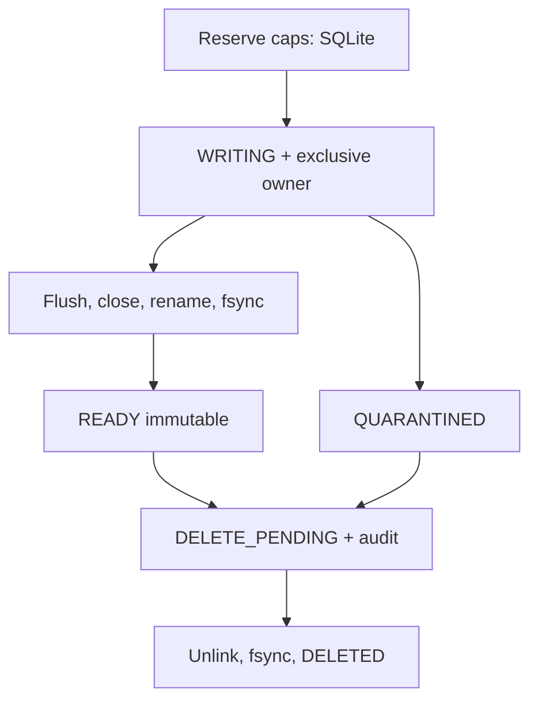

# Contracts và lifecycle storage v1

`main` chỉ orchestration và snapshot; `storage_queue` SPSC owns preallocated copies; `storage_aggregator` thuần khoa học; `storage_budget`/Python ledger cùng SQL schema; `hdf5_writer` chỉ serialize bounded; pipeline sở hữu writer/worker. Maintenance chia ownership, ledger, transfer, reader, science, panels và logging. Không thread writer trước fork. Producer dùng `try_submit`, enum kết quả, copy arrays/atomics/notify, không filesystem/log/network/mutex wait. Worker chậm có thể làm drop, được đếm và tạo gap, không sửa UDP cadence chủ ý.

SourceRecord chứa bốn mảng double, frame/segment/calibration ID, sample support, valid FFT count, backend processing timestamp và estimated UTC. OutputRecord có float32 bốn mảng, scalar weights/coverage, đầu/cuối/frame IDs và quality. Invalid ở bất kỳ constituent của frequency group làm toàn bộ group NaN cho cả bốn đại lượng: strict common-mask policy nên scalar weights đủ, không giả 0 hợp lệ. Queue capacity là số record hữu dụng; thêm một slot sentinel. Ownership copy sống độc lập khỏi buffers DSP.

Gộp toàn source cycle, tổng double theo valid FFT count, chia frequency group size. Không trung bình dB/angle. Gap/segment/calibration/backward estimated UTC ngắt window; partial emit/discard theo config. Sample support hợp khoảng để không cộng trùng overlap. Main hiện calibration bất biến trong session, không có API đổi live; future calibration change cần đóng file mới trong orchestration, không chỉ aggregator.

Reserve/intent/ready/delete intents dùng transaction ngắn, không giữ qua hash/IO/network. SQLite DELETE journal/FULL, version1, max_page_count. File flocks giữ ownership lâu; cleanup skip busy, lặp lại lượt sau. Schema có generation để job stale không hồi sinh deleted artifact. Tombstone/audit bounded, aggregate counters và quota không refund. PNG reservation một lần gắn parent; parent cap được tiêu thụ để compaction không cấp lại PNG. Một active quicklook worker toàn config. Upload/quicklook jobs riêng, FAILED/VERIFIED không thay lifecycle artifact. Destination gồm path và digest identity rclone config; thay tài khoản/refresh credential tạo namespace verify mới. Không lưu credential plaintext/hash vào HDF metadata.

Quota gồm hdf5 committed + png reserved/committed + aux committed. HDF cap prepaid không thu hồi giúp crash không vượt quota; custom VFD kiểm trước cả metadata allocation. PNG trong bounded buffer, giảm DPI tới min, publish no-clobber. Aux tính hai DB caps + headroom, bao gồm journal/backup/status/log/probe. Ngoài phạm vi: OS artifacts, filesystem allocation overhead, writes do flash translation. Không có tuyên bố hard cap physical SD writes.

Pipeline RUNNING chuyển PAUSED_QUOTA tới ngày mới, PAUSED_DISK tới hysteresis, ERROR retry có backoff/giới hạn. Lỗi flush định kỳ đi cùng retry path; lỗi cuối shutdown không publish. Shutdown có deadline drain nhưng không thể timeout kernel filesystem đang treo hoặc force-cancel thread an toàn. Error ngoài vòng xử lý để orphan WRITING cho recovery, không coi là READY.

Config v1, data schema v1, ledger v1, status v1 đều gate rõ. Python validator là nguồn validation cho C++ qua child process trước fork; spawn output/time bounded. Config snapshot/hash immutable; operational sync config current. Reader từ chối version lạ và chiều dataset không nhất quán. `migrate_ledger` chỉ backup/check v1; chưa có chuyển đổi version lịch sử.

HDF `/metadata` attributes, `/frequency_hz` float64 RF centers ascending, `/calibration_phi_rad_unshifted` float32; `/data/{s11_linear,s22_linear,s12_real,s12_imag}` float32 rows×bins. Scalar datasets: UTC start/end/midpoint, frame first/last, valid FFT frames, sample start/end, backend timestamp first/last, support duration, coverage, cadence, flags. Xem storage_record.hpp cho flags. UTC là processing-anchor estimate, uncertainty unknown; không hardware timestamp. Không suy ra statistical independent count từ Welch frame count.

Quicklook đọc finalized HDF5 snapshot, tính science riêng không matplotlib/network, render Agg bốn panel. Thời gian gap có mesh/NaN, common mask, phase undefined tại zero, coherence magnitude hoặc squared có tên rõ. Phổ panel3 mean(|visibility sau gộp|), không phải mean(|visibility nguồn|). ROI cố định, không peak tracking. Display decimation do max_pixels ghi số hàng nguồn/render; không sửa HDF5.

Status producer độc lập maintenance; atomic bounded snapshots có freshness. Snapshot không làm nguồn quota hay ownership. Logging rotation/rate giới hạn cho Python, C++ xuất status; chưa đồng nhất structured error codes mọi nhánh. Không lấy status cũ làm healthy.
